# Luồng nghiệp vụ giữa giao diện và backend

Tài liệu này mô tả các luồng nghiệp vụ đi qua nhiều trang: người dùng làm gì, giao diện gọi API nào, backend kiểm tra gì và dữ liệu thay đổi ra sao. Đặc tả từng trang nằm ở [../02-thiet-ke/giao-dien.md](../02-thiet-ke/giao-dien.md); cấu trúc bảng ở [../02-thiet-ke/co-so-du-lieu.md](../02-thiet-ke/co-so-du-lieu.md); danh sách API ở [../02-thiet-ke/api.md](../02-thiet-ke/api.md).

Mã trang (T1, B4, O3, M3...) khớp với [giao-dien.md](../02-thiet-ke/giao-dien.md).

## 1. Quy ước chung khi gọi API

### 1.1. Định dạng response

| Loại | Dạng |
|---|---|
| Một đối tượng | `{ "data": { ... } }` |
| Danh sách có phân trang | `{ "data": [ ... ], "meta": { "page", "limit", "total", "totalPages" } }` |
| Lỗi | `{ "code": "NOT_AVAILABLE", "message": "...", "details": ... }`; lỗi 500 có thêm `requestId` |
| Thành công không có nội dung | HTTP 204 |

Mọi response có header `X-Request-Id`. Khi gặp lỗi 500, giao diện nên hiện "Mã lỗi: <requestId>" (chữ nhỏ, chạm để sao chép) để người dùng gửi CSKH.

Giao diện nên **dựa vào `code`** để quyết định xử lý (chuyển trang, khóa nút...) và **hiển thị `message`** cho người dùng (backend đã viết sẵn bằng tiếng Việt).

### 1.2. Xử lý theo HTTP status

| Status | Ý nghĩa | Giao diện nên làm |
|---|---|---|
| 400 | Dữ liệu không hợp lệ | Với `VALIDATION_ERROR`: hiện `details[].message` dưới ô có tên `details[].path` |
| 401 | Chưa đăng nhập / token hết hạn | Xóa token, chuyển A1 kèm `redirect` về trang hiện tại |
| 402 | Thanh toán thất bại | Cho thử lại |
| 403 | Không có quyền / tài khoản bị khóa | Thông báo; nếu bị khóa thì đăng xuất |
| 404 | Không tìm thấy (hoặc không phải dữ liệu của mình) | Trang "Không tìm thấy" + nút quay lại |
| 409 | Vi phạm quy tắc nghiệp vụ | Hiện `message`, xử lý theo `code` (mục 8) |
| 429 | Gửi quá nhiều lần | "Vui lòng thử lại sau" |
| 0 / timeout | Mất mạng, server tắt | "Không kết nối được máy chủ" + nút Thử lại |

### 1.3. Token đăng nhập (access + refresh)

Đăng nhập trả **access token** (sống 15 phút, gửi kèm mọi request) và **refresh token** (30 ngày, chỉ dùng để lấy cặp token mới). Refresh token **xoay vòng**: mỗi lần dùng thì token cũ bị thu hồi.

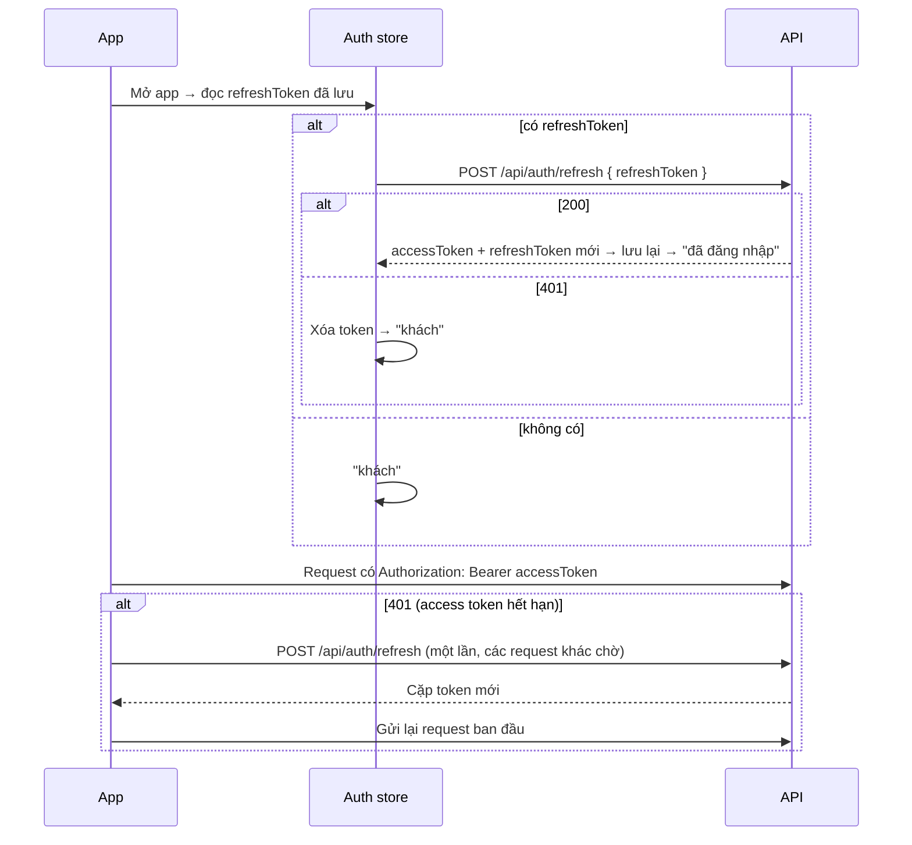

| Tình huống | Kết quả |
|---|---|
| `/refresh` trả `REFRESH_TOKEN_ROTATED` | Có request khác vừa làm mới trước: lấy token mới nhất trong store rồi thử lại, **không** đăng xuất |
| `/refresh` trả `REFRESH_TOKEN_REUSED` / `EXPIRED` / `INVALID_REFRESH_TOKEN` | Đăng xuất. `REUSED` nghĩa là token cũ bị dùng lại → backend đã thu hồi mọi phiên của tài khoản (BR-21) |
| Đổi mật khẩu | Response trả phiên mới cho thiết bị này; các thiết bị khác bị đăng xuất |
| Đặt lại mật khẩu, bị admin khóa | Mọi thiết bị bị đăng xuất |

- **Chỉ làm mới một lần cùng lúc:** nhiều request cùng nhận 401 thì chỉ request đầu gọi `/refresh`, các request còn lại chờ kết quả đó (tránh tự gây `ROTATED`).
- Lưu token: `expo-secure-store` trên Android/iOS; `localStorage` trên web.
- Đăng xuất: gọi `POST /api/auth/logout { refreshToken }` và `DELETE /api/devices { token }` (push), rồi xóa token và cache dữ liệu cá nhân (booking, yêu thích, thông báo) để người đăng nhập sau không thấy dữ liệu người trước.
- Access token đã cấp vẫn dùng được tới khi hết 15 phút dù phiên bị thu hồi; tài khoản bị khóa thì bị chặn ngay vì backend kiểm tra trạng thái ở mỗi request.

### 1.4. Làm mới dữ liệu sau khi thay đổi

Sau mỗi thao tác ghi, những màn hình khác đang hiển thị cùng dữ liệu cần được tải lại (với TanStack Query: `invalidateQueries`):

| Thao tác | Dữ liệu cần làm mới |
|---|---|
| Bật/tắt yêu thích | Danh sách yêu thích, chi tiết địa điểm (`isFavorite`) |
| Tạo / thanh toán / hủy booking | Danh sách booking, chi tiết booking, thông báo + badge |
| Viết / sửa đánh giá | Chi tiết booking, đánh giá của tôi |
| Chủ địa điểm / Staff đổi trạng thái booking | Danh sách booking quản lý, chi tiết booking, dashboard |
| Chủ địa điểm sửa gói/phòng, gửi duyệt; admin duyệt tin | Danh sách tin đăng, chi tiết quản lý địa điểm |
| Staff duyệt review | Hàng chờ duyệt, chi tiết địa điểm (rating) |

## 2. Luồng khám phá địa điểm (Guest)

Không cần đăng nhập (mục 5 tài liệu nghiệp vụ).

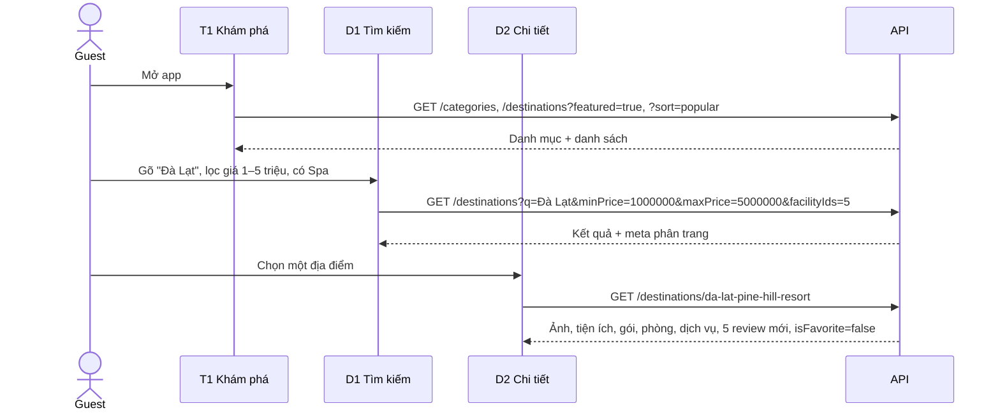

Backend chỉ trả địa điểm đang hoạt động (`isActive = true`). Lọc theo giá dùng "Giá từ" (`minPrice`) = gói rẻ nhất + phòng rẻ nhất cho đủ số đêm của gói.

## 3. Luồng đăng ký, đăng nhập và quay lại đúng chỗ

Khi khách đang ở một trang cần đăng nhập (♥ ở D2, "Tiếp tục" ở B1...), đưa họ sang A1 rồi **quay lại đúng trang đó** sau khi đăng nhập, không bắt họ tìm lại từ đầu.

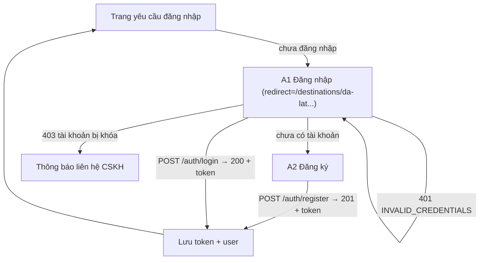

**Backend kiểm tra khi đăng ký:** dữ liệu hợp lệ (trường bắt buộc: họ tên, email, mật khẩu, đồng ý điều khoản – xem [tai-khoan-va-dang-ky.md](tai-khoan-va-dang-ky.md)) → email chưa tồn tại (409 `EMAIL_TAKEN`) → hash mật khẩu bằng bcrypt → tạo tài khoản role `USER` → trả token để đăng nhập luôn.

**Giới hạn:** đăng nhập/đăng ký tối đa 20 lần mỗi 15 phút cho một IP (429).

### 3.1. Xác thực email và quên mật khẩu

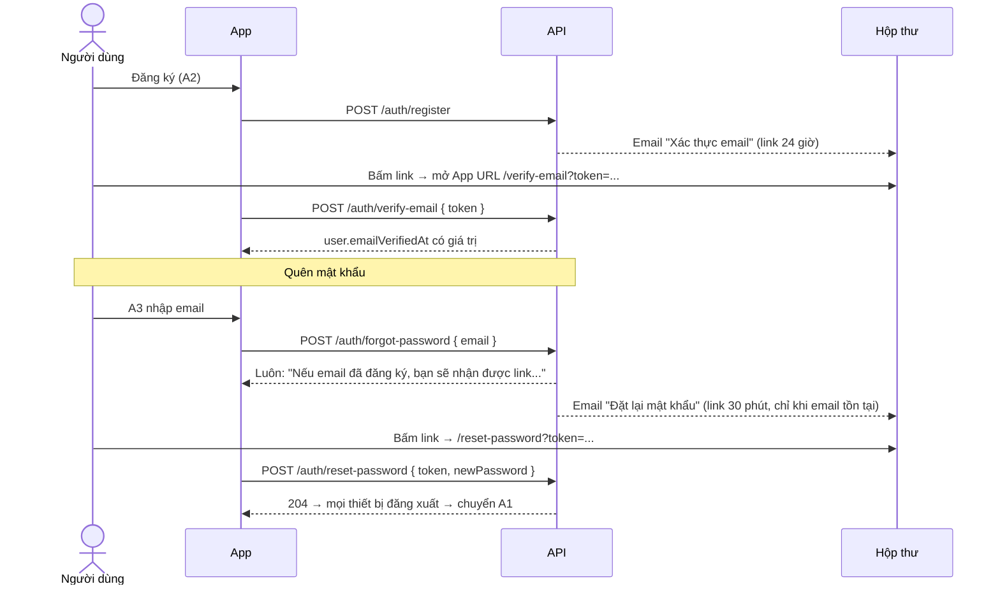

- Email chưa xác thực vẫn dùng app bình thường; chỉ **nộp hồ sơ đối tác** bị chặn (403 `EMAIL_NOT_VERIFIED`, BR-22). T5 nên hiện dải "Xác thực email" + nút **Gửi lại** (`POST /auth/resend-verification`).
- Link email trỏ về `APP_URL` (giao diện web). App mobile mở link qua deep link `travellingapp://verify-email?token=...` nếu cấu hình `APP_URL` theo scheme của app.
- Khi dev (`EMAIL_TRANSPORT=console`), email in ra log của API và response có `devVerificationToken` / `devResetToken`.

## 4. Luồng yêu thích (mục 7)

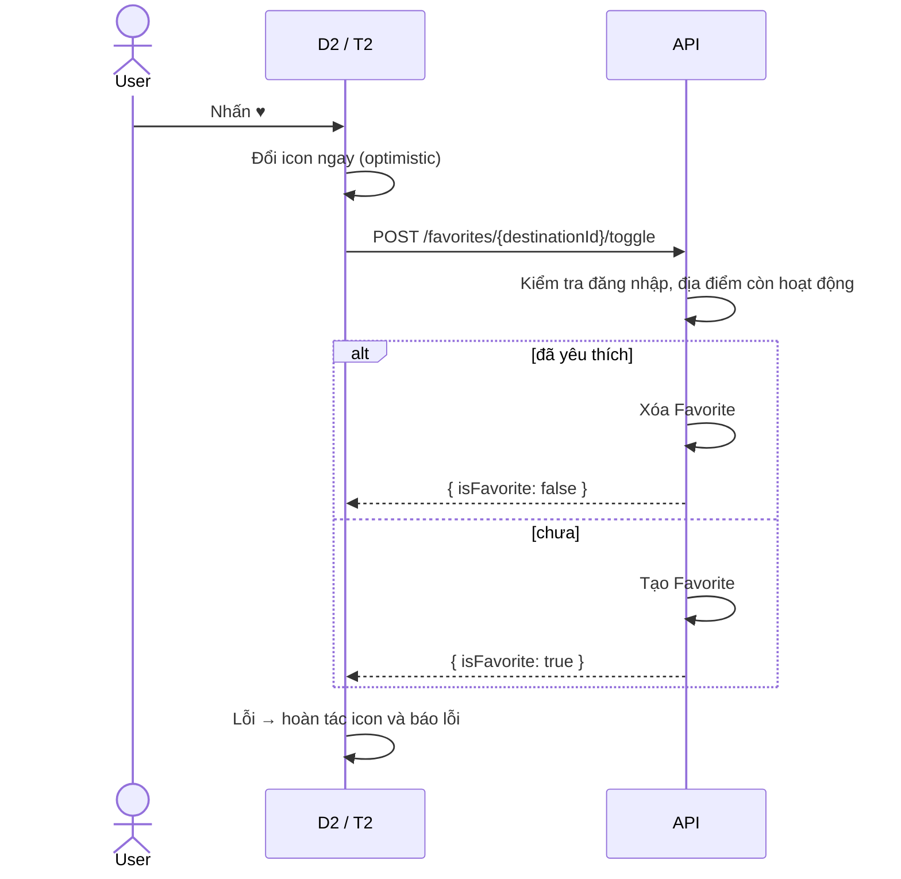

Database có khóa chính `(userId, destinationId)` nên bấm liên tục cũng không tạo bản ghi trùng (BR-03).

## 5. Luồng đặt chỗ (mục 8–14) – quan trọng nhất

### 5.1. Tổng quan các bước

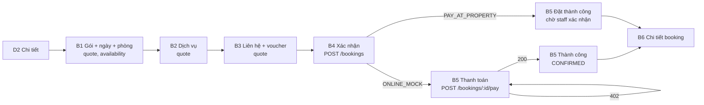

- **B1–B3 chỉ gọi báo giá** (`POST /api/bookings/quote`), không tạo gì trong database. Báo giá không cần đăng nhập, nên Guest vẫn xem được tổng tiền.
- **Chỉ B4 mới tạo booking.** Lúc này backend tính lại toàn bộ giá từ database; giao diện không gửi số tiền lên, vì vậy khách không thể sửa giá.

### 5.2. Báo giá và kiểm tra (B1–B3)

Body gửi lên ở mọi bước (thêm dần các trường):

```json
{
  "packageId": 2,
  "roomTypeId": 2,
  "checkInDate": "2026-11-20",
  "checkOutDate": "2026-11-22",
  "guests": 2,
  "roomsCount": 1,
  "services": [{ "addonServiceId": 1, "quantity": 1 }],
  "voucherCode": "WELCOME10"
}
```

Backend kiểm tra theo thứ tự, gặp lỗi đầu tiên thì dừng:

| # | Kiểm tra | Mã lỗi | Hiển thị ở |
|---|---|---|---|
| 1 | Ngày đúng định dạng `YYYY-MM-DD` | `VALIDATION_ERROR` | B1 |
| 2 | Ngày nhận ≥ hôm nay (giờ Việt Nam), ngày trả > ngày nhận, ≤ 30 đêm | `INVALID_DATES` | B1 |
| 3 | Gói tồn tại, đang bán, địa điểm đang hoạt động | `NOT_FOUND` | B1 |
| 4 | Loại phòng thuộc cùng địa điểm với gói | `INVALID_ROOM_TYPE` | B1 |
| 5 | Số đêm ≥ số đêm của gói | `INVALID_DATES` | B1 |
| 6 | Số khách ≤ sức chứa × số phòng | `CAPACITY_EXCEEDED` | B1 |
| 7 | Dịch vụ không trùng, thuộc địa điểm, đang bán | `DUPLICATE_SERVICE` / `INVALID_SERVICE` | B2 |
| 8 | Voucher còn hạn, còn lượt, đơn đủ tối thiểu | `INVALID_VOUCHER` / `VOUCHER_EXHAUSTED` / `VOUCHER_MIN_ORDER` | B3 |

Response báo giá (rút gọn):

```json
{
  "data": {
    "nights": 2,
    "availableRooms": 10,
    "isAvailable": true,
    "taxRate": 0.08,
    "price": {
      "packagePrice": 2000000,
      "roomPrice": 1000000,
      "servicesPrice": 200000,
      "subtotal": 3200000,
      "discountAmount": 200000,
      "taxAmount": 240000,
      "totalAmount": 3240000,
      "services": [{ "addonServiceId": 1, "quantity": 1, "unitPrice": 200000, "totalPrice": 200000 }]
    }
  }
}
```

`isAvailable = false` nghĩa là không đủ phòng: B1 nên báo ngay và chặn nút Tiếp tục, không đợi đến B4.

### 5.3. Tạo booking (B4)

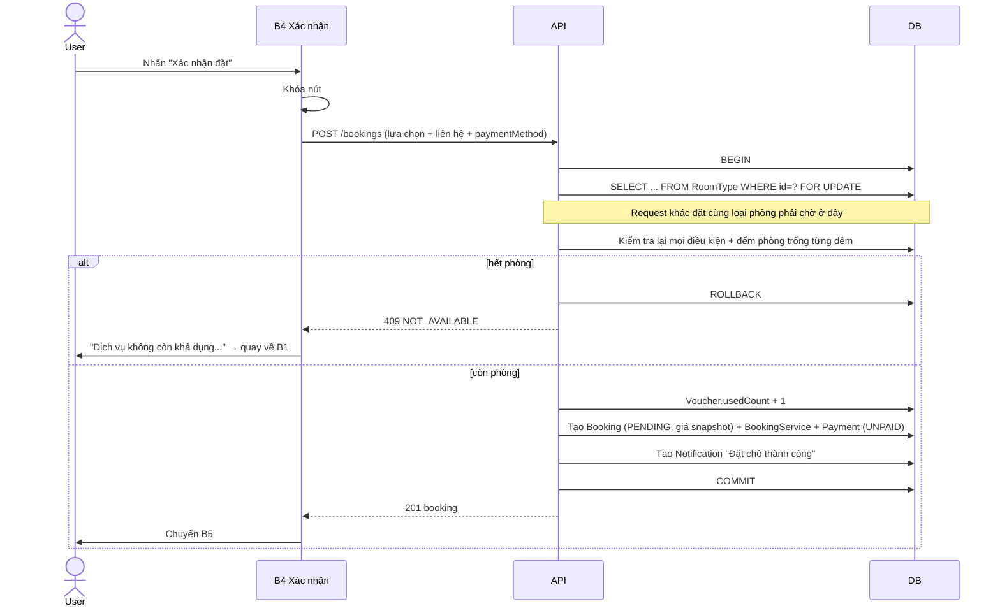

Khóa dòng `FOR UPDATE` giải quyết tình huống hai người cùng đặt phòng cuối cùng: người thứ hai phải chờ người thứ nhất xong, rồi đếm lại và nhận 409 (BR-04).

### 5.4. Thanh toán giả lập (B5)

Đặc tả đầy đủ: [thanh-toan-gia-lap.md](thanh-toan-gia-lap.md). Tóm tắt:

| Hành động | API | Kết quả trong database |
|---|---|---|
| Đặt với `ONLINE_MOCK` | `POST /bookings` | Booking `PENDING`, `paymentDueAt` = 15 phút sau; phòng được giữ tới hạn này |
| Thanh toán | `POST /bookings/{id}/pay` `{ "channel": "EWALLET" }` | `Payment` → `PAID` + `channel` + `transactionRef`; `Booking` → `CONFIRMED`; thông báo |
| Mô phỏng thất bại | `{ "simulateFailure": true }` | `Payment` → `FAILED` (được thử lại trước hạn); trả 402 |
| Quá hạn | | Thanh toán trả 409 `PAYMENT_EXPIRED`; phòng được trả ngay; job mỗi phút hủy booking với lý do "Quá hạn thanh toán" |

### 5.5. Hoa hồng môi giới

Lúc tạo booking, backend chụp lại hoa hồng theo tỷ lệ của chủ địa điểm (xem [tong-quan.md](tong-quan.md) mục 2):

```text
commissionAmount = round((subtotal - discountAmount) × commissionRate)
ownerRevenue     = (subtotal - discountAmount) - commissionAmount
```

Ví dụ hóa đơn ở B4 (tạm tính 3.200.000đ, giảm 200.000đ) tại địa điểm có hoa hồng 15%: hoa hồng sàn **450.000đ**, doanh thu chủ **2.550.000đ**, thuế 240.000đ do sàn thu hộ. Khách không thấy các con số này; chỉ chủ địa điểm và admin thấy.

## 6. Vòng đời booking sau khi đặt

### 6.1. Trạng thái và ai được làm gì

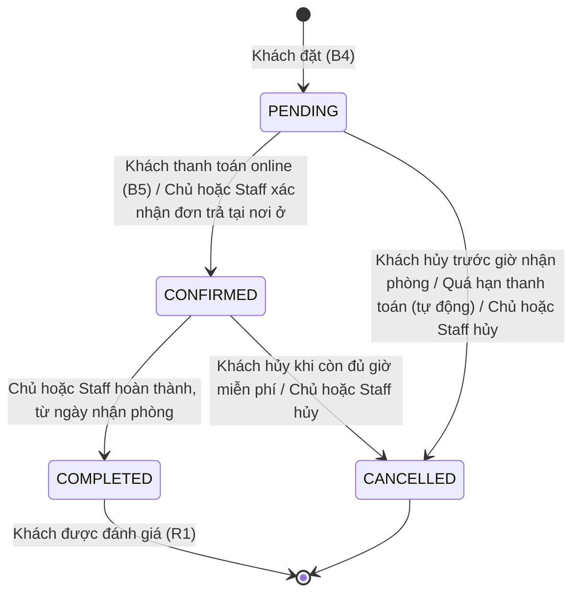

"Chủ" = chủ của địa điểm trong booking (trang O6–O7). Staff/Admin xử lý được mọi booking (M2–M3).

| Trạng thái | Khách thấy nút | Chủ địa điểm / Staff thấy nút |
|---|---|---|
| `PENDING` + online chưa trả | Thanh toán · Hủy · Liên hệ CSKH | Hủy |
| `PENDING` + trả tại nơi ở | Hủy · Liên hệ CSKH | Xác nhận · Hủy |
| `CONFIRMED` | Hủy (nếu còn hạn) · Liên hệ CSKH | Hoàn thành (từ ngày nhận phòng) · Hủy |
| `COMPLETED` | Viết / sửa đánh giá | — |
| `CANCELLED` | — | — |

### 6.2. Hủy booking (BR-07)

Giờ nhận phòng chuẩn: **14:00** ngày nhận (giờ Việt Nam).

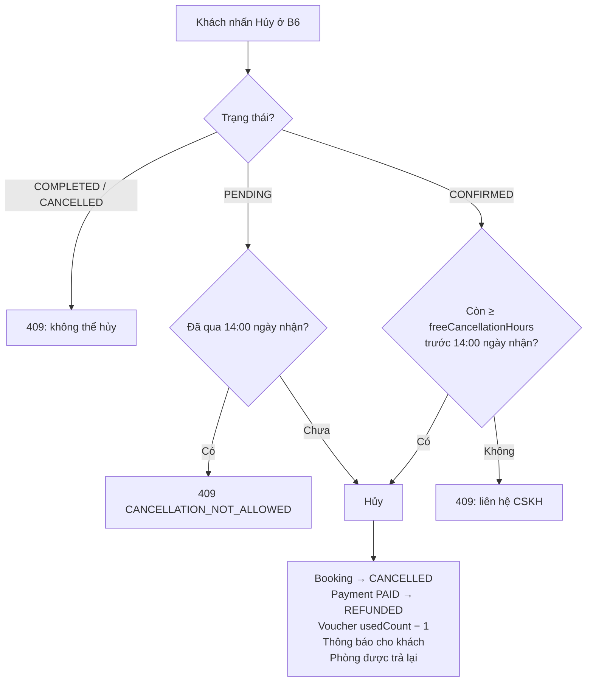

Chủ địa điểm và Staff hủy được ở mọi trạng thái `PENDING` / `CONFIRMED`, không bị giới hạn giờ (ví dụ khách gọi CSKH xin hủy muộn, hoặc cơ sở gặp sự cố), nhưng **bắt buộc ghi lý do** (400 `CANCEL_REASON_REQUIRED`). Khách và chủ địa điểm đều nhận thông báo.

### 6.3. Chủ địa điểm / Staff xử lý booking (O6–O7, M2–M3)

| Thao tác | Điều kiện backend kiểm tra | Mã lỗi khi vi phạm |
|---|---|---|
| Xác nhận | Đang `PENDING`; nếu thanh toán online thì phải `PAID` (BR-06) | `INVALID_STATUS`, `PAYMENT_REQUIRED` |
| Hoàn thành | Đang `CONFIRMED`; hôm nay ≥ ngày nhận phòng | `INVALID_STATUS` |

Khi hoàn thành đơn trả tại nơi ở, `Payment` tự chuyển `PAID` (coi như đã thu tiền tại quầy). Khách nhận thông báo "Chuyến đi đã hoàn thành… Hãy để lại đánh giá".

## 7. Luồng đánh giá (mục 16, 22)

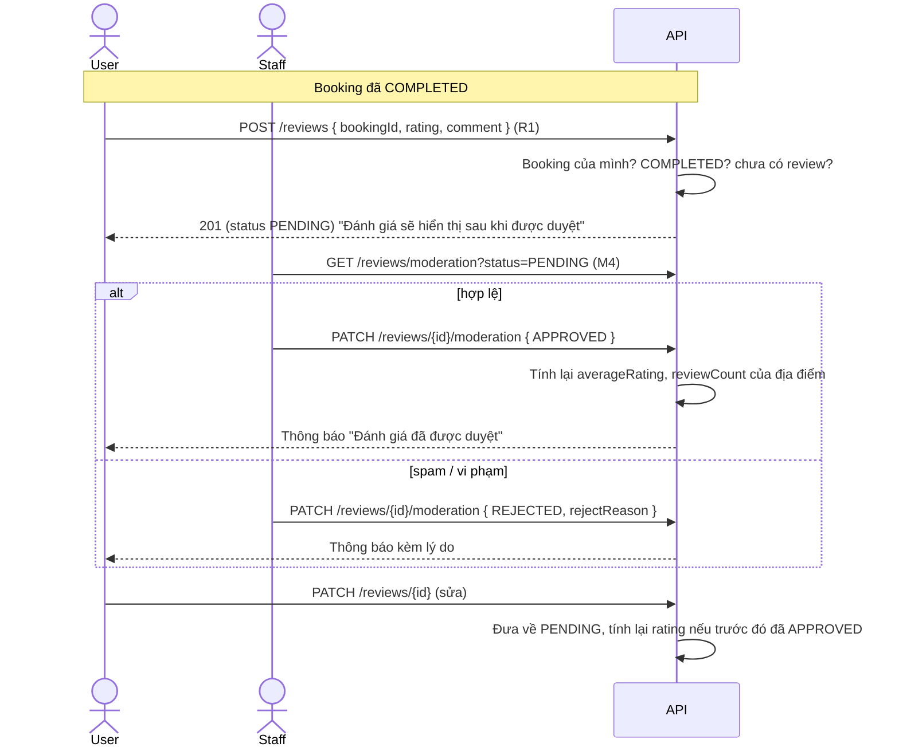

| Quy tắc | Cách thể hiện trên giao diện |
|---|---|
| BR-02 chỉ đánh giá sau khi hoàn thành | Nút "Viết đánh giá" chỉ hiện ở booking `COMPLETED` |
| BR-08 mỗi booking một review | Đã có review thì nút đổi thành "Xem / sửa đánh giá" |
| Chỉ review đã duyệt mới công khai | D2, D3 chỉ hiển thị `APPROVED`; P3 hiển thị cả trạng thái chờ/bị từ chối |

## 8. Luồng CSKH (mục 17)

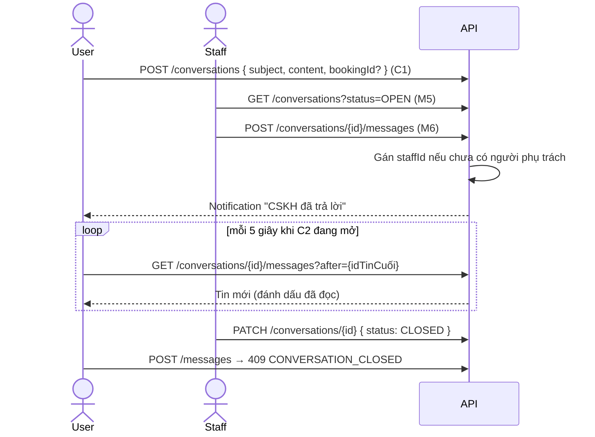

Polling mỗi 5 giây đủ cho đồ án. Chỉ poll khi màn hình C2/M6 đang hiển thị (dừng khi rời trang hoặc app chạy nền) để không tốn pin và tải server.

## 9. Luồng trở thành đối tác và đăng tin

### 9.1. Nộp hồ sơ và được duyệt

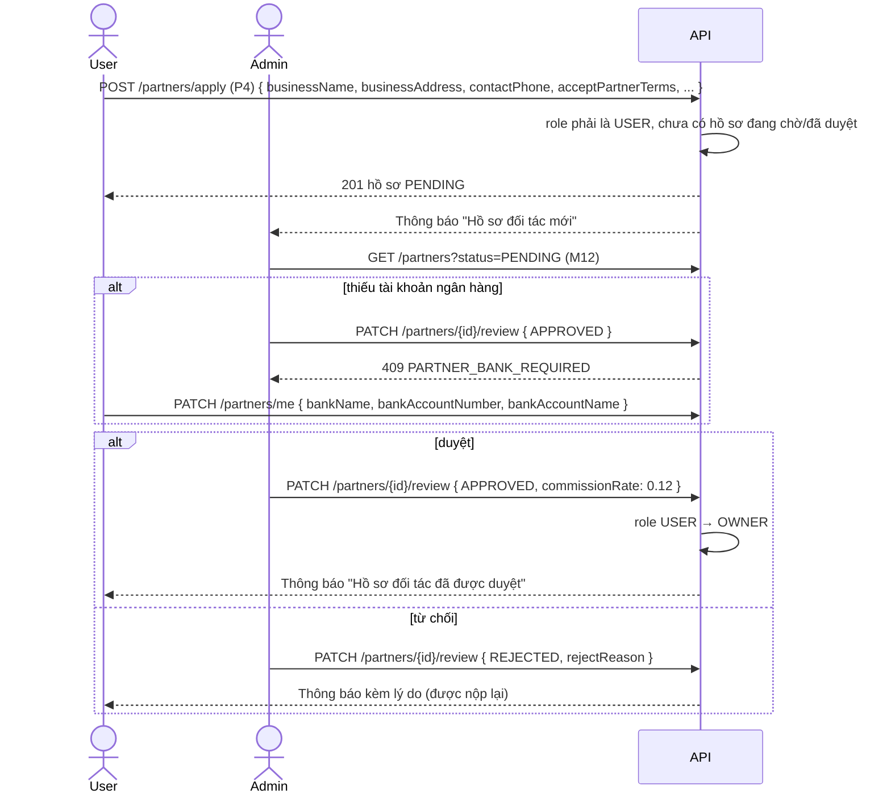

Quyền mới có hiệu lực ngay ở request tiếp theo (backend đọc role từ DB mỗi request). Giao diện chỉ cần gọi lại `GET /auth/me` để hiện menu chủ địa điểm.

### 9.2. Đăng tin địa điểm

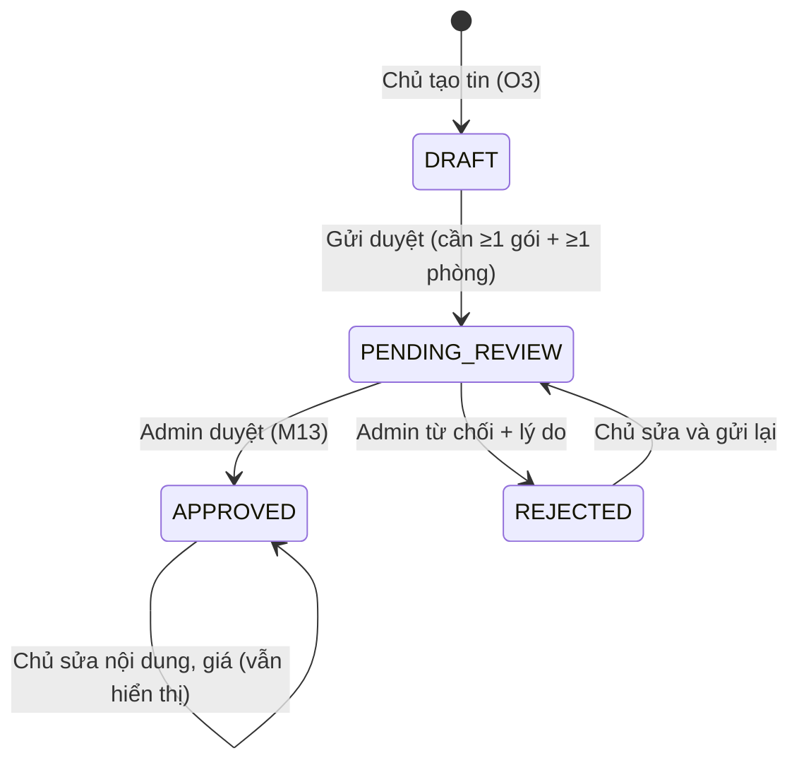

| Bước | Ai | API | Ghi chú |
|---|---|---|---|
| Tạo tin | Owner | `POST /destinations` | Luôn là `DRAFT`, `ownerId` = chính mình; `isFeatured` bị bỏ qua |
| Thêm phòng / gói / dịch vụ | Owner | `POST /room-types`, `/packages`, `/addon-services` | Chỉ cho địa điểm của mình (403 nếu không phải) |
| Xem trước | Owner | `GET /destinations/{id}` (có token) | Khách vãng lai nhận 404 |
| Gửi duyệt | Owner | `POST /destinations/{id}/submit` | 400 `LISTING_INCOMPLETE` nếu thiếu gói/phòng; admin nhận thông báo |
| Hàng chờ duyệt | Admin | `GET /manage/destinations?listingStatus=PENDING_REVIEW` | |
| Duyệt / từ chối | Admin | `PATCH /destinations/{id}/review` | Chủ nhận thông báo; tin duyệt xong hiện ngay cho khách |
| Tạm ngưng nhận khách | Owner | `PATCH /destinations/{id}` `{ isActive: false }` | Ẩn khỏi tìm kiếm, không đặt mới được; booking cũ giữ nguyên |
| Xóa | Owner | `DELETE /destinations/{id}` | Chỉ tin chưa từng được duyệt (409 `LISTING_APPROVED`) |

### 9.3. Tạm ngưng đối tác

Admin `PATCH /partners/{id}/status { status: "SUSPENDED", reason }` → role về `USER`, mọi địa điểm của đối tác bị ẩn (`isActive = false`), chủ không vào được trang quản lý nữa. Mở lại (`APPROVED`) trả quyền `OWNER`; chủ tự bật lại từng địa điểm.

### 9.4. Giá theo mùa

Chủ địa điểm thêm giá mùa cho từng loại phòng ở O3 (tab Phòng → Giá theo mùa): tên, từ ngày, đến ngày (gồm cả hai ngày), giá/đêm. Hai khoảng không được trùng ngày (409 `RATE_OVERLAP`).

Khi báo giá, mỗi đêm trong khoảng ở lấy giá mùa nếu rơi vào một khoảng, ngược lại lấy giá gốc. Response `/bookings/quote` có `nightlyRoomPrices`:

```json
[
  { "date": "2027-02-03", "price": 500000, "rateName": null },
  { "date": "2027-02-04", "price": 800000, "rateName": "Tết Nguyên đán 2027" }
]
```

B1/B4 nên hiện dòng "Phòng: 1 đêm thường + 1 đêm Tết" khi có `rateName`.

### 9.5. Đối soát và chuyển tiền cho chủ địa điểm

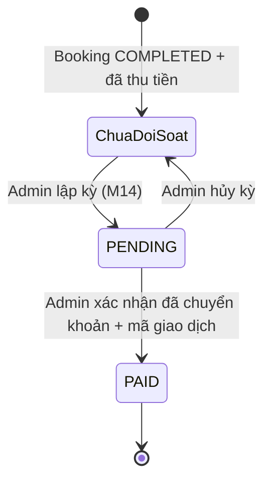

| Bước | Ai | API |
|---|---|---|
| Xem tiền chưa đối soát | Chủ (O8) | `GET /payouts/unsettled` |
| Xem trước kỳ, mọi chủ | Admin (M14) | `GET /payouts/preview?periodStart=&periodEnd=` |
| Lập kỳ cho một chủ | Admin | `POST /payouts { ownerId, periodStart, periodEnd }` → chủ nhận thông báo |
| Chuyển khoản ngoài hệ thống (Internet Banking), rồi xác nhận | Admin | `PATCH /payouts/:id/pay { transferRef }` → chủ nhận thông báo |
| Xem kỳ và từng booking | Chủ (O8), Admin | `GET /payouts`, `GET /payouts/:id` |

Kỳ tính theo **ngày hoàn thành** booking và phải đã kết thúc (thường lập theo tháng: 01 → cuối tháng trước). Đồ án không tự chuyển tiền; admin chuyển khoản thủ công rồi ghi mã giao dịch.

## 10. Luồng dashboard

Một API duy nhất, dữ liệu tự giới hạn theo vai trò:

```text
GET /api/stats/overview?from=2026-10-01&to=2026-10-31     (mặc định 30 ngày gần nhất, tối đa 366 ngày)
```

| Khối số liệu | Admin (`scope = PLATFORM`) | Owner (`scope = OWNER`) |
|---|---|---|
| `summary` | Tổng giá trị booking (GBV), doanh thu sàn (hoa hồng), doanh thu đối tác, giảm giá, số booking, tỷ lệ hủy, giá trị TB/booking, số đêm phòng bán ra | Cùng các chỉ số nhưng chỉ của địa điểm mình |
| `revenueByDay` | Mỗi ngày: số booking, GBV, hoa hồng, doanh thu chủ (đủ mọi ngày, ngày trống = 0) | Như bên trái |
| `bookingsByStatus` | Số booking theo trạng thái | Như bên trái |
| `topDestinations` | 5 địa điểm doanh thu cao nhất | 5 địa điểm của mình |
| `paymentMethods` | Số lượng và tiền theo phương thức | Như bên trái |
| `users` | Người dùng mới, tổng người dùng, số đối tác đang hoạt động | — |
| `listings` | — | Số tin theo trạng thái (nháp, chờ duyệt, đã duyệt, bị từ chối) |
| `rating` | — | Điểm trung bình và số đánh giá của các địa điểm mình |
| `pending` | Hồ sơ đối tác chờ duyệt, tin chờ duyệt, đánh giá chờ duyệt, booking trả tại nơi ở chờ xác nhận, hội thoại đang mở | Booking chờ xác nhận, lượt nhận phòng trong 7 ngày tới |

**Cách tính:** doanh thu chỉ gồm booking `CONFIRMED` và `COMPLETED`, theo ngày **tạo** booking, giờ Việt Nam. Tỷ lệ hủy = booking `CANCELLED` / tổng booking tạo trong kỳ.

Giao diện dashboard: xem trang M1 và O1 trong [giao-dien.md](../02-thiet-ke/giao-dien.md).

## 11. Luồng thông báo (mục 18)

Backend tự tạo thông báo khi có sự kiện; giao diện chỉ cần đọc.

| Sự kiện | Người nhận | `type` | `data` → mở trang |
|---|---|---|---|
| Đặt chỗ thành công | Khách | `BOOKING` | `bookingId` → B6 |
| Có booking mới / booking bị hủy tại địa điểm | Chủ địa điểm | `BOOKING` | `bookingId` → O7 |
| Thanh toán thành công / thất bại / quá hạn | Khách | `PAYMENT` | `bookingId` → B6 |
| Booking được xác nhận / hoàn thành / bị hủy | Khách | `BOOKING` | `bookingId` → B6 |
| Staff trả lời chat | Khách | `SUPPORT` | `conversationId` → C2 |
| Review được duyệt / bị từ chối | Khách | `REVIEW` | `destinationId` → D2 |
| Hồ sơ đối tác mới; tin đăng chờ duyệt | Mọi Admin | `PARTNER` | `partnerProfileId` → M12; `destinationId` → M13 |
| Hồ sơ đối tác được duyệt / từ chối / tạm ngưng / mở lại | Người nộp | `PARTNER` | → P4 hoặc O1 |
| Tin đăng được duyệt / bị từ chối | Chủ địa điểm | `PARTNER` | `destinationId` → O4 |
| Có kỳ đối soát mới / đã chuyển tiền | Chủ địa điểm | `PARTNER` | `payoutId` → O8 |

**Badge chưa đọc:** gọi `GET /api/notifications/unread-count` khi mở app, khi quay lại app từ nền và sau mỗi thao tác booking. Hiển thị trên tab T4.

**Push notification:** mọi thông báo trên được gửi push tới thiết bị đã đăng ký (`POST /api/devices`) khi `PUSH_ENABLED=true`. App xin quyền thông báo bằng `expo-notifications`, lấy Expo push token rồi đăng ký sau khi đăng nhập; chạm vào push thì đọc `data` và mở trang như khi chạm thông báo trong T4.

## 12. Bảng mã lỗi nghiệp vụ

| `code` | Status | Xảy ra khi | Giao diện xử lý |
|---|---|---|---|
| `VALIDATION_ERROR` | 400 | Thiếu/sai trường | Hiện lỗi dưới từng ô theo `details[].path` |
| `INVALID_JSON` | 400 | Body sai cú pháp | Lỗi lập trình, ghi log |
| `UNAUTHORIZED` | 401 | Chưa đăng nhập / token hết hạn | Đăng xuất → A1 |
| `INVALID_CREDENTIALS` | 401 | Sai email hoặc mật khẩu | Báo lỗi ở A1 |
| `FORBIDDEN` | 403 | Sai vai trò / tài khoản bị khóa / quản lý địa điểm không phải của mình | Thông báo; bị khóa thì đăng xuất |
| `NOT_FOUND` | 404 | Không tồn tại hoặc không phải của mình | Trang "Không tìm thấy" |
| `ROUTE_NOT_FOUND` | 404 | Sai đường dẫn API | Lỗi lập trình |
| `EMAIL_TAKEN` | 409 | Đăng ký email đã có | Lỗi dưới ô email |
| `INVALID_PASSWORD` | 400 | Đổi mật khẩu, mật khẩu cũ sai | Lỗi dưới ô mật khẩu hiện tại |
| `INVALID_DATES` | 400 | Ngày quá khứ / ngày trả ≤ ngày nhận / ít hơn số đêm của gói / > 30 đêm | Lỗi ở ô chọn ngày (B1) |
| `INVALID_ROOM_TYPE` | 400 | Phòng không thuộc địa điểm | Chọn lại phòng |
| `CAPACITY_EXCEEDED` | 400 | Quá số khách | Gợi ý tăng số phòng |
| `DUPLICATE_SERVICE` / `INVALID_SERVICE` | 400 | Dịch vụ trùng / không hợp lệ | Tải lại danh sách dịch vụ |
| `INVALID_VOUCHER` / `VOUCHER_EXHAUSTED` / `VOUCHER_MIN_ORDER` | 400 | Voucher không dùng được | Lỗi dưới ô voucher, cho đặt tiếp không voucher |
| `NOT_AVAILABLE` | 409 | Hết phòng lúc đặt | Quay về B1 chọn ngày/phòng khác |
| `PAYMENT_FAILED` | 402 | Thanh toán thất bại | Nút "Thử lại" |
| `PAYMENT_EXPIRED` | 409 | Thanh toán sau 15 phút | "Booking đã hết hạn, vui lòng đặt lại" → D2 |
| `ALREADY_PAID` / `INVALID_PAYMENT_METHOD` | 409 | Thanh toán không hợp lệ | Tải lại B6 |
| `INVALID_STATUS` | 409 | Đổi trạng thái sai thứ tự | Tải lại booking (có thể người khác vừa đổi) |
| `PAYMENT_REQUIRED` | 409 | Xác nhận đơn online chưa trả | Khóa nút "Xác nhận" |
| `CANCELLATION_NOT_ALLOWED` | 409 | Khách hủy quá hạn | Gợi ý liên hệ CSKH |
| `CANCEL_REASON_REQUIRED` | 400 | Chủ/Staff hủy booking không ghi lý do | Bắt buộc ô lý do |
| `BOOKING_NOT_COMPLETED` | 409 | Đánh giá khi chưa hoàn thành | Ẩn nút đánh giá |
| `ALREADY_REVIEWED` | 409 | Đánh giá lần hai | Chuyển sang chế độ sửa |
| `REJECT_REASON_REQUIRED` | 400 | Từ chối review/hồ sơ không lý do | Bắt buộc ô lý do |
| `CONVERSATION_CLOSED` | 409 | Nhắn vào hội thoại đã đóng | Khóa ô nhập |
| `INVALID_ROLE` | 409 | Tài khoản không phải USER nộp hồ sơ đối tác | Ẩn nút "Trở thành đối tác" |
| `ALREADY_APPLIED` | 409 | Đã có hồ sơ đang chờ / đã duyệt | Mở trang trạng thái hồ sơ |
| `PARTNER_BANK_REQUIRED` | 409 | Duyệt hồ sơ thiếu ngân hàng | Admin yêu cầu đối tác bổ sung |
| `INVALID_PARTNER_STATUS` | 409 | Duyệt/tạm ngưng sai trạng thái | Tải lại hồ sơ |
| `PARTNER_SUSPENDED` | 409 | Đối tác bị ngưng sửa hồ sơ | Hiện thông báo tạm ngưng |
| `LISTING_INCOMPLETE` | 400 | Gửi duyệt khi thiếu gói/phòng | Dẫn tới tab Gói / Phòng |
| `INVALID_LISTING_STATUS` | 409 | Gửi/duyệt tin sai trạng thái | Tải lại tin |
| `LISTING_APPROVED` | 409 | Chủ xóa tin đã duyệt | Gợi ý "Tạm ngưng" |
| `INVALID_OWNER` | 400 | Admin gán chủ không phải OWNER | Chọn lại chủ |
| `USE_PARTNER_API` | 400 | Đổi role tài khoản OWNER ở trang người dùng | Dẫn sang trang đối tác |
| `INVALID_RANGE` | 400 | Khoảng ngày thống kê sai / > 366 ngày | Báo lỗi ở bộ chọn ngày |
| `INVALID_REFRESH_TOKEN` / `REFRESH_TOKEN_EXPIRED` / `REFRESH_TOKEN_REUSED` | 401 | Refresh token sai, hết hạn, hoặc token cũ bị dùng lại | Đăng xuất → A1 |
| `REFRESH_TOKEN_ROTATED` | 401 | Hai request làm mới cùng lúc | Dùng token mới nhất trong store, thử lại |
| `INVALID_TOKEN` | 400 | Link xác thực / đặt lại mật khẩu sai, hết hạn hoặc đã dùng | "Link đã hết hạn" + nút gửi lại |
| `ALREADY_VERIFIED` | 409 | Gửi lại email khi đã xác thực | Ẩn dải xác thực |
| `EMAIL_NOT_VERIFIED` | 403 | Nộp hồ sơ đối tác khi chưa xác thực email | Mở dải xác thực email ở P4 |
| `RATE_OVERLAP` | 409 | Giá mùa trùng ngày khoảng khác | Báo trùng, giữ form |
| `NOTHING_TO_PAY` | 409 | Lập kỳ đối soát khi không có booking | Thông báo ở M14 |
| `INVALID_PAYOUT_STATUS` / `PAYOUT_CONFLICT` | 409 | Chuyển / hủy kỳ sai trạng thái; dữ liệu vừa đổi | Tải lại kỳ |
| `FILE_REQUIRED` / `INVALID_FILE_TYPE` / `INVALID_UPLOAD` | 400 | Thiếu file, không phải JPEG/PNG/WebP | Báo dưới nút chọn ảnh |
| `FILE_TOO_LARGE` | 413 | Ảnh quá `UPLOAD_MAX_MB` (5 MB) | Nén ảnh trước khi tải (`expo-image-manipulator`) |
| `INVALID_IMAGE` | 400 | Ảnh đánh giá không phải do mình tải lên | Tải lại ảnh |
| `DUPLICATE` | 409 | Trùng dữ liệu duy nhất (slug, mã voucher...) | Báo trùng ở form quản trị |
| `REFERENCE_CONFLICT` | 409 | Xóa dữ liệu đang được dùng | Gợi ý "Ngừng hoạt động" thay vì xóa |
| `TOO_MANY_REQUESTS` | 429 | Quá nhiều lần đăng nhập/đăng ký | Chờ rồi thử lại |
| `NETWORK_ERROR` | — | Mất mạng (do client tự tạo) | Nút "Thử lại" |

## 13. API còn thiếu cho giao diện đầy đủ

Đã bổ sung ngày 25/10/2026: quên mật khẩu + xác thực email, tải ảnh, push notification, refresh token, đối soát, giá mùa, nhật ký quản trị, tìm không dấu. Còn lại:

| Chức năng | Trang | Đề xuất |
|---|---|---|
| Phân bố số sao | D3 | Thêm `ratingBreakdown` vào `GET /destinations/:id/reviews` |
| Lọc booking nhiều trạng thái | T3, O6 | Cho `status=PENDING,CONFIRMED` |
| Chủ địa điểm trả lời đánh giá | O4 | Cột `ownerReply` trong `Review` |
| Xuất báo cáo CSV | M1, O1, M14 | `GET /stats/export?format=csv` |
| Chat thời gian thực | C2, M6 | WebSocket (Socket.IO) thay cho polling |
