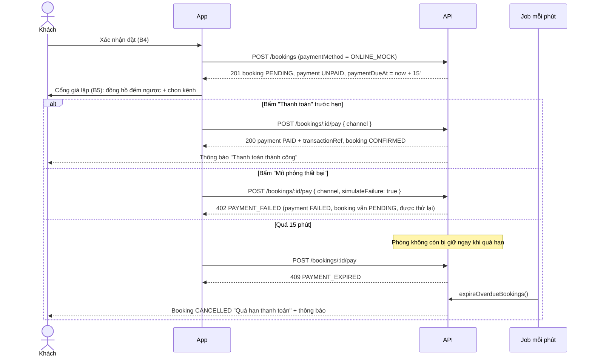
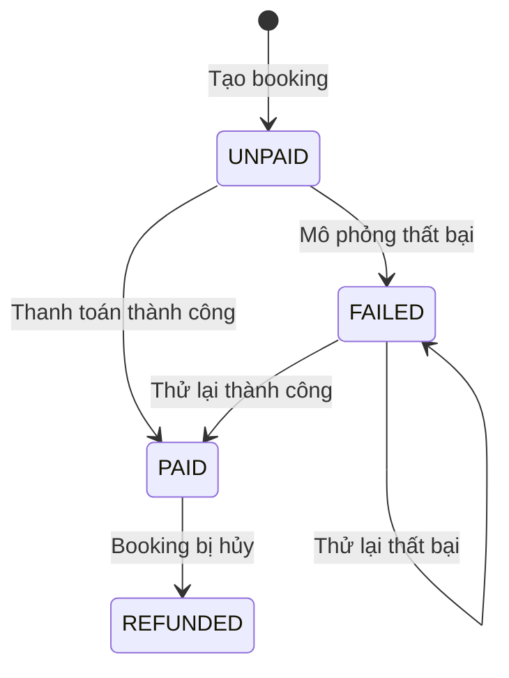

# Thanh toán giả lập

Đồ án **không kết nối cổng thanh toán thật** và **không nhận, không lưu số thẻ hay thông tin tài khoản ngân hàng của khách**. Thay vào đó, app có một **cổng thanh toán giả lập**: khách chọn kênh thanh toán, bấm thanh toán, và kết quả được backend ghi nhận như một giao dịch thật. Mọi trạng thái, hạn thanh toán, hoàn tiền và thống kê đều chạy đúng nghiệp vụ, nên sau này chỉ cần thay phần "cổng" bằng VNPay/MoMo.

## 1. Hai phương thức thanh toán

| Phương thức | Mã | Khi nào xác nhận booking | Hạn thanh toán |
|---|---|---|---|
| Thanh toán online (giả lập) | `ONLINE_MOCK` | **Tự động** ngay khi thanh toán thành công | 15 phút kể từ khi đặt |
| Trả tại nơi lưu trú | `PAY_AT_PROPERTY` | Chủ địa điểm hoặc Staff xác nhận thủ công | Không có; tiền được ghi nhận khi booking hoàn thành |

## 2. Kênh thanh toán trên cổng giả lập

Khách chọn một kênh khi thanh toán online. Kênh chỉ để hiển thị và thống kê, không ảnh hưởng số tiền.

| Kênh | `channel` | Giao diện giả lập nên hiển thị |
|---|---|---|
| Thẻ ATM / thẻ quốc tế | `CARD` (mặc định) | Biểu tượng thẻ và dòng "Thẻ thử nghiệm – không cần nhập số thẻ" |
| Ví điện tử | `EWALLET` | Mã QR minh họa (ảnh tĩnh) |
| Chuyển khoản ngân hàng | `BANK_TRANSFER` | Nội dung chuyển khoản = mã booking (chỉ để hiển thị) |

> **Không làm form nhập số thẻ, CVV, mật khẩu ví, mã OTP** kể cả dữ liệu giả. Giao diện như vậy dễ bị hiểu nhầm là trang thu thập thông tin thanh toán thật. Cổng giả lập chỉ cần nút **Thanh toán** và (để demo) **Mô phỏng thất bại**.

## 3. Luồng thanh toán online

### Trạng thái thanh toán

## 4. Quy tắc

| Quy tắc | Mã lỗi khi vi phạm |
|---|---|
| Chỉ chủ booking thanh toán được booking của mình | 404 `NOT_FOUND` |
| Chỉ thanh toán booking `PENDING` | 409 `INVALID_STATUS` |
| Booking trả tại nơi ở không thanh toán online | 409 `INVALID_PAYMENT_METHOD` |
| Không thanh toán lần hai | 409 `ALREADY_PAID` / `INVALID_STATUS` |
| Không thanh toán sau `paymentDueAt` | 409 `PAYMENT_EXPIRED` |
| `channel` chỉ nhận `CARD`, `EWALLET`, `BANK_TRANSFER` | 400 `VALIDATION_ERROR` |

**Vì sao cần hạn thanh toán?** Không có hạn, một booking bỏ dở sẽ giữ phòng mãi và chặn khách khác đặt. Đặt phòng thật (Booking.com, Agoda, các app hàng không) đều giữ chỗ trong một khoảng thời gian ngắn.

**Hai lớp bảo vệ khi quá hạn:**

1. **Ngay lập tức:** khi đếm phòng trống, booking `PENDING` đã quá `paymentDueAt` không còn được tính là đang giữ phòng, kể cả khi job chưa chạy.
2. **Dọn dẹp:** job chạy mỗi phút trong tiến trình API, chuyển booking quá hạn sang `CANCELLED`, trả lượt voucher, gửi thông báo.

Khi chạy nhiều instance API, nên tách job thành một cron job riêng để không chạy trùng.

## 5. Hoàn tiền

| Tình huống | Kết quả |
|---|---|
| Hủy booking đã `PAID` (khách tự hủy trong hạn, chủ địa điểm/Staff hủy) | Payment → `REFUNDED`, ghi `refundedAt`; thông báo "Khoản thanh toán sẽ được hoàn lại" |
| Hủy booking chưa thanh toán | Không có gì để hoàn |
| Booking trả tại nơi ở được hoàn thành | Payment `UNPAID` → `PAID` (coi như đã thu tại quầy) |

## 6. API

| Endpoint | Body | Kết quả |
|---|---|---|
| `POST /api/bookings` | `paymentMethod: "ONLINE_MOCK" \| "PAY_AT_PROPERTY"` | Booking có `paymentDueAt` (online) hoặc `null` |
| `POST /api/bookings/:id/pay` | `{ "channel": "CARD", "simulateFailure": false }` (cả hai tùy chọn) | 200 booking đã xác nhận / 402 / 409 |

Dữ liệu ghi trong bảng `Payment`: `method`, `channel`, `status`, `amount`, `transactionRef` (dạng `MOCK-<uuid>`), `paidAt`, `refundedAt`.

## 7. Khi tích hợp cổng thật (VNPay / MoMo)

| Phần | Giả lập hiện tại | Khi tích hợp |
|---|---|---|
| Bắt đầu thanh toán | App gọi `POST /pay` | Backend tạo URL thanh toán có chữ ký, app mở trang của cổng |
| Nhận kết quả | Ngay trong response của `/pay` | Cổng gọi **IPN/callback** về backend; backend kiểm tra chữ ký rồi mới đổi `PAID` |
| `transactionRef` | `MOCK-<uuid>` | Mã giao dịch của cổng |
| Hạn thanh toán | `paymentDueAt` | Giữ nguyên; truyền làm thời hạn của URL thanh toán |
| Hoàn tiền | Đổi trạng thái `REFUNDED` | Gọi API hoàn tiền của cổng |

Chỉ hàm `payBooking` trong `be/src/services/booking.service.ts` cần thay; phần trạng thái booking, hạn thanh toán, thông báo và thống kê giữ nguyên.
