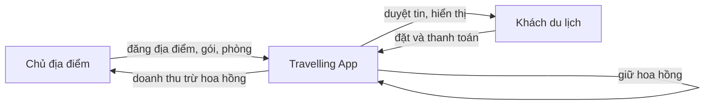
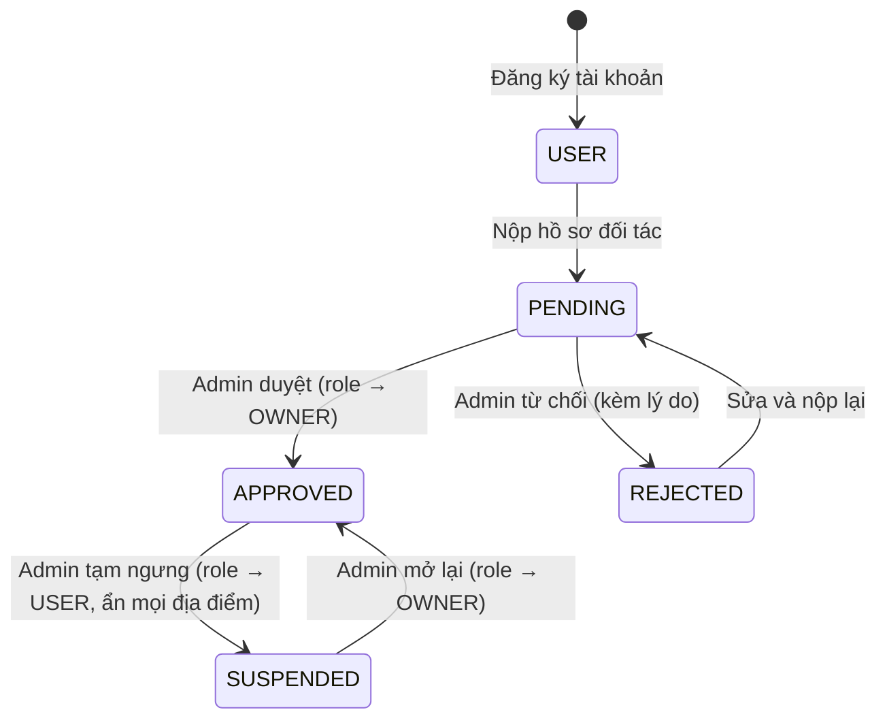

# Tổng quan hệ thống

Travelling App là **sàn môi giới dịch vụ du lịch** chạy trên Web và Mobile (Android, iOS). Sàn không sở hữu khách sạn hay resort: **chủ địa điểm** (đối tác) đăng địa điểm, gói dịch vụ và phòng lên sàn; **khách du lịch** tìm kiếm và đặt chỗ; sàn thu **hoa hồng** trên mỗi booking thành công.

Tài liệu gốc do nhóm viết: [../tham-khao/Mô tả hệ thống (bản gốc).docx](../tham-khao/). Tài liệu này là bản cập nhật, có bổ sung actor chủ địa điểm, hoa hồng, dashboard và thanh toán giả lập.

## 1. Mục tiêu

| # | Mục tiêu | Chức năng đáp ứng |
|---|---|---|
| 1 | Tập trung thông tin địa điểm du lịch | Khám phá, tìm kiếm, lọc, xem chi tiết |
| 2 | Khách tự đặt dịch vụ trực tuyến | Chọn gói, phòng, dịch vụ bổ sung; báo giá; đặt; thanh toán |
| 3 | Chủ địa điểm tự quản lý sản phẩm | Hồ sơ đối tác, đăng tin, quản lý gói/phòng/giá, xử lý booking |
| 4 | Sàn kiểm soát chất lượng | Duyệt đối tác, duyệt tin đăng, kiểm duyệt đánh giá |
| 5 | Chăm sóc khách hàng | Chat CSKH, thông báo |
| 6 | Theo dõi hiệu quả kinh doanh | Dashboard cho Admin (toàn sàn) và chủ địa điểm (cơ sở của mình) |

## 2. Mô hình kinh doanh môi giới



Với mỗi booking được chốt (`CONFIRMED` hoặc `COMPLETED`):

```text
Cơ sở tính          = Tạm tính - Giảm giá
Hoa hồng của sàn    = Cơ sở tính × tỷ lệ hoa hồng của đối tác   (mặc định 15%, admin chỉnh được 0–50%)
Doanh thu chủ       = Cơ sở tính - Hoa hồng
Thuế/phí            = do sàn thu hộ, không chia
```

- Tỷ lệ hoa hồng được **chụp lại trên booking** lúc đặt. Admin đổi tỷ lệ chỉ ảnh hưởng booking mới.
- Địa điểm không có chủ (`ownerId = NULL`) là địa điểm **sàn tự kinh doanh**: tỷ lệ = 100%, sàn giữ toàn bộ.
- Voucher là khuyến mãi của sàn nhưng trừ vào cơ sở tính, nên sàn và chủ cùng chịu theo tỷ lệ.
- Đồ án chỉ ghi nhận số liệu. Việc chuyển tiền thật cho chủ (đối soát, payout) nằm ngoài phạm vi; xem đề xuất ở [../04-quan-ly-du-an/lo-trinh.md](../04-quan-ly-du-an/lo-trinh.md).

## 3. Các actor

| Actor | Role trong hệ thống | Mô tả | Nền tảng chính |
|---|---|---|---|
| Khách vãng lai (Guest) | — (chưa đăng nhập) | Xem, tìm kiếm địa điểm, xem báo giá | Mobile, Web |
| Khách hàng (User) | `USER` | Yêu thích, đặt chỗ, thanh toán, đánh giá, chat CSKH; có thể nộp hồ sơ làm đối tác | Mobile, Web |
| **Chủ địa điểm (Owner)** | `OWNER` | Đối tác đã được duyệt: đăng và quản lý địa điểm của mình, xử lý booking tại cơ sở mình, xem dashboard doanh thu | **Web** (có bản mobile rút gọn) |
| Nhân viên CSKH (Staff) | `STAFF` | Trả lời chat, kiểm duyệt đánh giá, xử lý booking toàn sàn | Web |
| Quản trị viên (Admin) | `ADMIN` | Duyệt đối tác và tin đăng, quản lý danh mục, voucher, người dùng, hoa hồng; xem dashboard toàn sàn | Web |
| Cổng thanh toán | — (hệ thống ngoài) | Đồ án dùng **cổng giả lập** trong app; xem [thanh-toan-gia-lap.md](thanh-toan-gia-lap.md) | — |

Một người có một tài khoản. Chủ địa điểm vẫn đặt chỗ được như khách (xem booking của mình bằng `scope=mine`).

### Vòng đời tài khoản chủ địa điểm



## 4. Chức năng theo actor (use case)

### Guest

| Mã | Chức năng |
|---|---|
| UC-G1 | Xem địa điểm nổi bật, phổ biến, mới, theo danh mục |
| UC-G2 | Tìm kiếm và lọc (từ khóa, danh mục, khu vực, khoảng giá, rating, tiện ích) |
| UC-G3 | Xem chi tiết địa điểm, gói, phòng, dịch vụ, đánh giá |
| UC-G4 | Kiểm tra phòng trống và xem báo giá |
| UC-G5 | Đăng ký, đăng nhập |

### User (gồm mọi chức năng Guest)

| Mã | Chức năng |
|---|---|
| UC-U1 | Thêm/bỏ địa điểm yêu thích |
| UC-U2 | Đặt chỗ (chọn gói, phòng, dịch vụ, voucher, phương thức thanh toán) |
| UC-U3 | Thanh toán qua cổng giả lập |
| UC-U4 | Xem lịch sử, chi tiết booking; hủy theo chính sách |
| UC-U5 | Đánh giá sau chuyến đi; sửa/xóa đánh giá |
| UC-U6 | Chat với CSKH |
| UC-U7 | Xem thông báo |
| UC-U8 | Quản lý hồ sơ (ảnh đại diện), đổi mật khẩu, xác thực email, quên mật khẩu, quản lý thiết bị đăng nhập, nhận push |
| UC-U9 | **Nộp hồ sơ trở thành đối tác** |

### Owner

| Mã | Chức năng |
|---|---|
| UC-O1 | Cập nhật hồ sơ đối tác, tài khoản ngân hàng nhận tiền |
| UC-O2 | Tạo tin đăng địa điểm (bản nháp), chỉnh sửa, xem trước |
| UC-O3 | Quản lý gói dịch vụ, loại phòng, dịch vụ bổ sung, giá của địa điểm mình |
| UC-O4 | Gửi tin đăng để admin duyệt; sửa và gửi lại khi bị từ chối |
| UC-O5 | Tạm ngưng / mở lại nhận khách cho địa điểm (`isActive`) |
| UC-O6 | Xem và xử lý booking tại địa điểm mình: xác nhận, hoàn thành, hủy (kèm lý do) |
| UC-O7 | Dashboard: doanh thu, hoa hồng, booking, tin đăng, rating của cơ sở mình |
| UC-O8 | Đặt giá theo mùa / ngày lễ cho từng loại phòng |
| UC-O9 | Xem tiền chưa đối soát và các kỳ sàn đã chuyển |

### Staff

| Mã | Chức năng |
|---|---|
| UC-S1 | Xem và xử lý mọi booking |
| UC-S2 | Kiểm duyệt đánh giá |
| UC-S3 | Nhận và trả lời hội thoại CSKH, đóng hội thoại |
| UC-S4 | Xem danh sách người dùng |

### Admin (gồm mọi chức năng Staff)

| Mã | Chức năng |
|---|---|
| UC-A1 | Duyệt/từ chối hồ sơ đối tác, đặt tỷ lệ hoa hồng, tạm ngưng/mở lại đối tác |
| UC-A2 | Duyệt/từ chối tin đăng địa điểm |
| UC-A3 | Quản lý mọi địa điểm, gắn chủ, đánh dấu nổi bật |
| UC-A4 | Quản lý danh mục, tiện ích, voucher |
| UC-A5 | Khóa/mở tài khoản, đổi vai trò (trừ OWNER, đi qua hồ sơ đối tác) |
| UC-A6 | **Dashboard toàn sàn** |
| UC-A7 | Đối soát: lập kỳ, xác nhận đã chuyển khoản cho chủ địa điểm |
| UC-A8 | Xem nhật ký thao tác quản trị |

## 5. Phạm vi đồ án

**Có trong phạm vi:** toàn bộ use case ở mục 4; chạy được trên Android, iOS (nếu có máy Mac), Web; triển khai backend bằng Docker.

**Ngoài phạm vi (ghi nhận để phát triển sau):**

- Cổng thanh toán thật (VNPay, MoMo) và chuyển tiền **tự động** cho chủ địa điểm (đồ án có đối soát, admin chuyển khoản thủ công rồi ghi mã giao dịch).
- Chat thời gian thực (hiện dùng polling).
- Chủ địa điểm trả lời đánh giá, đóng phòng theo ngày, phí hủy một phần.

Email (xác thực, quên mật khẩu), push notification, tải ảnh và giá theo mùa đã có từ 25/10/2026.

## 6. Tài liệu liên quan

| Nội dung | Tài liệu |
|---|---|
| Đăng ký tài khoản và hồ sơ đối tác: trường bắt buộc/tùy chọn | [tai-khoan-va-dang-ky.md](tai-khoan-va-dang-ky.md) |
| Quy tắc nghiệp vụ BR-01 → BR-27 | [quy-tac-nghiep-vu.md](quy-tac-nghiep-vu.md) |
| Luồng nghiệp vụ chi tiết | [luong-nghiep-vu.md](luong-nghiep-vu.md) |
| Thanh toán giả lập | [thanh-toan-gia-lap.md](thanh-toan-gia-lap.md) |
| Cơ sở dữ liệu | [../02-thiet-ke/co-so-du-lieu.md](../02-thiet-ke/co-so-du-lieu.md) |
| Danh sách API | [../02-thiet-ke/api.md](../02-thiet-ke/api.md) |
| Trang giao diện | [../02-thiet-ke/giao-dien.md](../02-thiet-ke/giao-dien.md) |
