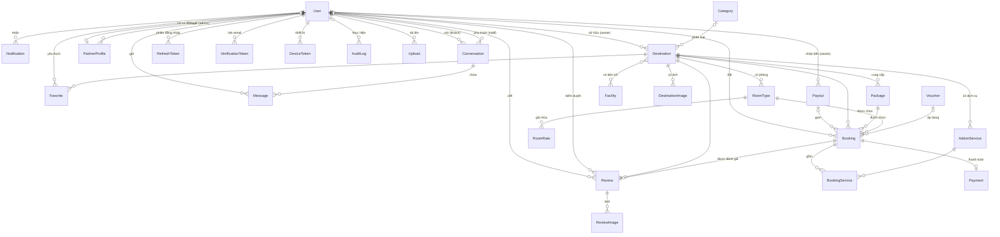
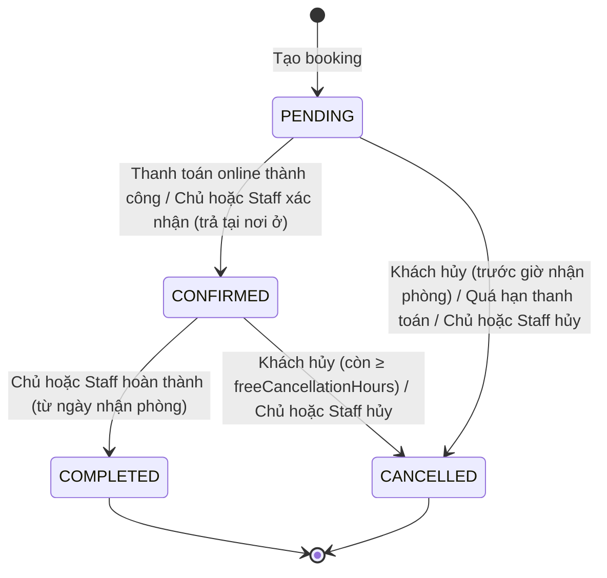

# Thiết kế cơ sở dữ liệu – Travelling App

Tài liệu này mô tả cơ sở dữ liệu đề xuất cho Travelling App, xây dựng từ đặc tả trong [../01-dac-ta/](../01-dac-ta/tong-quan.md). Thiết kế đã được cài đặt bằng Prisma tại `be/prisma/schema.prisma`; danh sách migration ở mục 8.

- **Hệ quản trị:** MariaDB 11 (Prisma provider `mysql`), bảng mã `utf8mb4`, collation `utf8mb4_unicode_ci`.
- **ORM:** Prisma 7 với adapter `@prisma/adapter-mariadb`.
- **Quy ước:** tên bảng PascalCase theo tên model (`Booking`, `RoomType`), tên cột camelCase, khóa chính `id INT AUTO_INCREMENT`, mọi bảng nghiệp vụ có `createdAt` và `updatedAt`.

## 1. Tổng quan

Cơ sở dữ liệu gồm 27 bảng (26 model và bảng nối `_DestinationToFacility`), chia thành 6 nhóm:

| Nhóm | Bảng | Mục đích |
|---|---|---|
| Tài khoản và đối tác | `User`, `PartnerProfile`, `RefreshToken`, `VerificationToken`, `DeviceToken` | Người dùng 4 vai trò; hồ sơ đối tác; phiên đăng nhập; token xác thực email / đặt lại mật khẩu; thiết bị nhận push |
| Danh mục và nội dung | `Category`, `Facility`, `Destination`, `DestinationImage`, `_DestinationToFacility` | Địa điểm du lịch, danh mục, tiện ích, ảnh |
| Sản phẩm đặt chỗ | `Package`, `RoomType`, `RoomRate`, `AddonService`, `Voucher` | Gói dịch vụ, loại phòng, giá theo mùa, dịch vụ bổ sung, mã giảm giá |
| Giao dịch | `Booking`, `BookingService`, `Payment`, `Payout` | Đơn đặt chỗ, dịch vụ đã chọn, thanh toán, kỳ đối soát chuyển tiền cho chủ |
| Tương tác | `Favorite`, `Review`, `ReviewImage`, `Conversation`, `Message`, `Notification` | Yêu thích, đánh giá + ảnh, chat CSKH, thông báo |
| Vận hành | `AuditLog`, `Upload` | Nhật ký thao tác quản trị; file người dùng tải lên |

## 2. Sơ đồ quan hệ (ERD)



Cây dữ liệu theo nghiệp vụ (mục 20 và 23 trong tài liệu mô tả):

```text
User (OWNER: owner1@travelling.app)
└── PartnerProfile (Công ty Du lịch Đà Lạt Xanh, hoa hồng 15%, APPROVED)

Destination (Đà Lạt Pine Hill Resort, ownerId = owner1, listingStatus = APPROVED)
├── Category: Resort
├── Facility: Wi-Fi, Bữa sáng, Spa...      (tiện ích để hiển thị và lọc)
├── Package: Standard / Premium / VIP     (giá gói, số ngày-đêm, chính sách hủy)
├── RoomType: Standard / Deluxe / Suite   (giá theo đêm, sức chứa, tổng số phòng)
├── AddonService: Đưa đón, Spa, Giường phụ (dịch vụ trả thêm phí)
└── Review (chỉ từ booking đã hoàn thành)

Booking
├── Package + RoomType + Voucher (tham chiếu)
├── BookingService[]  (dịch vụ đã chọn, chụp lại giá)
├── Payment           (1-1)
├── commission*       (hoa hồng chụp lại lúc đặt)
└── Review            (1-1, tùy chọn)
```

## 3. Kiểu liệt kê (enum)

| Enum | Giá trị | Dùng tại |
|---|---|---|
| `Role` | `USER`, `OWNER`, `STAFF`, `ADMIN` | `User.role` |
| `PartnerStatus` | `PENDING`, `APPROVED`, `REJECTED`, `SUSPENDED` | `PartnerProfile.status` |
| `ListingStatus` | `DRAFT`, `PENDING_REVIEW`, `APPROVED`, `REJECTED` | `Destination.listingStatus` |
| `PayoutStatus` | `PENDING`, `PAID`, `CANCELLED` | `Payout.status` |
| `VerificationTokenType` | `EMAIL_VERIFY`, `PASSWORD_RESET` | `VerificationToken.type` |
| `DevicePlatform` | `IOS`, `ANDROID`, `WEB` | `DeviceToken.platform` |
| `UserStatus` | `ACTIVE`, `LOCKED` | `User.status` |
| `BookingStatus` | `PENDING`, `CONFIRMED`, `COMPLETED`, `CANCELLED` | `Booking.status` |
| `PaymentMethod` | `ONLINE_MOCK` (thanh toán online giả lập), `PAY_AT_PROPERTY` (trả tại nơi lưu trú) | `Payment.method` |
| `PaymentStatus` | `UNPAID`, `PAID`, `REFUNDED`, `FAILED` | `Payment.status` |
| `ReviewStatus` | `PENDING`, `APPROVED`, `REJECTED` | `Review.status` |
| `ServicePricingUnit` | `PER_BOOKING`, `PER_GUEST`, `PER_NIGHT` | `AddonService.pricingUnit` |
| `DiscountType` | `PERCENT`, `FIXED` | `Voucher.discountType` |
| `NotificationType` | `BOOKING`, `PAYMENT`, `SUPPORT`, `REVIEW`, `PARTNER`, `SYSTEM` | `Notification.type` |
| `ConversationStatus` | `OPEN`, `CLOSED` | `Conversation.status` |

Dùng enum thay cho chuỗi tự do (thiết kế cũ có `status String`) để database từ chối giá trị sai chính tả như `"CONFIRM"`.

## 4. Chi tiết các bảng

Ký hiệu: **PK** khóa chính, **FK** khóa ngoại, **UQ** duy nhất, **?** cho phép NULL.

### 4.1. `User` – Tài khoản

| Cột | Kiểu | Ràng buộc | Ghi chú |
|---|---|---|---|
| `id` | INT | PK | |
| `name` | VARCHAR(191) | | Họ tên |
| `email` | VARCHAR(191) | UQ | Lưu chữ thường; dùng để đăng nhập |
| `emailVerifiedAt` | DATETIME? | | `NULL` = chưa xác thực email; bắt buộc trước khi nộp hồ sơ đối tác |
| `googleId` | VARCHAR(64)? | UNIQUE | `sub` của tài khoản Google đã liên kết; `NULL` = chưa liên kết |
| `password` | VARCHAR(191) | | Hash bcrypt, không bao giờ trả ra API (BR-09) |
| `phone` | VARCHAR(20)? | | |
| `dateOfBirth` | DATE? | | |
| `avatarUrl` | VARCHAR(500)? | | |
| `role` | ENUM `Role` | mặc định `USER` | |
| `status` | ENUM `UserStatus` | mặc định `ACTIVE` | `LOCKED` chặn đăng nhập và mọi request ngay lập tức |

Một bảng cho cả bốn vai trò vì mọi người dùng chung cơ chế đăng nhập; quyền được kiểm tra bằng `role`. `OWNER` chỉ được cấp khi `PartnerProfile` được duyệt (BR-12).

### 4.1b. `PartnerProfile` – Hồ sơ đối tác (chủ địa điểm)

| Cột | Kiểu | Ràng buộc | Ghi chú |
|---|---|---|---|
| `id` | INT | PK | |
| `userId` | INT | **UQ**, FK → `User`, CASCADE | Mỗi tài khoản tối đa một hồ sơ |
| `businessName` | VARCHAR(191) | | Tên cơ sở / doanh nghiệp |
| `taxCode` | VARCHAR(20)? | | Mã số thuế (hộ cá nhân có thể trống) |
| `businessAddress` | VARCHAR(500) | | |
| `contactPhone` | VARCHAR(20) | | |
| `description` | TEXT? | | |
| `bankName`, `bankAccountNumber`, `bankAccountName` | VARCHAR? | | Tài khoản nhận doanh thu; **bắt buộc trước khi duyệt** (BR-13) |
| `status` | ENUM `PartnerStatus` | mặc định `PENDING`, INDEX | |
| `commissionRate` | DOUBLE | mặc định 0.15 | Tỷ lệ hoa hồng sàn thu, 0–0.5 |
| `rejectReason` | VARCHAR? | | |
| `reviewedById` | INT? | FK → `User`, SET NULL | Admin đã duyệt |
| `reviewedAt` | DATETIME? | | |

### 4.1c. Phiên đăng nhập và token email

`RefreshToken` – mỗi dòng là một phiên trên một thiết bị:

| Cột | Kiểu | Ghi chú |
|---|---|---|
| `userId` | INT, FK → `User` CASCADE | |
| `tokenHash` | CHAR(64), UQ | SHA-256 của refresh token; token gốc chỉ client giữ |
| `deviceName`, `userAgent`, `ip` | VARCHAR? | Hiển thị ở danh sách phiên |
| `expiresAt` | DATETIME | Tạo + `REFRESH_TOKEN_TTL_DAYS` (30 ngày) |
| `lastUsedAt`, `revokedAt` | DATETIME? | `revokedAt` khác NULL = đã thu hồi (đăng xuất, đổi mật khẩu, bị khóa, đã xoay) |
| `replacedById` | INT? | Token mới thay thế khi xoay vòng |

`VerificationToken` – link một lần trong email: `type` (`EMAIL_VERIFY` 24 giờ, `PASSWORD_RESET` 30 phút), `tokenHash` UQ, `expiresAt`, `usedAt`. Tạo token mới thì token cũ cùng loại hết hiệu lực.

`DeviceToken` – Expo push token: `token` UQ, `platform`, `lastSeenAt`. Một token chỉ thuộc một tài khoản; đăng nhập tài khoản khác trên cùng máy thì token chuyển sang tài khoản đó.

Tách hồ sơ đối tác khỏi `User` vì chỉ một phần nhỏ người dùng là chủ địa điểm; tránh thêm nhiều cột NULL vào bảng `User`. Không lưu số CCCD/CMND (dữ liệu nhạy cảm, đồ án không cần).

### 4.2. `Category` – Danh mục

| Cột | Kiểu | Ràng buộc | Ghi chú |
|---|---|---|---|
| `id` | INT | PK | |
| `name` | VARCHAR(191) | UQ | Biển, Núi, Resort, Khách sạn, Khu vui chơi, Di tích lịch sử, Văn hóa, Sinh thái |
| `slug` | VARCHAR(191) | UQ | Dùng trong URL, ví dụ `di-tich-lich-su` |
| `iconName` | VARCHAR(191)? | | Tên icon hiển thị trên app |

### 4.3. `Facility` – Tiện ích

| Cột | Kiểu | Ràng buộc | Ghi chú |
|---|---|---|---|
| `id` | INT | PK | |
| `name` | VARCHAR(191) | UQ | Wi-Fi, Hồ bơi, Bữa sáng, Bãi đỗ xe, Spa, Gym, Đưa đón sân bay |
| `iconName` | VARCHAR(191)? | | |

Quan hệ nhiều-nhiều với `Destination` qua bảng nối `_DestinationToFacility (A = destinationId, B = facilityId)` do Prisma quản lý.

Tiện ích chỉ để **hiển thị và lọc**. Tiện ích nào thu thêm tiền (ví dụ Spa) được tạo thành `AddonService` để tính vào giá.

### 4.4. `Destination` – Địa điểm du lịch

| Cột | Kiểu | Ràng buộc | Ghi chú |
|---|---|---|---|
| `id` | INT | PK | |
| `name` | VARCHAR(191) | | |
| `slug` | VARCHAR(191) | UQ | `da-lat-pine-hill-resort` |
| `description` | TEXT? | | |
| `location` | VARCHAR(191) | INDEX | Khu vực/thành phố, dùng để lọc |
| `address` | VARCHAR(500)? | | |
| `latitude`, `longitude` | DOUBLE? | | Vị trí bản đồ |
| `imageUrl` | VARCHAR(500)? | | Ảnh đại diện |
| `contactPhone`, `contactEmail` | VARCHAR? | | Thông tin liên hệ |
| `policy` | TEXT? | | Chính sách nhận/trả phòng |
| `categoryId` | INT? | FK → `Category`, ON DELETE SET NULL | |
| `ownerId` | INT? | FK → `User`, RESTRICT, INDEX | Chủ địa điểm; `NULL` = sàn tự quản lý |
| `listingStatus` | ENUM `ListingStatus` | mặc định `APPROVED`, INDEX | Chủ tạo → `DRAFT`; admin tạo → `APPROVED` |
| `listingRejectReason` | VARCHAR? | | Lý do admin từ chối tin |
| `submittedAt`, `approvedAt` | DATETIME? | | Mốc gửi duyệt / được duyệt |
| `searchText` | VARCHAR(1000) | mặc định `''` | **Dữ liệu dẫn xuất:** tên + khu vực + địa chỉ + danh mục, viết thường, bỏ dấu, dùng để tìm "da lat" ra "Đà Lạt" |
| `isActive` | BOOLEAN | mặc định `true` | Tạm ngưng / mở nhận khách. Khách chỉ thấy khi `isActive = true` **và** `listingStatus = APPROVED` (BR-15) |
| `isFeatured` | BOOLEAN | mặc định `false` | Địa điểm nổi bật trên trang chủ |
| `minPrice` | INT | mặc định 0 | **Dữ liệu dẫn xuất:** "Giá từ" |
| `averageRating` | DOUBLE | mặc định 0 | **Dữ liệu dẫn xuất:** điểm trung bình review đã duyệt |
| `reviewCount` | INT | mặc định 0 | **Dữ liệu dẫn xuất:** số review đã duyệt |

`minPrice`, `averageRating`, `reviewCount` được lưu sẵn để lọc theo khoảng giá/rating và sắp xếp nhanh mà không phải JOIN + aggregate mỗi lần tìm kiếm. Backend tính lại các cột này:

- `minPrice` = giá gói rẻ nhất + giá/đêm của phòng rẻ nhất × số đêm của gói, cập nhật khi admin hoặc chủ địa điểm thêm/sửa gói hoặc phòng.
- `averageRating`, `reviewCount` chỉ tính review `APPROVED`, cập nhật khi duyệt, sửa hoặc xóa review.

### 4.5. `DestinationImage` – Thư viện ảnh

| Cột | Kiểu | Ràng buộc |
|---|---|---|
| `id` | INT | PK |
| `destinationId` | INT | FK → `Destination`, ON DELETE CASCADE |
| `url` | VARCHAR(500) | |
| `sortOrder` | INT | mặc định 0 |

### 4.6. `Package` – Gói dịch vụ

| Cột | Kiểu | Ràng buộc | Ghi chú |
|---|---|---|---|
| `id` | INT | PK | |
| `destinationId` | INT | FK → `Destination`, CASCADE | |
| `name` | VARCHAR(191) | | Gói Standard / Premium / VIP |
| `description` | TEXT? | | |
| `inclusions` | JSON? | | Danh sách quyền lợi, ví dụ `["Phòng Deluxe","Ăn sáng","Đưa đón"]` |
| `durationDays`, `durationNights` | INT | | 3 ngày 2 đêm; số đêm tối thiểu khi đặt |
| `price` | INT | | Giá gói (VNĐ) cho cả booking |
| `freeCancellationHours` | INT | mặc định 48 | Chính sách hủy miễn phí (BR-07) |
| `isActive` | BOOLEAN | mặc định `true` | |

### 4.7. `RoomType` – Loại phòng

| Cột | Kiểu | Ràng buộc | Ghi chú |
|---|---|---|---|
| `id` | INT | PK | |
| `destinationId` | INT | FK → `Destination`, CASCADE | |
| `name` | VARCHAR(191) | | Standard, Deluxe, Family, Suite |
| `description` | TEXT? | | |
| `capacity` | INT | | Số khách tối đa mỗi phòng |
| `pricePerNight` | INT | | VNĐ/đêm/phòng |
| `totalRooms` | INT | | Tổng số phòng loại này |
| `isActive` | BOOLEAN | mặc định `true` | |

**Giá theo mùa – `RoomRate`:** `roomTypeId` (FK CASCADE), `name` ("Tết Nguyên đán 2027"), `startDate`, `endDate` (DATE, gồm cả hai ngày), `pricePerNight`. Các khoảng của cùng loại phòng **không được chồng ngày** (409 `RATE_OVERLAP`), nên mỗi đêm khớp tối đa một giá mùa; đêm không khớp dùng `RoomType.pricePerNight`. "Giá từ" (`minPrice`) vẫn tính theo giá gốc.

**Không lưu cột "số phòng còn trống".** Số phòng trống thay đổi theo ngày nên được tính khi cần (mục 6.2). Lưu một con số cố định sẽ sai khi khách đặt các khoảng ngày khác nhau.

### 4.8. `AddonService` – Dịch vụ bổ sung

| Cột | Kiểu | Ràng buộc | Ghi chú |
|---|---|---|---|
| `id` | INT | PK | |
| `destinationId` | INT | FK → `Destination`, CASCADE | |
| `name` | VARCHAR(191) | | Đưa đón sân bay, Giường phụ, Hướng dẫn viên, Thuê xe |
| `description` | TEXT? | | |
| `price` | INT | | Đơn giá |
| `pricingUnit` | ENUM | mặc định `PER_BOOKING` | Tính theo lượt, theo khách hoặc theo đêm |
| `isActive` | BOOLEAN | mặc định `true` | |

### 4.9. `Voucher` – Mã giảm giá

| Cột | Kiểu | Ràng buộc | Ghi chú |
|---|---|---|---|
| `id` | INT | PK | |
| `code` | VARCHAR(191) | UQ | `WELCOME10` |
| `description` | VARCHAR? | | |
| `discountType` | ENUM | | `PERCENT` hoặc `FIXED` |
| `value` | INT | | 10 (%) hoặc 200000 (VNĐ) |
| `maxDiscount` | INT? | | Mức giảm tối đa khi giảm theo % |
| `minOrderValue` | INT | mặc định 0 | Giá trị đơn tối thiểu |
| `usageLimit` | INT? | | NULL = không giới hạn |
| `usedCount` | INT | mặc định 0 | Tăng khi đặt, giảm khi hủy |
| `startsAt`, `endsAt` | DATETIME | | Thời gian hiệu lực |
| `isActive` | BOOLEAN | mặc định `true` | |

### 4.10. `Booking` – Đơn đặt chỗ

| Cột | Kiểu | Ràng buộc | Ghi chú |
|---|---|---|---|
| `id` | INT | PK | |
| `code` | VARCHAR(191) | UQ | Mã đọc được, ví dụ `TA261021-7K3F9Q` |
| `status` | ENUM `BookingStatus` | mặc định `PENDING` | |
| `userId` | INT | FK → `User`, RESTRICT | |
| `destinationId` | INT | FK → `Destination`, RESTRICT | |
| `packageId` | INT | FK → `Package`, RESTRICT | |
| `roomTypeId` | INT | FK → `RoomType`, RESTRICT | |
| `voucherId` | INT? | FK → `Voucher`, SET NULL | |
| `checkInDate`, `checkOutDate` | DATE | | Ngày nhận, ngày trả |
| `nights` | INT | | Số đêm |
| `guests` | INT | | Số khách |
| `roomsCount` | INT | | Số phòng |
| `contactName`, `contactPhone`, `contactEmail` | VARCHAR | | Thông tin người lưu trú, có thể khác chủ tài khoản |
| `note` | TEXT? | | Ghi chú |
| `packagePrice` | INT | | Giá gói tại thời điểm đặt |
| `roomPrice` | INT | | Giá/đêm × số đêm × số phòng |
| `servicesPrice` | INT | | Tổng dịch vụ bổ sung |
| `subtotal` | INT | | Tạm tính |
| `discountAmount` | INT | mặc định 0 | |
| `taxAmount` | INT | mặc định 0 | |
| `totalAmount` | INT | | Tổng thanh toán |
| `commissionRate` | DOUBLE | mặc định 0 | Tỷ lệ hoa hồng chụp lại lúc đặt (1 = địa điểm của sàn) |
| `commissionAmount` | INT | mặc định 0 | Hoa hồng sàn = round((subtotal − discount) × rate) |
| `ownerRevenue` | INT | mặc định 0 | Doanh thu chủ = (subtotal − discount) − commissionAmount |
| `payoutId` | INT? | FK → `Payout`, SET NULL, INDEX | Kỳ đối soát đã gom booking này; `NULL` = chưa chuyển tiền cho chủ |
| `paymentDueAt` | DATETIME? | INDEX `(status, paymentDueAt)` | Hạn thanh toán online (tạo + 15 phút); `NULL` với trả tại nơi ở hoặc đã thanh toán (BR-19) |
| `confirmedAt`, `completedAt`, `cancelledAt` | DATETIME? | | Mốc thời gian theo trạng thái |
| `cancelReason` | TEXT? | | |

Bảng giá và hoa hồng trong booking là **ảnh chụp (snapshot)**. Khi đổi giá gói, giá phòng hay tỷ lệ hoa hồng sau này, booking cũ vẫn giữ đúng số tiền khách đã đồng ý và số tiền chủ được nhận.

Các khóa ngoại dùng `RESTRICT`: không thể xóa địa điểm, gói hoặc phòng đã có booking. Muốn ngừng bán, đặt `isActive = false`.

### 4.11. `BookingService` – Dịch vụ đã chọn trong booking

| Cột | Kiểu | Ràng buộc |
|---|---|---|
| `id` | INT | PK |
| `bookingId` | INT | FK → `Booking`, CASCADE |
| `addonServiceId` | INT | FK → `AddonService`, RESTRICT |
| `quantity` | INT | |
| `unitPrice` | INT | Đơn giá tại thời điểm đặt |
| `totalPrice` | INT | Thành tiền sau khi nhân theo `pricingUnit` |

### 4.12. `Payment` – Thanh toán

| Cột | Kiểu | Ràng buộc | Ghi chú |
|---|---|---|---|
| `id` | INT | PK | |
| `bookingId` | INT | UQ, FK → `Booking`, CASCADE | Quan hệ 1-1 |
| `method` | ENUM `PaymentMethod` | | |
| `status` | ENUM `PaymentStatus` | mặc định `UNPAID` | |
| `channel` | VARCHAR(30)? | | Kênh trên cổng giả lập: `CARD`, `EWALLET`, `BANK_TRANSFER` |
| `amount` | INT | | Bằng `Booking.totalAmount` |
| `transactionRef` | VARCHAR? | UQ | Mã giao dịch; giả lập dạng `MOCK-<uuid>` |
| `paidAt`, `refundedAt` | DATETIME? | | |

### 4.12b. `Payout` – Kỳ đối soát

| Cột | Kiểu | Ghi chú |
|---|---|---|
| `ownerId` | INT, FK → `User` RESTRICT | Chủ địa điểm nhận tiền |
| `periodStart`, `periodEnd` | DATE | Kỳ theo ngày **hoàn thành** booking (giờ Việt Nam), phải đã kết thúc |
| `bookingCount`, `grossAmount`, `commissionAmount`, `amount` | INT | Số booking; tổng khách trả; hoa hồng sàn; **số tiền chuyển cho chủ** = Σ `ownerRevenue` |
| `status` | ENUM `PayoutStatus` | `PENDING` → `PAID`, hoặc `PENDING` → `CANCELLED` |
| `bankName`, `bankAccountNumber`, `bankAccountName` | VARCHAR? | Chụp lại tài khoản lúc lập kỳ |
| `transferRef`, `paidAt`, `cancelledAt`, `note` | | Mã chuyển khoản khi admin xác nhận |
| `createdById` | INT? FK → `User` SET NULL | Admin lập kỳ |

Booking vào kỳ khi: `COMPLETED`, thanh toán `PAID`, chưa thuộc kỳ nào (`payoutId` NULL), hoàn thành trong kỳ. Gắn `payoutId` có điều kiện `payoutId IS NULL` trong cùng transaction, nên hai admin bấm cùng lúc không chi trùng. Hủy kỳ `PENDING` thì trả booking về chưa đối soát.

### 4.13. `Favorite` – Yêu thích

| Cột | Kiểu | Ràng buộc |
|---|---|---|
| `userId` | INT | PK (ghép), FK → `User`, CASCADE |
| `destinationId` | INT | PK (ghép), FK → `Destination`, CASCADE |
| `createdAt` | DATETIME | |

Khóa chính ghép `(userId, destinationId)` đảm bảo **BR-03** ở mức database: mỗi người chỉ yêu thích một địa điểm một lần, kể cả khi hai request đến cùng lúc.

### 4.14. `Review` – Đánh giá

| Cột | Kiểu | Ràng buộc | Ghi chú |
|---|---|---|---|
| `id` | INT | PK | |
| `userId` | INT | FK → `User`, CASCADE | Tác giả |
| `destinationId` | INT | FK → `Destination`, CASCADE | |
| `bookingId` | INT | **UQ**, FK → `Booking`, CASCADE | Mỗi booking một review (BR-08) |
| `rating` | INT | | 1–5 sao |
| `comment` | TEXT? | | |
| `status` | ENUM `ReviewStatus` | mặc định `PENDING` | Chờ kiểm duyệt |
| `moderatedById` | INT? | FK → `User`, SET NULL | Nhân viên duyệt |
| `moderatedAt` | DATETIME? | | |
| `rejectReason` | VARCHAR? | | Bắt buộc khi từ chối |

`ReviewImage(reviewId, url, sortOrder)`: tối đa 5 ảnh mỗi đánh giá; URL phải là file chính người viết đã tải lên (`Upload` purpose `review`).

Review gắn với `bookingId` thay vì chỉ `destinationId`. Như vậy chỉ khách có booking mới tạo được review, và backend kiểm tra booking đó đã `COMPLETED` (**BR-02**).

### 4.15. `Conversation` và `Message` – Chat CSKH

`Conversation`

| Cột | Kiểu | Ràng buộc | Ghi chú |
|---|---|---|---|
| `id` | INT | PK | |
| `customerId` | INT | FK → `User`, CASCADE | Khách mở hội thoại |
| `staffId` | INT? | FK → `User`, SET NULL | Gán cho nhân viên trả lời đầu tiên |
| `bookingId` | INT? | | Booking liên quan (nếu có) |
| `subject` | VARCHAR(191) | | |
| `status` | ENUM | mặc định `OPEN` | |
| `lastMessageAt` | DATETIME | | Sắp xếp hộp thư |

`Message`

| Cột | Kiểu | Ràng buộc |
|---|---|---|
| `id` | INT | PK |
| `conversationId` | INT | FK → `Conversation`, CASCADE |
| `senderId` | INT | FK → `User`, CASCADE |
| `content` | TEXT | |
| `readAt` | DATETIME? | Thời điểm phía bên kia đã đọc |
| `createdAt` | DATETIME | |

### 4.16. `Notification` – Thông báo

| Cột | Kiểu | Ràng buộc | Ghi chú |
|---|---|---|---|
| `id` | INT | PK | |
| `userId` | INT | FK → `User`, CASCADE | Người nhận |
| `type` | ENUM | | |
| `title` | VARCHAR(191) | | |
| `body` | TEXT | | |
| `data` | JSON? | | Ví dụ `{"bookingId": 12, "code": "TA261021-..."}` để app mở đúng màn hình |
| `isRead` | BOOLEAN | mặc định `false` | Đã đọc / chưa đọc |

Cột `pushedAt` (DATETIME?): `NULL` = chưa xử lý gửi push. Đây là **outbox**: thông báo ghi cùng transaction nghiệp vụ, job gửi push đọc các dòng `pushedAt IS NULL` sau khi đã commit, gửi xong thì đánh dấu. Thông báo quá 24 giờ không gửi dồn.

Thông báo được tạo **trong cùng transaction** với sự kiện nghiệp vụ (tạo booking, thanh toán, hủy, xác nhận, staff trả lời, duyệt review), nên không xảy ra trường hợp đổi trạng thái thành công mà mất thông báo.

### 4.17. `AuditLog` – Nhật ký quản trị

| Cột | Kiểu | Ghi chú |
|---|---|---|
| `actorId` | INT? FK → `User` SET NULL | Người thực hiện |
| `action` | VARCHAR(64) | Dạng `<đối tượng>.<hành động>`: `user.lock`, `partner.approve`, `listing.reject`, `payout.pay`, `room_rate.update`... |
| `entity`, `entityId` | VARCHAR(64) | Bảng và khóa của đối tượng bị tác động |
| `before`, `after` | JSON? | Giá trị trước / sau (chỉ các trường thay đổi chính) |
| `ip` | VARCHAR(64)? | |

Ghi trong cùng transaction với thao tác. Danh sách hành động được ghi: [../01-dac-ta/quy-tac-nghiep-vu.md](../01-dac-ta/quy-tac-nghiep-vu.md) BR-25.

### 4.18. `Upload` – File tải lên

`userId` (FK CASCADE), `key` UQ (đường dẫn trong kho, ví dụ `review/2026-10/Xy3k.png`), `url`, `mimeType`, `size`, `purpose` (`avatar` · `destination` · `review`). File nằm ở thư mục `uploads/` của API (`STORAGE_DRIVER=local`) hoặc S3 / Cloudflare R2 / MinIO (`s3`); DB chỉ lưu URL.

## 5. Index

| Bảng | Index | Phục vụ |
|---|---|---|
| `User` | `email` (UQ) | Đăng nhập |
| `Destination` | `slug` (UQ), `location`, `categoryId`, `(isActive, isFeatured)`, `ownerId`, `listingStatus` | Chi tiết theo slug, lọc khu vực/danh mục, trang chủ, tin của chủ, hàng chờ duyệt tin |
| `Booking` | `code` (UQ), `(userId, status)`, `(roomTypeId, checkInDate, checkOutDate)`, `status`, `(status, paymentDueAt)` | Lịch sử đặt, **kiểm tra phòng trống**, màn hình quản lý, **job tự hủy quá hạn** |
| `PartnerProfile` | `userId` (UQ), `status` | Hồ sơ của tôi, hàng chờ duyệt đối tác |
| `Booking` | `payoutId` | Booking của một kỳ đối soát |
| `RoomRate` | `(roomTypeId, startDate, endDate)` | Giá mùa giao với khoảng ở |
| `RefreshToken` | `tokenHash` (UQ), `(userId, revokedAt)` | Làm mới token; danh sách / thu hồi phiên |
| `VerificationToken` | `tokenHash` (UQ), `(userId, type)` | Dùng link; vô hiệu link cũ |
| `Notification` | `(pushedAt, createdAt)` | Job gửi push |
| `AuditLog` | `(entity, entityId)`, `actorId`, `createdAt` | Lọc nhật ký |
| `Payout` | `(ownerId, status)` | Kỳ của chủ, kỳ chờ chuyển |
| `Review` | `bookingId` (UQ), `(destinationId, status)`, `status` | Review đã duyệt của địa điểm, hàng chờ kiểm duyệt |
| `Conversation` | `customerId`, `(status, lastMessageAt)` | Hộp thư khách, hàng đợi CSKH |
| `Message` | `(conversationId, createdAt)` | Tải tin nhắn theo thứ tự |
| `Notification` | `(userId, isRead)` | Đếm thông báo chưa đọc |
| `Package`, `RoomType`, `AddonService`, `DestinationImage` | `destinationId` | Trang chi tiết địa điểm |

## 6. Quy tắc nghiệp vụ trong dữ liệu

### 6.1. Ánh xạ Business Rule

| Rule | Cách đảm bảo |
|---|---|
| BR-01 Phải đăng nhập để yêu thích/đặt/đánh giá/chat | Các bảng tương ứng đều có `userId` NOT NULL; API yêu cầu JWT |
| BR-02 Chỉ review sau khi hoàn thành booking | `Review.bookingId` bắt buộc; backend kiểm tra `Booking.status = COMPLETED` |
| BR-03 Không yêu thích trùng | Khóa chính ghép `Favorite(userId, destinationId)` |
| BR-04 Không đặt vượt số phòng | Tính phòng trống theo từng đêm + khóa dòng `RoomType` (mục 6.2) |
| BR-05 Booking có trạng thái rõ ràng | Enum `BookingStatus` + máy trạng thái (mục 6.3) |
| BR-06 Thanh toán online xong mới xác nhận | Không cho `CONFIRMED` khi `Payment.method = ONLINE_MOCK` và `status ≠ PAID` |
| BR-07 Hủy theo chính sách gói | `Package.freeCancellationHours` |
| BR-08 Mỗi booking một review | `Review.bookingId` UNIQUE; sửa review đưa về `PENDING` để duyệt lại |
| BR-09 Không lưu mật khẩu plaintext | `User.password` là hash bcrypt |
| BR-10 Không xem dữ liệu người khác | Mọi truy vấn của USER lọc theo `userId`; của OWNER lọc theo `Destination.ownerId` |
| BR-12, BR-13 Chủ địa điểm qua hồ sơ được duyệt, có tài khoản ngân hàng | `PartnerProfile.status`, các cột `bank*` |
| BR-14 Chủ chỉ quản lý địa điểm của mình | `Destination.ownerId` |
| BR-15, BR-16 Chỉ hiển thị tin đã duyệt | `Destination.listingStatus`, `isActive` |
| BR-19 Hạn thanh toán online | `Booking.paymentDueAt` |

Danh sách đầy đủ BR-01 → BR-27: [../01-dac-ta/quy-tac-nghiep-vu.md](../01-dac-ta/quy-tac-nghiep-vu.md).

### 6.2. Kiểm tra phòng trống (BR-04)

Booking đang giữ phòng là booking có trạng thái `PENDING` hoặc `CONFIRMED`, **chưa quá hạn thanh toán** (hoặc không có hạn, hoặc đã thanh toán), và giao với khoảng ngày cần đặt:

```sql
SELECT checkInDate, checkOutDate, roomsCount
FROM Booking
WHERE roomTypeId = ?
  AND status IN ('PENDING', 'CONFIRMED')
  AND (paymentDueAt IS NULL OR paymentDueAt > NOW() OR <payment đã PAID>)
  AND checkInDate < :checkOut
  AND checkOutDate > :checkIn;
```

Với từng đêm trong khoảng ở, cộng `roomsCount` của các booking phủ đêm đó. Đêm đông nhất quyết định số phòng còn trống:

```text
phòng trống = RoomType.totalRooms - max(số phòng bị giữ của từng đêm)
```

Lấy giá trị lớn nhất theo từng đêm chứ không cộng dồn mọi booking giao nhau, vì hai booking không trùng ngày nhau có thể dùng lại cùng một phòng.

Để tránh hai khách cùng lấy phòng cuối, transaction tạo booking khóa dòng loại phòng trước khi đếm:

```sql
SELECT id FROM RoomType WHERE id = ? FOR UPDATE;
```

Request thứ hai phải chờ request thứ nhất commit rồi mới đếm lại. Trường hợp này đã được kiểm thử: Suite có 2 phòng, booking thứ 3 cùng ngày bị từ chối với mã `NOT_AVAILABLE`.

### 6.3. Máy trạng thái Booking



Tác động lên các bảng khác:

| Sự kiện | `Payment` | `Voucher` | `Notification` |
|---|---|---|---|
| Tạo booking | Tạo bản ghi `UNPAID`; `paymentDueAt` nếu online | `usedCount + 1` | Khách: "Đặt chỗ thành công"; chủ: "Có booking mới" |
| Thanh toán online thành công | `PAID`, `channel`, `paidAt`, `transactionRef`; `paymentDueAt` → NULL | | "Thanh toán thành công" |
| Quá hạn thanh toán | (giữ nguyên) | `usedCount - 1` | "Booking đã hết hạn thanh toán" |
| Thanh toán thất bại | `FAILED` (được thử lại) | | "Thanh toán thất bại" |
| Hủy | `PAID` → `REFUNDED` | `usedCount - 1` | Khách và chủ: "Booking đã bị hủy" |
| Hoàn thành (trả tại nơi ở) | `UNPAID` → `PAID` | | "Chuyến đi đã hoàn thành" |

Giờ nhận phòng chuẩn là 14:00 giờ Việt Nam; hạn hủy miễn phí được tính ngược từ mốc này.

### 6.4. Công thức tính tiền

```text
roomPrice     = RoomType.pricePerNight × nights × roomsCount
servicesPrice = Σ AddonService.price × quantity × (1 | guests | nights theo pricingUnit)
subtotal      = Package.price + roomPrice + servicesPrice
discount      = PERCENT: min(subtotal × value%, maxDiscount)   |   FIXED: min(value, subtotal)
tax           = round((subtotal - discount) × BOOKING_TAX_RATE)   -- mặc định 8%, cấu hình qua env
totalAmount   = subtotal - discount + tax
```

Voucher chỉ áp dụng khi còn hiệu lực, còn lượt và `subtotal ≥ minOrderValue`.

Hoa hồng (mục 2 của [tong-quan.md](../01-dac-ta/tong-quan.md)):

```text
commissionRate   = PartnerProfile.commissionRate của chủ địa điểm   (1 nếu ownerId = NULL)
commissionAmount = round((subtotal - discount) × commissionRate)
ownerRevenue     = (subtotal - discount) - commissionAmount
```

## 7. Quyết định thiết kế

| Quyết định | Lý do |
|---|---|
| Lưu tiền bằng `INT` (VNĐ) | VNĐ không có phần lẻ; tránh sai số của số thực. Giới hạn ~2,1 tỷ VNĐ mỗi giá trị, đủ cho một booking du lịch. Nếu cần ngoại tệ, đổi sang `DECIMAL(14,2)` |
| Ngày ở dùng `DATE`, mốc sự kiện dùng `DATETIME(3)` | Ngày nhận/trả là ngày lịch, không có múi giờ; mốc thanh toán/hủy cần thời điểm chính xác |
| Phòng thuộc địa điểm, không thuộc gói | Một loại phòng dùng chung cho nhiều gói; khách chọn gói rồi chọn phòng như quy trình mục 8–9 của tài liệu mô tả |
| Snapshot giá trong `Booking` và `BookingService` | Đổi bảng giá không làm sai hóa đơn cũ |
| Xóa mềm bằng `isActive` | Giữ lịch sử booking và báo cáo; FK `RESTRICT` chặn xóa nhầm |
| Cột dẫn xuất `minPrice`, `averageRating`, `reviewCount` | Lọc và sắp xếp nhanh trên danh sách; chấp nhận cập nhật khi dữ liệu nguồn đổi |
| `Payment` tách khỏi `Booking` (1-1) | Dễ mở rộng sang nhiều lần thanh toán hoặc cổng thật (VNPay, MoMo) mà không đổi bảng Booking |
| `Destination.ownerId` cho phép NULL | Giữ được địa điểm do sàn tự kinh doanh và dữ liệu cũ trước khi có actor chủ địa điểm |
| `listingStatus` mặc định `APPROVED` | Migration thêm cột không làm ẩn các địa điểm đã có; chủ tạo mới thì backend đặt `DRAFT` |
| Tìm không dấu bằng cột `searchText` + `LIKE`, không dùng FULLTEXT | Tiếng Việt nhiều âm tiết 2 ký tự ("da", "hồ"); FULLTEXT của InnoDB bỏ từ ngắn hơn 3 ký tự nên "da lat" không ra kết quả. Dữ liệu đồ án nhỏ, `LIKE` đủ nhanh |
| Refresh token và link email chỉ lưu SHA-256 | Lộ DB cũng không dùng lại được token |
| Push gửi qua outbox (`Notification.pushedAt`) | Lỗi mạng tới Expo không làm hỏng thao tác chính; gửi lại được ở lần chạy sau |
| Ảnh lưu ngoài DB, DB chỉ giữ URL | DB nhẹ; đổi kho (local → S3/R2) không đổi dữ liệu |
| Thống kê tính trực tiếp từ `Booking`, không lưu bảng tổng hợp | Dữ liệu đồ án nhỏ, truy vấn nhanh nhờ index; khi lớn có thể thêm bảng tổng hợp theo ngày |

## 8. Migration và môi trường

| Migration | Nội dung |
|---|---|
| `20261004083101_init` | 3 bảng ban đầu: `User`, `Destination`, `Booking` |
| `20261021090000_business_domain` | Danh mục, tiện ích, gói, phòng, dịch vụ, voucher, booking đầy đủ, thanh toán, yêu thích, đánh giá, chat, thông báo |
| `20261025090000_platform_extensions` | Đối soát (`Payout`), giá mùa (`RoomRate`), refresh token, token email, thiết bị push + `Notification.pushedAt`, nhật ký, `Upload` + `ReviewImage`, `Destination.searchText`, `User.emailVerifiedAt`. Tài khoản có sẵn được coi là đã xác thực email; thông báo cũ không gửi push |
| `20261026090000_google_sign_in` | `User.googleId` (unique) cho đăng nhập Google |
| `20261024090000_partner_owner_dashboard` | Role `OWNER`, bảng `PartnerProfile`, `Destination.ownerId` + kiểm duyệt tin, hoa hồng trên `Booking`, `paymentDueAt`, `Payment.channel`, loại thông báo `PARTNER` |

**Lưu ý khi tạo migration trên Windows:** MariaDB trên Windows mặc định `lower_case_table_names=1`, nên SQL do Prisma sinh ra có thể viết tên bảng thành chữ thường (`` `booking` ``). Trên Linux/Docker, tên bảng phân biệt hoa thường và migration đó sẽ lỗi khi deploy. Sau khi tạo migration, kiểm tra và sửa lại tên bảng đúng PascalCase (`` `Booking` ``) trước khi commit. Ba migration `business_domain`, `partner_owner_dashboard`, `platform_extensions` đã được sửa theo cách này. Sau migration `platform_extensions` chạy `npm run db:backfill` một lần để tính `searchText` cho địa điểm có sẵn.

Lệnh thường dùng (chạy trong `be/`):

```bash
npm run db:migrate -- --name ten_migration   # tạo + áp dụng migration khi dev
npm run db:deploy                            # áp dụng migration ở server/production
npm run db:seed                              # dữ liệu mẫu: 6 tài khoản (gồm 2 chủ địa điểm), 8 danh mục, 6 địa điểm, voucher WELCOME10, booking 30 ngày cho dashboard
npm run db:studio                            # xem dữ liệu
```

## 9. Đề xuất mở rộng

Đã triển khai ngày 25/10/2026: đối soát (`Payout`), giá mùa (`RoomRate`), refresh token, xác thực email + quên mật khẩu, push notification, nhật ký quản trị, tìm kiếm không dấu, ảnh tải lên + ảnh đánh giá. Còn lại:

1. **Đóng phòng theo ngày:** bảng `RoomBlock(roomTypeId, date, blockedRooms)` cho bảo trì hoặc bán qua kênh khác.
2. **Phí hủy thay vì chặn hủy:** thêm `Package.cancellationFeePercent` và `Payment.refundAmount` để hủy muộn vẫn được, nhưng hoàn một phần.
3. **Cổng thanh toán thật:** bảng `PaymentTransaction(paymentId, provider, providerRef, status, rawPayload, createdAt)` lưu từng lần gọi và callback từ VNPay/MoMo.
4. **Chủ địa điểm trả lời đánh giá:** cột `Review.ownerReply`, `ownerRepliedAt`.
5. **Dọn file mồ côi:** job xóa `Upload` không được tham chiếu sau 24 giờ.
