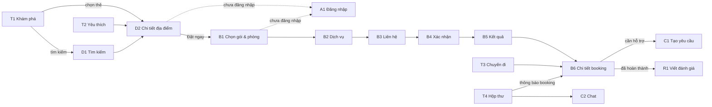

# Đặc tả các trang giao diện

Tài liệu này liệt kê các trang cần có cho Travelling App và nghiệp vụ của từng trang: trang dùng để làm gì, hiển thị gì, gọi API nào, người dùng thao tác gì và hệ thống phản hồi ra sao. Các API đều đã có trong backend (`be/src/routes`); trang nào cần API chưa có sẽ được ghi rõ.

Luồng nghiệp vụ xuyên nhiều trang (đặt chỗ, thanh toán, hủy, đánh giá, đăng tin...) và danh sách mã lỗi nằm ở [luong-nghiep-vu.md](../01-dac-ta/luong-nghiep-vu.md). Cách dựng **một codebase cho cả Web và Mobile** (bố cục, breakpoint, file `.web.tsx`) nằm ở [frontend-web-mobile.md](../03-trien-khai/frontend-web-mobile.md); mỗi trang dưới đây có thêm dòng **Web / Mobile** ghi điểm khác nhau giữa hai nền tảng.

## 1. Cách đọc tài liệu

Mỗi trang được mô tả theo cùng một khung:

| Mục | Nội dung |
|---|---|
| **Route** | File trong `fe/src/app/` (Expo Router) |
| **Ai dùng** | Guest (chưa đăng nhập), User, Owner (chủ địa điểm), Staff, Admin |
| **Web / Mobile** | Điểm khác nhau về bố cục giữa hai nền tảng (nếu có) |
| **Ưu tiên** | **MVP**: bắt buộc để demo luồng chính · **P2**: nên có · **P3**: mở rộng |
| **Hiển thị** | Thành phần trên màn hình |
| **API** | Endpoint backend cần gọi |
| **Thao tác** | Hành động của người dùng → kết quả |
| **Trạng thái** | Loading / rỗng / lỗi cần xử lý |
| **Quy tắc** | Business rule áp dụng (BR-xx trong `docs/Mô tả hệ thống.docx`) |

Mọi trang có gọi API đều phải có đủ 3 trạng thái **đang tải, rỗng, lỗi** (Definition of Done trong [huong-dan-react-native-expo.md](../tham-khao/huong-dan-react-native-expo.md)).

## 2. Sơ đồ trang (sitemap)

```text
fe/src/app/
├── _layout.tsx                      Stack gốc: provider, khôi phục phiên đăng nhập
│
├── (tabs)/                          5 tab chính
│   ├── _layout.tsx
│   ├── index.tsx                    T1  Khám phá (trang chủ)
│   ├── favorites.tsx                T2  Yêu thích
│   ├── bookings.tsx                 T3  Chuyến đi của tôi
│   ├── inbox.tsx                    T4  Hộp thư (thông báo + chat CSKH)
│   └── profile.tsx                  T5  Tài khoản
│
├── (auth)/
│   ├── login.tsx                    A1  Đăng nhập
│   ├── register.tsx                 A2  Đăng ký
│   ├── forgot-password.tsx          A3  Quên mật khẩu
│   ├── reset-password.tsx           A4  Đặt mật khẩu mới (mở từ link email)
│   └── verify-email.tsx             A5  Xác thực email (mở từ link email)
│
├── search.tsx                       D1  Kết quả tìm kiếm + bộ lọc
├── destinations/
│   ├── [slug].tsx                   D2  Chi tiết địa điểm
│   └── [slug]/reviews.tsx           D3  Tất cả đánh giá
│
├── booking/                         Luồng đặt chỗ nhiều bước
│   ├── _layout.tsx                  (Stack + thanh tiến trình bước 1/4)
│   ├── options.tsx                  B1  Chọn gói, ngày, phòng, số khách
│   ├── services.tsx                 B2  Chọn dịch vụ bổ sung
│   ├── contact.tsx                  B3  Thông tin liên hệ + voucher + phương thức thanh toán
│   ├── review.tsx                   B4  Xác nhận đơn
│   └── result.tsx                   B5  Kết quả đặt chỗ / thanh toán
│
├── bookings/[id].tsx                B6  Chi tiết booking (thanh toán, hủy, đánh giá)
├── reviews/new.tsx                  R1  Viết / sửa đánh giá
├── conversations/
│   ├── new.tsx                      C1  Tạo yêu cầu hỗ trợ
│   └── [id].tsx                     C2  Màn hình chat
│
├── profile/
│   ├── edit.tsx                     P1  Sửa hồ sơ
│   ├── password.tsx                 P2  Đổi mật khẩu
│   ├── reviews.tsx                  P3  Đánh giá của tôi
│   ├── partner.tsx                  P4  Trở thành đối tác / trạng thái hồ sơ
│   └── sessions.tsx                 P5  Thiết bị đang đăng nhập
│
├── owner/                           Khu chủ địa điểm (ưu tiên Web, có bản Mobile rút gọn)
│   ├── _layout.tsx                  Chặn role OWNER, sidebar (web) / stack (mobile)
│   ├── index.tsx                    O1  Dashboard của chủ
│   ├── destinations/index.tsx       O2  Tin đăng của tôi
│   ├── destinations/[id].tsx        O3  Tạo / sửa tin: thông tin, phòng, gói, dịch vụ
│   ├── destinations/[id]/status.tsx O4  Trạng thái duyệt, xem trước, đánh giá của khách
│   ├── profile.tsx                  O5  Hồ sơ đối tác & tài khoản nhận tiền
│   ├── bookings/index.tsx           O6  Booking tại cơ sở của tôi
│   ├── bookings/[id].tsx            O7  Xử lý booking
│   └── payouts.tsx                  O8  Đối soát: tiền chưa đối soát, các kỳ đã nhận
│
└── admin/                           Khu quản trị (ưu tiên chạy trên Web)
    ├── _layout.tsx                  Chặn theo role STAFF/ADMIN, sidebar
    ├── index.tsx                    M1  Tổng quan
    ├── bookings/index.tsx           M2  Quản lý booking
    ├── bookings/[id].tsx            M3  Xử lý booking
    ├── reviews.tsx                  M4  Kiểm duyệt đánh giá
    ├── support/index.tsx            M5  Hàng đợi CSKH
    ├── support/[id].tsx             M6  Trả lời khách
    ├── destinations/index.tsx       M7  Danh sách địa điểm          (ADMIN)
    ├── destinations/[id].tsx        M8  Thêm / sửa địa điểm, gói, phòng, dịch vụ (ADMIN)
    ├── catalog.tsx                  M9  Danh mục & tiện ích         (ADMIN)
    ├── vouchers.tsx                 M10 Mã giảm giá                 (ADMIN)
    ├── users.tsx                    M11 Quản lý người dùng
    ├── partners.tsx                 M12 Hồ sơ đối tác: duyệt, hoa hồng, tạm ngưng (ADMIN)
    ├── listings.tsx                 M13 Duyệt tin đăng địa điểm     (ADMIN)
    ├── payouts.tsx                  M14 Đối soát, chuyển tiền cho chủ (ADMIN)
    └── audit-logs.tsx               M15 Nhật ký quản trị            (ADMIN)
```

Nhóm `(tabs)` và `(auth)` trong ngoặc là route group của Expo Router: không xuất hiện trong URL, chỉ để gom layout.

### Điều hướng tổng quát



## 3. Trang dành cho khách (Guest / User)

### T1 – Khám phá (trang chủ)

- **Route:** `(tabs)/index.tsx` · **Ai dùng:** tất cả · **Ưu tiên:** MVP
- **Mục đích:** điểm bắt đầu khám phá; hiển thị nội dung theo mục 5 – Bước 1 của tài liệu nghiệp vụ.

**Hiển thị**

1. Lời chào (có tên nếu đã đăng nhập).
2. Ô tìm kiếm (chạm vào → mở D1).
3. Danh mục dạng chip cuộn ngang: Biển, Núi, Resort...
4. Băng chuyền "Nổi bật".
5. Danh sách "Phổ biến" và "Mới".
6. Badge số thông báo chưa đọc ở góc (nếu đã đăng nhập).

**API**

| Khối | Endpoint |
|---|---|
| Danh mục | `GET /api/categories` |
| Nổi bật | `GET /api/destinations?featured=true&sort=rating&limit=10` |
| Phổ biến | `GET /api/destinations?sort=popular&limit=10` |
| Mới | `GET /api/destinations?sort=newest&limit=10` |
| Badge | `GET /api/notifications/unread-count` (chỉ khi đã đăng nhập) |

**Thao tác**

| Người dùng | Hệ thống |
|---|---|
| Chạm ô tìm kiếm | Mở D1 với bàn phím bật sẵn |
| Chạm chip danh mục | Mở D1 với `categoryId` đã chọn |
| Chạm thẻ địa điểm | Mở D2 theo `slug` |
| Kéo xuống | Tải lại toàn bộ khối |

**Trạng thái:** mỗi khối có skeleton/loading riêng; một khối lỗi không làm hỏng cả trang (hiện nút "Thử lại" trong khối đó).

**Thẻ địa điểm** (dùng lại ở T1, T2, D1): ảnh, danh mục · khu vực, tên, sao + số đánh giá (hoặc "Chưa có đánh giá"), "Từ {minPrice}đ".

---

### D1 – Tìm kiếm và lọc

- **Route:** `search.tsx` · **Ai dùng:** tất cả · **Ưu tiên:** MVP
- **Mục đích:** mục 5 – Bước 2 và 3: tìm theo từ khóa, lọc, sắp xếp.

**Hiển thị:** ô tìm kiếm, nút "Bộ lọc" (kèm số bộ lọc đang bật), dòng "N kết quả", menu sắp xếp, danh sách thẻ địa điểm cuộn vô hạn.

**Bộ lọc** (bottom sheet trên mobile, cột bên trái trên web):

| Bộ lọc | Tham số API | Điều khiển gợi ý |
|---|---|---|
| Từ khóa | `q` | Ô nhập (tìm trong tên, khu vực, địa chỉ, tên danh mục) |
| Danh mục | `categoryId` | Chip chọn một |
| Khu vực | `location` | Ô nhập hoặc danh sách gợi ý |
| Khoảng giá | `minPrice`, `maxPrice` | Thanh trượt hai đầu |
| Rating tối thiểu | `minRating` | 3+ / 4+ / 4.5+ sao |
| Tiện ích | `facilityIds=1,2` | Checkbox (lấy từ `GET /api/facilities`) |
| Sắp xếp | `sort` = `popular` / `rating` / `price_asc` / `price_desc` / `newest` | Menu |

**API:** `GET /api/destinations?{bộ lọc}&page={n}&limit=20`; dùng `meta.totalPages` để biết còn trang tiếp không.

**Thao tác**

| Người dùng | Hệ thống |
|---|---|
| Gõ từ khóa | Chờ ngừng gõ ~400 ms (debounce) rồi mới gọi API |
| Áp dụng bộ lọc | Quay về trang 1, gọi lại API |
| Cuộn tới cuối | Tải trang kế tiếp, nối vào danh sách |
| "Xóa bộ lọc" | Đặt lại mặc định |

**Trạng thái rỗng:** "Không tìm thấy địa điểm phù hợp" + nút "Xóa bộ lọc".

---

### D2 – Chi tiết địa điểm

- **Route:** `destinations/[slug].tsx` · **Ai dùng:** tất cả · **Ưu tiên:** MVP
- **Mục đích:** mục 5 – Bước 4: mọi thông tin để khách quyết định đặt.

**Hiển thị** (theo thứ tự cuộn)

1. Thư viện ảnh vuốt ngang (`images`, nếu trống dùng `imageUrl`); nút quay lại, nút ♥, nút chia sẻ.
2. Tên, danh mục, khu vực, sao + số đánh giá.
3. Mô tả (thu gọn, "Xem thêm").
4. Tiện ích: lưới icon + tên.
5. **Các gói dịch vụ:** thẻ gồm tên, "3 ngày 2 đêm", quyền lợi (`inclusions`), giá, "Hủy miễn phí trước {freeCancellationHours} giờ".
6. **Loại phòng:** tên, sức chứa, giá/đêm.
7. Dịch vụ bổ sung có thu phí: tên, giá, đơn vị (/lượt, /khách, /đêm).
8. Địa chỉ + bản đồ (`latitude`, `longitude`); chạm để mở Google Maps.
9. Chính sách (`policy`) và liên hệ (`contactPhone` chạm để gọi, `contactEmail`).
10. 5 đánh giá mới nhất (`latestReviews`) + "Xem tất cả" → D3.
11. **Thanh cố định đáy:** "Từ {minPrice}đ" + nút **Đặt ngay**.

**API:** `GET /api/destinations/{slug}` (gửi kèm token nếu có để nhận đúng `isFavorite`).

**Thao tác**

| Người dùng | Hệ thống |
|---|---|
| Chạm ♥ khi chưa đăng nhập | Mở A1, đăng nhập xong quay lại D2 (BR-01) |
| Chạm ♥ khi đã đăng nhập | `POST /api/favorites/{id}/toggle`; đổi icon ngay (optimistic), lỗi thì hoàn tác |
| Chạm một thẻ gói | Mở B1 với gói đó được chọn sẵn |
| **Đặt ngay** | Mở B1 với gói rẻ nhất được chọn sẵn |

**Trạng thái:** 404 → "Địa điểm không tồn tại hoặc đã ngừng hoạt động" + nút về trang chủ.

---

### D3 – Tất cả đánh giá

- **Route:** `destinations/[slug]/reviews.tsx` · **Ai dùng:** tất cả · **Ưu tiên:** P2
- **Hiển thị:** điểm trung bình lớn, tổng số đánh giá, danh sách (avatar, tên, sao, ngày, nội dung, ảnh thu nhỏ – chạm để xem lớn), cuộn vô hạn.
- **API:** `GET /api/destinations/{id}/reviews?page=&limit=`
- **Quy tắc:** chỉ review đã được duyệt (`APPROVED`) mới hiện ở đây.
- **Đề xuất API bổ sung:** biểu đồ phân bố 1–5 sao cần endpoint thống kê (chưa có).

---

### T2 – Yêu thích

- **Route:** `(tabs)/favorites.tsx` · **Ai dùng:** User · **Ưu tiên:** MVP
- **Mục đích:** mục 7: xem lại địa điểm đã lưu.
- **Hiển thị:** danh sách thẻ địa điểm; mỗi thẻ có nút ♥ đầy để bỏ yêu thích.
- **API:** `GET /api/favorites`; bỏ yêu thích: `POST /api/favorites/{destinationId}/toggle`.

| Người dùng | Hệ thống |
|---|---|
| Chưa đăng nhập mở tab | "Đăng nhập để lưu địa điểm yêu thích" + nút Đăng nhập |
| Chạm ♥ trên thẻ | Gỡ thẻ khỏi danh sách; hiện snackbar "Đã bỏ yêu thích · Hoàn tác" |
| Chạm thẻ | Mở D2 |

**Rỗng:** "Bạn chưa có địa điểm yêu thích" + nút "Khám phá ngay" → T1.
**Quy tắc:** BR-01, BR-03. Địa điểm đã bị admin ẩn sẽ tự biến mất khỏi danh sách.

---

### T3 – Chuyến đi của tôi

- **Route:** `(tabs)/bookings.tsx` · **Ai dùng:** User · **Ưu tiên:** MVP
- **Mục đích:** mục 15: "My Booking / Lịch sử đặt".
- **Hiển thị:** tab con lọc theo trạng thái: **Sắp tới** (`PENDING` + `CONFIRMED`) · **Đã hoàn thành** · **Đã hủy**. Mỗi dòng: mã booking, badge trạng thái, ảnh + tên địa điểm, gói · phòng × số phòng, ngày nhận → trả, số khách, tổng tiền.
- **API:** `GET /api/bookings?status={PENDING|CONFIRMED|COMPLETED|CANCELLED}&page=`
  - Tab "Sắp tới" gọi 2 lần (PENDING và CONFIRMED) rồi ghép, hoặc đề xuất backend nhận nhiều status.

**Badge gợi ý**

| Trạng thái | Nhãn | Màu |
|---|---|---|
| `PENDING` + `UNPAID` online | Chờ thanh toán | Cam |
| `PENDING` + trả tại nơi ở | Chờ xác nhận | Vàng |
| `CONFIRMED` | Đã xác nhận | Xanh lá |
| `COMPLETED` | Đã hoàn thành | Xanh dương |
| `CANCELLED` | Đã hủy | Xám |

**Thao tác:** chạm một dòng → B6. Booking `COMPLETED` chưa có `review` hiện thêm nút nhỏ "Đánh giá" → R1.
**Rỗng:** "Bạn chưa có chuyến đi nào" + "Khám phá ngay".

---

### B1 – Chọn gói, ngày, phòng, số khách

- **Route:** `booking/options.tsx` · **Ai dùng:** User (Guest vẫn xem được giá) · **Ưu tiên:** MVP
- **Mục đích:** mục 8–10: chọn gói, loại phòng, ngày nhận/trả, số khách, số phòng.

**Hiển thị**

1. Tên địa điểm (nhỏ, trên cùng) + thanh tiến trình "Bước 1/4".
2. Chọn gói (radio card).
3. Chọn ngày nhận và ngày trả (date picker; gợi ý ngày trả = ngày nhận + số đêm của gói).
4. Chọn loại phòng (radio card), kèm "Còn {availableRooms} phòng".
5. Bộ đếm số khách và số phòng (+/−).
6. Nếu khoảng ở có giá mùa (`nightlyRoomPrices[].rateName` trong báo giá): nhãn "Có 2 đêm giá Tết (800.000đ/đêm)" dưới loại phòng; lịch chọn ngày tô màu các ngày có giá mùa (`roomTypes[].rates` trong D2).
6. Thanh đáy: tạm tính + nút **Tiếp tục**.

**API**

| Mục đích | Endpoint |
|---|---|
| Dữ liệu gói/phòng | Lấy lại từ D2 (cache) hoặc `GET /api/destinations/{slug}` |
| Còn phòng | `GET /api/destinations/{id}/availability?roomTypeId=&checkInDate=&checkOutDate=` |
| Tạm tính | `POST /api/bookings/quote` mỗi khi đổi lựa chọn (debounce) |

**Kiểm tra trên giao diện** (backend kiểm tra lại lần nữa)

- Ngày nhận không ở quá khứ; ngày trả sau ngày nhận; tối đa 30 đêm.
- Số đêm ≥ số đêm của gói (gói 3N2Đ phải ở ít nhất 2 đêm).
- Số khách ≤ sức chứa phòng × số phòng → nếu vượt, gợi ý tăng số phòng.
- Loại phòng hết chỗ → làm mờ, ghi "Hết phòng".

**Thao tác:** **Tiếp tục** khi chưa đăng nhập → A1 rồi quay lại; đã đăng nhập → B2.
**Quy tắc:** BR-04 (không đặt quá số phòng còn trống).

Các lựa chọn của B1–B4 nên lưu trong một store tạm (ví dụ Zustand `booking-draft-store`) để quay lại bước trước không mất dữ liệu.

---

### B2 – Chọn dịch vụ bổ sung

- **Route:** `booking/services.tsx` · **Ai dùng:** User · **Ưu tiên:** MVP
- **Hiển thị:** danh sách `services` của địa điểm; mỗi dòng có checkbox, tên, giá + đơn vị, bộ đếm số lượng (khi được chọn), thành tiền của dòng. Thanh đáy: tạm tính cập nhật + **Tiếp tục** / "Bỏ qua".
- **API:** `POST /api/bookings/quote` với `services: [{ addonServiceId, quantity }]`.
- **Cách tính thành tiền** (hiển thị cho khách hiểu):
  - `PER_BOOKING`: giá × số lượng
  - `PER_GUEST`: giá × số khách × số lượng
  - `PER_NIGHT`: giá × số đêm × số lượng

---

### B3 – Thông tin liên hệ, voucher, phương thức thanh toán

- **Route:** `booking/contact.tsx` · **Ai dùng:** User · **Ưu tiên:** MVP

**Hiển thị**

1. Họ tên, số điện thoại, email người lưu trú (điền sẵn từ hồ sơ, sửa được).
2. Ghi chú (tùy chọn, tối đa 1000 ký tự).
3. Ô mã giảm giá + nút "Áp dụng".
4. Phương thức thanh toán: **Thanh toán online** (`ONLINE_MOCK`) / **Trả tại nơi lưu trú** (`PAY_AT_PROPERTY`).

**Kiểm tra:** họ tên ≥ 2 ký tự; số điện thoại dạng `0xxxxxxxxx` hoặc `+84...`; email hợp lệ.

**Voucher:** "Áp dụng" gọi `POST /api/bookings/quote` có `voucherCode`:

| Kết quả | Hiển thị |
|---|---|
| Thành công | Dòng "Giảm giá −{discountAmount}đ" màu xanh |
| `INVALID_VOUCHER` | "Mã không tồn tại hoặc đã hết hạn" |
| `VOUCHER_EXHAUSTED` | "Mã đã hết lượt sử dụng" |
| `VOUCHER_MIN_ORDER` | Hiện nguyên `message` từ API (có số tiền tối thiểu) |

---

### B4 – Xác nhận đơn

- **Route:** `booking/review.tsx` · **Ai dùng:** User · **Ưu tiên:** MVP
- **Mục đích:** mục 12: khách xem lại toàn bộ trước khi đặt.

**Hiển thị** – hóa đơn theo đúng công thức mục 11 của tài liệu nghiệp vụ:

```text
Đà Lạt Pine Hill Resort
Gói Premium · Deluxe Room × 1 · 2 khách
Nhận 20/11/2026 → Trả 22/11/2026 (2 đêm)
---------------------------------------------
Gói Premium                       2.000.000đ
Phòng (500.000đ × 2 đêm × 1)      1.000.000đ
Đưa đón sân bay                     200.000đ
---------------------------------------------
Tạm tính                          3.200.000đ
Giảm giá (WELCOME10)               −200.000đ
Thuế/phí (8%)                       240.000đ
---------------------------------------------
Tổng cộng                         3.240.000đ
```

Kèm thông tin liên hệ, phương thức thanh toán, chính sách hủy của gói, checkbox "Tôi đồng ý với chính sách", nút **Đặt ngay** (rộng hết thanh đáy, căn giữa).

**API:** `POST /api/bookings` (body = toàn bộ lựa chọn B1–B3).

| Kết quả | Xử lý |
|---|---|
| 201 | Xóa store tạm; `ONLINE_MOCK` → chuyển sang thanh toán; `PAY_AT_PROPERTY` → B5 |
| 409 `NOT_AVAILABLE` | "Dịch vụ không còn khả dụng trong khoảng thời gian bạn chọn" + nút quay về B1 chọn lại |
| 400 | Hiện lỗi, quay lại bước có trường sai |

Nút **Đặt ngay** phải bị khóa trong lúc chờ API để khách không bấm hai lần tạo hai booking.

---

### B5 – Cổng thanh toán giả lập / kết quả đặt chỗ

- **Route:** `booking/result.tsx?bookingId=` · **Ai dùng:** User · **Ưu tiên:** MVP
- **Mục đích:** mục 13–14. Đặc tả nghiệp vụ: [thanh-toan-gia-lap.md](../01-dac-ta/thanh-toan-gia-lap.md).
- **Web / Mobile:** web hiển thị hai cột (tóm tắt đơn bên trái, cổng thanh toán bên phải); mobile xếp dọc, nút thanh toán cố định đáy.

**Với `ONLINE_MOCK`** – cổng thanh toán giả lập:

1. Dải cảnh báo nhỏ: "Môi trường thử nghiệm – không phát sinh giao dịch thật".
2. Mã booking, tổng tiền, **đồng hồ đếm ngược** tới `paymentDueAt` ("Giữ chỗ trong 14:32").
3. Chọn kênh: **Thẻ** (`CARD`) · **Ví điện tử** (`EWALLET`, hiện ảnh QR minh họa) · **Chuyển khoản** (`BANK_TRANSFER`, hiện nội dung chuyển khoản = mã booking).
4. Nút **Thanh toán** và nút phụ "Mô phỏng thất bại" (để demo).
5. **Không có ô nhập số thẻ, CVV, OTP** – kể cả dữ liệu giả.

| Thao tác | API | Kết quả |
|---|---|---|
| Thanh toán | `POST /api/bookings/{id}/pay` `{ "channel": "EWALLET" }` | 200 → "Thanh toán thành công, booking đã được xác nhận" ✓ |
| Mô phỏng thất bại | `{ "channel": "CARD", "simulateFailure": true }` | 402 `PAYMENT_FAILED` → "Thanh toán thất bại" + "Thử lại" (còn trong hạn) |
| Hết giờ đếm ngược | (không gọi) | Khóa nút, hiện "Đã hết thời gian giữ chỗ" + nút "Đặt lại" → D2 |
| Thanh toán sau hạn | | 409 `PAYMENT_EXPIRED` → như trên |

**Với `PAY_AT_PROPERTY`:** "Đặt chỗ thành công – đang chờ cơ sở xác nhận" + mã booking. Không có đồng hồ.

Cả hai có nút "Xem booking" → B6 và "Về trang chủ". Nút back của hệ thống không được quay lại B4 (dùng `router.replace`).

---

### B6 – Chi tiết booking

- **Route:** `bookings/[id].tsx` · **Ai dùng:** User (chủ booking) · **Ưu tiên:** MVP
- **Hiển thị:** mã booking (chạm để sao chép), badge trạng thái, dòng thời gian (Đặt → Thanh toán → Xác nhận → Hoàn thành, hoặc → Hủy), thông tin địa điểm, gói, phòng, ngày, khách, hóa đơn chi tiết (`services`, `discountAmount`, `taxAmount`, `totalAmount`), thanh toán (`payment.method`, `payment.status`, `paidAt`), thông tin liên hệ, ghi chú.
- **API:** `GET /api/bookings/{id}`

**Nút hành động theo trạng thái**

| Điều kiện | Nút | API |
|---|---|---|
| `PENDING` + `ONLINE_MOCK` + chưa `PAID` | Thanh toán ngay | → B5 |
| `PENDING` hoặc `CONFIRMED`, trước giờ nhận phòng | Hủy booking | `POST /api/bookings/{id}/cancel` `{ reason }` |
| `COMPLETED` và `review = null` | Viết đánh giá | → R1 |
| `COMPLETED` và đã có review | Xem / sửa đánh giá | → R1 |
| Mọi trạng thái | Liên hệ CSKH | → C1 (gắn sẵn `bookingId`) |

**Hủy booking:** hộp thoại xác nhận hiển thị chính sách và ô lý do.

- Booking `CONFIRMED` đã thanh toán: báo trước "Khoản thanh toán sẽ được hoàn lại".
- Gần giờ nhận phòng hơn `freeCancellationHours`: nên ẩn hoặc làm mờ nút hủy, ghi "Đã quá hạn hủy miễn phí, vui lòng liên hệ CSKH". Nếu vẫn gọi, API trả 409 `CANCELLATION_NOT_ALLOWED`.

**Quy tắc:** BR-05, BR-06, BR-07, BR-10 (booking của người khác trả 404).

---

### R1 – Viết / sửa đánh giá

- **Route:** `reviews/new.tsx?bookingId=` (sửa: `?reviewId=`) · **Ai dùng:** User · **Ưu tiên:** MVP
- **Mục đích:** mục 16.
- **Hiển thị:** tên địa điểm + ngày đi, chọn 1–5 sao (bắt buộc), ô nhận xét (tối đa 2000 ký tự, có bộ đếm), **tối đa 5 ảnh** (nút + Thêm ảnh, xem trước, xóa), nút **Gửi**.
- **Ảnh:** chọn bằng `expo-image-picker`, nén về cạnh dài ≤ 1600px bằng `expo-image-manipulator`, tải từng ảnh qua `POST /api/uploads` (`multipart/form-data`, purpose `review`), giữ `url` trả về; gửi kèm `imageUrls` khi tạo/sửa đánh giá.
- **API:** tạo `POST /api/reviews` `{ bookingId, rating, comment }`; sửa `PATCH /api/reviews/{id}`; xóa `DELETE /api/reviews/{id}`.

| Kết quả | Hiển thị |
|---|---|
| 201 | "Cảm ơn bạn! Đánh giá sẽ hiển thị sau khi được duyệt" |
| 409 `BOOKING_NOT_COMPLETED` | "Chỉ đánh giá được sau khi hoàn thành chuyến đi" |
| 409 `ALREADY_REVIEWED` | Chuyển sang chế độ sửa |

**Quy tắc:** BR-02, BR-08. Sửa review sẽ đưa nó về trạng thái chờ duyệt lại; nên ghi chú cho khách biết.

---

### T4 – Hộp thư

- **Route:** `(tabs)/inbox.tsx` · **Ai dùng:** User · **Ưu tiên:** MVP (Thông báo), P2 (Hỗ trợ)
- **Hiển thị:** 2 tab con.

**Tab "Thông báo"** (mục 18)

- Danh sách: icon theo `type`, tiêu đề, nội dung, thời gian tương đối ("5 phút trước"); thông báo chưa đọc có nền đậm.
- **API:** `GET /api/notifications?page=`; chạm một thông báo: `PATCH /api/notifications/{id}/read`; nút "Đánh dấu tất cả đã đọc": `PATCH /api/notifications/read-all`.
- **Điều hướng theo `data`:** có `bookingId` → B6; có `conversationId` → C2; có `destinationId` → D2.

**Tab "Hỗ trợ"** (mục 17)

- Danh sách hội thoại: tiêu đề, tin nhắn cuối, thời gian, trạng thái Mở/Đã đóng.
- **API:** `GET /api/conversations`. Nút "+ Yêu cầu hỗ trợ" → C1.

---

### C1 – Tạo yêu cầu hỗ trợ

- **Route:** `conversations/new.tsx?bookingId=` · **Ai dùng:** User · **Ưu tiên:** P2
- **Hiển thị:** chủ đề (gợi ý nhanh: "Thay đổi booking", "Thanh toán", "Hoàn tiền", "Khác"), chọn booking liên quan (tùy chọn), nội dung tin nhắn đầu tiên.
- **API:** `POST /api/conversations` `{ subject, content, bookingId? }` → mở C2.

### C2 – Màn hình chat

- **Route:** `conversations/[id].tsx` · **Ai dùng:** User, Staff · **Ưu tiên:** P2
- **Hiển thị:** bong bóng tin nhắn (của mình bên phải, của CSKH bên trái kèm tên), ô nhập + nút gửi; hội thoại đã đóng thì ẩn ô nhập và ghi "Cuộc trò chuyện đã kết thúc".
- **API:**
  - Tải tin: `GET /api/conversations/{id}/messages`
  - Lấy tin mới: gọi lại mỗi 5 giây với `?after={id tin cuối}` khi màn hình đang mở (polling)
  - Gửi: `POST /api/conversations/{id}/messages` `{ content }`
- **Trạng thái:** 409 `CONVERSATION_CLOSED` → khóa ô nhập.
- **Nâng cấp sau:** chuyển polling sang WebSocket (Socket.IO) để tin đến tức thì.

---

### T5 – Tài khoản

- **Route:** `(tabs)/profile.tsx` · **Ai dùng:** tất cả · **Ưu tiên:** MVP

**Chưa đăng nhập:** lời mời + nút **Đăng nhập** (A1) và **Tạo tài khoản** (A2).

**Đã đăng nhập:**

1. Avatar, tên, email, vai trò.
2. Menu: Sửa hồ sơ (P1) · Đổi mật khẩu (P2) · Đánh giá của tôi (P3) · Địa điểm yêu thích (T2) · Hỗ trợ (T4).
3. Theo vai trò:

| Role | Mục thêm |
|---|---|
| `USER` | **Trở thành đối tác** → P4 (nếu đã nộp: hiện trạng thái hồ sơ) |
| `OWNER` | **Quản lý cơ sở** → O1 |
| `STAFF` / `ADMIN` | **Trang quản trị** → M1 |

4. Nếu `emailVerifiedAt = null`: dải vàng "Xác thực email để trở thành đối tác" + nút **Gửi lại email** (`POST /api/auth/resend-verification`).
5. Mục **Thiết bị đang đăng nhập** → P5.
6. Nút **Đăng xuất**: `POST /api/auth/logout { refreshToken }`, `DELETE /api/devices { token }`, xóa token, xóa cache dữ liệu cá nhân, về T1.

**API:** `GET /api/auth/me`; với USER thêm `GET /api/partners/me` (404 = chưa nộp hồ sơ).

---

### A1 – Đăng nhập

- **Route:** `(auth)/login.tsx?redirect=` · **Ai dùng:** Guest · **Ưu tiên:** MVP
- **Hiển thị:** email, mật khẩu (nút hiện/ẩn), nút **Đăng nhập**, link **Quên mật khẩu?** → A3, link "Chưa có tài khoản? Đăng ký".
- **API:** `POST /api/auth/login` `{ email, password, deviceName }` → lưu `accessToken` và `refreshToken` (SecureStore trên mobile, localStorage trên web) và `user`. `deviceName` lấy từ `expo-device` (ví dụ "Samsung Galaxy A54") để hiện ở P5.

| Kết quả | Xử lý |
|---|---|
| 200 | Quay về trang trong `redirect` (hoặc T1) |
| 401 `INVALID_CREDENTIALS` | "Email hoặc mật khẩu không đúng" (không nói rõ sai cái nào) |
| 403 | "Tài khoản đã bị khóa, vui lòng liên hệ CSKH" |
| 429 `TOO_MANY_REQUESTS` | "Bạn thử quá nhiều lần, vui lòng thử lại sau" |

### A3 – Quên mật khẩu · A4 – Đặt mật khẩu mới · A5 – Xác thực email

| Trang | Ưu tiên | Hiển thị | API | Sau khi xong |
|---|---|---|---|---|
| A3 `(auth)/forgot-password.tsx` | P2 | Ô email + nút Gửi link | `POST /api/auth/forgot-password` | Luôn hiện "Nếu email đã đăng ký, bạn sẽ nhận được link..." (không nói email có tồn tại không) |
| A4 `(auth)/reset-password.tsx?token=` | P2 | Mật khẩu mới, nhập lại | `POST /api/auth/reset-password` | "Đã đổi mật khẩu" → A1; lỗi `INVALID_TOKEN` → "Link hết hạn" + nút về A3 |
| A5 `(auth)/verify-email.tsx?token=` | P2 | Tự gọi API khi mở trang, hiện đang xác thực / thành công / thất bại | `POST /api/auth/verify-email` | Thành công → T5; lỗi → nút Gửi lại (nếu đã đăng nhập) |

Link trong email trỏ tới `APP_URL/reset-password?token=...` và `APP_URL/verify-email?token=...`, nên route phải đúng các đường dẫn này. Khi dev, token có sẵn trong response (`devResetToken`, `devVerificationToken`) và trong log của API.

### A2 – Đăng ký

- **Route:** `(auth)/register.tsx` · **Ai dùng:** Guest · **Ưu tiên:** MVP
- **Mục đích:** mục 6: nhập thông tin → kiểm tra → kiểm tra email trùng → mã hóa mật khẩu → tạo tài khoản → thông báo thành công.
- **Web / Mobile:** web là form một cột rộng tối đa 480px giữa màn hình; mobile toàn màn hình, bàn phím không che nút (dùng `KeyboardAvoidingView`).

**Hiển thị** – đánh dấu `*` cho trường bắt buộc (quy tắc chi tiết: [tai-khoan-va-dang-ky.md](../01-dac-ta/tai-khoan-va-dang-ky.md)):

| Ô | Bắt buộc | Kiểm tra trên giao diện |
|---|---|---|
| Họ tên * | ✓ | 2–100 ký tự |
| Email * | ✓ | Định dạng email; bàn phím email; không tự viết hoa |
| Mật khẩu * | ✓ | 8–72 ký tự, có chữ và số; hiện thanh độ mạnh |
| Nhập lại mật khẩu * | ✓ | Trùng mật khẩu (chỉ kiểm tra ở giao diện) |
| Số điện thoại | | `0xxxxxxxxx` / `+84...` |
| Ngày sinh | | Date picker, không chọn ngày tương lai |
| ☐ Tôi đồng ý Điều khoản sử dụng và Chính sách bảo mật * | ✓ | Nút **Đăng ký** khóa tới khi tích |

- **API:** `POST /api/auth/register` `{ name, email, password, phone?, dateOfBirth?, acceptTerms: true }` → trả về `token` luôn, nên đăng nhập tự động sau khi đăng ký.
- **Lỗi:** 409 `EMAIL_TAKEN` → báo dưới ô email "Email đã được sử dụng"; 400 → hiển thị `details[].message` dưới đúng ô theo `details[].path`.

### P1 – Sửa hồ sơ · P2 – Đổi mật khẩu · P3 – Đánh giá của tôi

| Trang | Ưu tiên | Hiển thị | API |
|---|---|---|---|
| P1 `profile/edit.tsx` | P2 | Tên, số điện thoại, ngày sinh, ảnh đại diện (chọn ảnh → tải lên → lưu URL; email không sửa được) | `POST /api/uploads` (purpose `avatar`) → `PATCH /api/auth/me { avatarUrl }` |
| P2 `profile/password.tsx` | P2 | Mật khẩu hiện tại, mật khẩu mới, nhập lại | `PATCH /api/auth/me/password` → **lưu phiên mới trong response** (thiết bị khác bị đăng xuất); 400 `INVALID_PASSWORD` → "Mật khẩu hiện tại không đúng" |
| P5 `profile/sessions.tsx` | P3 | Danh sách thiết bị: tên, trình duyệt/IP, lần dùng cuối; nút Đăng xuất từng thiết bị; nút Đăng xuất tất cả | `GET /api/auth/sessions`, `DELETE /api/auth/sessions/:id`, `POST /api/auth/logout-all` |
| P3 `profile/reviews.tsx` | P3 | Review của tôi kèm trạng thái: Chờ duyệt / Đã hiển thị / Bị từ chối + lý do | `GET /api/reviews/mine` |

### P4 – Trở thành đối tác

- **Route:** `profile/partner.tsx` · **Ai dùng:** User · **Ưu tiên:** MVP (cần để có chủ địa điểm)
- **Mục đích:** UC-U9 – nộp hồ sơ để đăng địa điểm lên sàn.
- **Web / Mobile:** web chia 2 cột (form bên trái, quyền lợi + mức hoa hồng bên phải); mobile form nhiều bước: Thông tin cơ sở → Tài khoản nhận tiền → Xác nhận.

**Theo trạng thái hồ sơ** (`GET /api/partners/me`):

| Trạng thái | Hiển thị |
|---|---|
| Chưa có (404) | Giới thiệu chương trình đối tác + form nộp hồ sơ |
| `PENDING` | "Hồ sơ đang được xét duyệt" + thông tin đã nộp; cho sửa thông tin ngân hàng (`PATCH /partners/me`) |
| `REJECTED` | Lý do từ chối + form đã điền sẵn để sửa và **Nộp lại** |
| `APPROVED` | "Bạn đã là đối tác" + nút **Vào trang quản lý** → O1 (sau khi gọi lại `GET /auth/me`) |
| `SUSPENDED` | "Tài khoản đối tác đang tạm ngưng, liên hệ CSKH" |

**Form** (`*` = bắt buộc): Tên cơ sở *, Địa chỉ kinh doanh *, SĐT liên hệ *, Mã số thuế, Giới thiệu, Ngân hàng, Số tài khoản, Chủ tài khoản, ☐ Đồng ý điều khoản đối tác * (hiển thị mức hoa hồng mặc định 15%). Ghi chú dưới phần ngân hàng: "Bắt buộc trước khi hồ sơ được duyệt".

**API:** `POST /api/partners/apply`. Lỗi: 403 `EMAIL_NOT_VERIFIED` (hiện dải xác thực email như T5, khóa nút Nộp), 409 `ALREADY_APPLIED`, 409 `INVALID_ROLE` (Staff/Admin không nộp).

## 4. Trang chủ địa điểm (Owner)

Khu `owner/` dành cho đối tác đã được duyệt. **Web là giao diện chính** (chủ thường quản lý trên máy tính: bảng, form dài, biểu đồ). **Mobile** có bản rút gọn để xử lý việc gấp: xem dashboard, xác nhận booking, bật/tắt nhận khách.

`owner/_layout.tsx`: chưa đăng nhập → A1; `role ≠ OWNER` → T5. Backend vẫn kiểm tra quyền và quyền sở hữu ở từng API.

| Bố cục | Web (≥ 1024px) | Mobile |
|---|---|---|
| Điều hướng | Sidebar trái: Tổng quan · Tin đăng · Booking · Hồ sơ đối tác | Stack mở từ T5 → "Quản lý cơ sở"; màn hình O1 có lưới nút tắt |
| Danh sách (O2, O6) | Bảng có cột, lọc, phân trang | Thẻ dọc, cuộn vô hạn |
| Form (O3) | Tab ngang: Thông tin · Phòng · Gói · Dịch vụ | Từng phần một màn hình, nút Lưu cố định đáy |

### O1 – Dashboard của chủ

- **Ưu tiên:** MVP
- **API:** `GET /api/stats/overview?from=&to=` (tự giới hạn theo địa điểm của chủ, `scope = OWNER`).

**Hiển thị**

1. Bộ chọn khoảng thời gian: 7 ngày · 30 ngày · Tháng này · Tùy chọn.
2. **Thẻ chỉ số:** Doanh thu của tôi (`ownerRevenue`) · Tổng giá trị booking (`grossBookingValue`) · Hoa hồng sàn (`platformRevenue`) · Số booking đã chốt · Tỷ lệ hủy · Đêm phòng đã bán · Điểm đánh giá TB (`rating`).
3. **Biểu đồ đường** doanh thu theo ngày (`revenueByDay[].ownerRevenue`) – trục X ngày, trục Y VNĐ.
4. **Việc cần làm:** "N booking chờ xác nhận" → O6 (lọc PENDING); "N lượt nhận phòng trong 7 ngày" → O6.
5. **Tin đăng:** số tin theo trạng thái (`listings`), tin bị từ chối hiện màu đỏ → O4.
6. **Tiền:** "Chưa đối soát: x đ (N booking)" và "Chờ sàn chuyển: y đ" (`payouts`) → O8.
6. **Top địa điểm** của tôi theo doanh thu.

**Rỗng:** chưa có tin đăng → "Đăng địa điểm đầu tiên" → O3.

### O2 – Tin đăng của tôi

- **Ưu tiên:** MVP · **API:** `GET /api/manage/destinations?listingStatus=&q=&page=`
- **Hiển thị:** ảnh, tên, khu vực, badge trạng thái duyệt (Nháp xám · Chờ duyệt vàng · Đã duyệt xanh · Bị từ chối đỏ), công tắc **Nhận khách** (`isActive`), số booking, rating; nút "+ Đăng địa điểm mới".
- **Thao tác:** công tắc → `PATCH /api/destinations/{id}` `{ isActive }`; chạm dòng → O3 (nháp/bị từ chối) hoặc O4 (đã duyệt/chờ duyệt).

### O3 – Tạo / sửa tin đăng

- **Ưu tiên:** MVP · **API đọc:** `GET /api/manage/destinations/{id}` (gồm cả phòng/gói/dịch vụ đang tắt)

| Tab | Trường | API ghi |
|---|---|---|
| Thông tin | Tên *, Khu vực *, danh mục, địa chỉ, tọa độ, mô tả, chính sách, liên hệ, ảnh (tải lên qua `POST /api/uploads` purpose `destination`, kéo để sắp thứ tự), tiện ích | `POST /api/destinations` (tạo nháp) · `PATCH /api/destinations/{id}` |
| Phòng | Tên, mô tả, sức chứa, giá/đêm, tổng số phòng, đang bán; mỗi phòng có mục **Giá theo mùa** (tên, từ ngày, đến ngày, giá/đêm) | `POST /api/room-types` · `PATCH /api/room-types/{id}` · `POST/PATCH/DELETE /api/room-types/{id}/rates` (409 `RATE_OVERLAP` khi trùng ngày) |
| Gói | Tên, mô tả, quyền lợi, số ngày/đêm, giá, giờ hủy miễn phí, đang bán | `POST /api/packages` · `PATCH /api/packages/{id}` |
| Dịch vụ | Tên, mô tả, giá, đơn vị tính, đang bán | `POST /api/addon-services` · `PATCH /api/addon-services/{id}` |

- **Thanh hành động:** **Lưu nháp** · **Xem trước** (mở D2 với token chủ) · **Gửi duyệt** (`POST /api/destinations/{id}/submit`).
- **Kiểm tra trước khi gửi:** checklist "Có ít nhất 1 phòng ✓ · 1 gói ✓ · có ảnh · có mô tả"; API trả 400 `LISTING_INCOMPLETE` nếu thiếu phòng/gói.
- Tin `REJECTED` hiện lý do từ chối ở đầu trang. Không có trường "Nổi bật" (chỉ admin).

### O4 – Trạng thái tin và đánh giá

- **Ưu tiên:** P2
- **Hiển thị:** dòng thời gian duyệt (tạo → gửi duyệt `submittedAt` → duyệt `approvedAt` / từ chối + lý do), link xem trang công khai, danh sách đánh giá của khách (`GET /api/destinations/{id}/reviews`).
- **Đề xuất API bổ sung:** chủ trả lời đánh giá.

### O5 – Hồ sơ đối tác

- **Ưu tiên:** P2 · **API:** `GET /api/partners/me`, `PATCH /api/partners/me`
- **Hiển thị:** thông tin cơ sở, tài khoản nhận tiền (che bớt số tài khoản: `•••• 3456`), tỷ lệ hoa hồng hiện tại (chỉ đọc), ngày được duyệt.

### O8 – Đối soát

- **Ưu tiên:** P2 · **API:** `GET /api/payouts/unsettled`, `GET /api/payouts`, `GET /api/payouts/{id}`
- **Hiển thị:** thẻ "Doanh thu chưa đối soát" (số booking, số tiền); bảng các kỳ: kỳ (từ → đến), số booking, tổng khách trả, hoa hồng, **số tiền nhận**, trạng thái (Chờ chuyển vàng · Đã chuyển xanh · Đã hủy xám), ngày chuyển, mã giao dịch. Chạm một kỳ → danh sách booking của kỳ và doanh thu từng booking.
- **Không có thao tác ghi:** sàn lập kỳ và chuyển tiền (M14).

### O6 – Booking tại cơ sở của tôi · O7 – Xử lý booking

- **Ưu tiên:** MVP
- **O6:** `GET /api/bookings?status=&code=&page=` (với OWNER mặc định `scope=managed` = booking tại địa điểm của mình). Bảng: mã, khách, địa điểm, nhận → trả, số khách, tổng tiền, **doanh thu của tôi** (`ownerRevenue`), thanh toán, trạng thái.
- **O7:** như B6 + thông tin liên hệ khách + phần "Doanh thu": tạm tính, giảm giá, hoa hồng (`commissionRate`, `commissionAmount`), doanh thu của tôi.

| Điều kiện | Nút | API |
|---|---|---|
| `PENDING` + trả tại nơi ở | Xác nhận | `PATCH /api/bookings/{id}/status` `{ "status": "CONFIRMED" }` |
| `PENDING` + online chưa trả | (khóa) "Chờ khách thanh toán – hết hạn lúc hh:mm" | |
| `CONFIRMED`, từ ngày nhận phòng | Hoàn thành | `{ "status": "COMPLETED" }` |
| `PENDING` / `CONFIRMED` | Hủy (**bắt buộc lý do**) | `POST /api/bookings/{id}/cancel` `{ reason }` |

Muốn xem booking mình đặt với tư cách khách, chủ dùng tab T3 (gọi `GET /api/bookings?scope=mine`).

## 5. Trang quản trị (Staff / Admin)

Khu `admin/` nên ưu tiên giao diện **web** (màn hình rộng, bảng dữ liệu, sidebar). Trên mobile vẫn dùng được nhưng có thể đơn giản hơn.

`admin/_layout.tsx` phải chặn theo vai trò: chưa đăng nhập → A1; `role = USER` → về T1. Đây chỉ là chặn ở giao diện; backend vẫn kiểm tra quyền ở từng API.

| Trang | STAFF | ADMIN |
|---|:---:|:---:|
| M1 Tổng quan | ✓ | ✓ |
| M2–M3 Booking | ✓ | ✓ |
| M4 Kiểm duyệt review | ✓ | ✓ |
| M5–M6 CSKH | ✓ | ✓ |
| M7–M8 Địa điểm, gói, phòng, dịch vụ | | ✓ |
| M9 Danh mục & tiện ích | | ✓ |
| M10 Voucher | | ✓ |
| M11 Người dùng | Xem | Xem, khóa/mở, đổi role |
| M12 Hồ sơ đối tác | | ✓ |
| M13 Duyệt tin đăng | | ✓ |
| M14 Đối soát | | ✓ |
| M15 Nhật ký quản trị | | ✓ |

### M1 – Dashboard toàn sàn

- **Ưu tiên:** MVP (Admin); Staff chỉ xem phần "Việc cần xử lý"
- **API:** `GET /api/stats/overview?from=&to=` (`scope = PLATFORM`). Staff không gọi được API này (403); trang của Staff dùng các API đếm ở M2, M4, M5.
- **Web / Mobile:** web lưới 4 cột thẻ chỉ số + 2 biểu đồ cạnh nhau; mobile 2 cột thẻ, biểu đồ xếp dọc, bảng top địa điểm thành danh sách.

**Hiển thị**

1. Bộ chọn khoảng thời gian (mặc định 30 ngày).
2. **Thẻ chỉ số:** Tổng giá trị booking (GBV) · **Doanh thu sàn** (hoa hồng) · Doanh thu trả đối tác · Booking đã chốt · Tỷ lệ hủy · Giá trị TB/booking · Người dùng mới · Đối tác đang hoạt động.
3. **Biểu đồ cột chồng** theo ngày: hoa hồng sàn + doanh thu đối tác (`revenueByDay`).
4. **Biểu đồ tròn / thanh ngang:** booking theo trạng thái (`bookingsByStatus`), theo phương thức thanh toán (`paymentMethods`).
5. **Bảng top 5 địa điểm** (`topDestinations`): tên, khu vực, số booking, GBV, hoa hồng, rating.
6. **Việc cần xử lý** (`pending`), mỗi thẻ có nút dẫn tới trang xử lý:

| Thẻ | Dẫn tới |
|---|---|
| Hồ sơ đối tác chờ duyệt | M12 |
| Tin đăng chờ duyệt | M13 |
| Đánh giá chờ duyệt | M4 |
| Booking trả tại nơi ở chờ xác nhận | M2 (lọc PENDING) |
| Hội thoại đang mở | M5 |

**Cách đọc số liệu** (ghi chú nhỏ dưới tiêu đề): doanh thu chỉ tính booking đã xác nhận/hoàn thành, theo ngày đặt.

### M2 – Quản lý booking · M3 – Xử lý booking

- **Ưu tiên:** MVP (cần có để chuyển booking sang `COMPLETED`, nếu không sẽ không demo được luồng review)
- **M2 hiển thị:** bảng gồm mã, khách, địa điểm, ngày nhận → trả, tổng tiền, thanh toán, trạng thái; lọc theo trạng thái, tìm theo mã.
  - **API:** `GET /api/bookings?status=&code=&page=` (Staff nhận tất cả booking).
- **M3 hiển thị:** như B6 cộng thêm thông tin khách (`user`).

**Nút hành động của Staff**

| Điều kiện | Nút | API |
|---|---|---|
| `PENDING` + trả tại nơi ở | Xác nhận | `PATCH /api/bookings/{id}/status` `{ "status": "CONFIRMED" }` |
| `PENDING` + online chưa trả | (khóa) "Chờ khách thanh toán" | API trả 409 `PAYMENT_REQUIRED` nếu cố xác nhận (BR-06) |
| `CONFIRMED`, từ ngày nhận phòng | Hoàn thành | `PATCH /api/bookings/{id}/status` `{ "status": "COMPLETED" }` |
| `PENDING` / `CONFIRMED` | Hủy (bắt buộc lý do) | `POST /api/bookings/{id}/cancel` – Staff được hủy kể cả khi quá hạn miễn phí |

Mỗi thao tác backend tự gửi thông báo cho khách; giao diện chỉ cần tải lại dữ liệu.

### M4 – Kiểm duyệt đánh giá

- **Ưu tiên:** MVP
- **Hiển thị:** tab Chờ duyệt / Đã duyệt / Đã từ chối; mỗi thẻ: khách, địa điểm, sao, nội dung, ngày; nút **Duyệt** / **Từ chối**.
- **API:** `GET /api/reviews/moderation?status=PENDING`; `PATCH /api/reviews/{id}/moderation` `{ status: "APPROVED" }` hoặc `{ status: "REJECTED", rejectReason }`.
- **Quy tắc:** từ chối bắt buộc nhập lý do (gợi ý nhanh: Spam, Quảng cáo, Ngôn từ không phù hợp, Không liên quan). Duyệt/từ chối sẽ tính lại rating của địa điểm và gửi thông báo cho khách.

### M5 – Hàng đợi CSKH · M6 – Trả lời khách

- **Ưu tiên:** P2
- **M5:** danh sách hội thoại sắp theo tin mới nhất, lọc Mở/Đã đóng, cột "Người phụ trách". **API:** `GET /api/conversations?status=OPEN`.
- **M6:** dùng lại giao diện C2, thêm: thông tin khách và booking liên quan ở cột phải, nút **Nhận xử lý** (`PATCH /api/conversations/{id}` `{ staffId }`) và **Đóng hội thoại** (`{ status: "CLOSED" }`).
- **Quy tắc:** nhân viên trả lời đầu tiên được tự gán phụ trách; khách nhận thông báo "CSKH đã trả lời".

### M7 – Danh sách địa điểm · M8 – Thêm / sửa địa điểm

Admin dùng chung giao diện O3 cho M8, thêm 2 trường: **Chủ địa điểm** (`ownerId`, chọn từ đối tác đã duyệt; để trống = sàn tự quản lý) và **Nổi bật** (`isFeatured`). Địa điểm admin tạo được duyệt sẵn. Đọc dữ liệu đầy đủ bằng `GET /api/manage/destinations/{id}`.

- **Ưu tiên:** P2 (dữ liệu demo đã có sẵn nhờ seed)
- **M7:** bảng tên, khu vực, danh mục, giá từ, rating, Nổi bật (toggle), Hoạt động (toggle); nút "+ Thêm địa điểm".
  - **API:** `GET /api/manage/destinations?ownerId=&listingStatus=&q=&page=` (thêm cột Chủ địa điểm, Trạng thái duyệt); toggle: `PATCH /api/destinations/{id}` `{ isFeatured }` / `{ isActive }`.
- **M8:** form nhiều tab:

| Tab | Trường | API |
|---|---|---|
| Thông tin | Tên, slug (tự sinh), danh mục, khu vực, địa chỉ, tọa độ, mô tả, chính sách, liên hệ, tiện ích, ảnh | `POST /api/destinations` · `PATCH /api/destinations/{id}` |
| Gói | Tên, mô tả, quyền lợi, số ngày/đêm, giá, giờ hủy miễn phí, hoạt động | `POST /api/packages` · `PATCH /api/packages/{id}` |
| Phòng | Tên, mô tả, sức chứa, giá/đêm, tổng số phòng, hoạt động | `POST /api/room-types` · `PATCH /api/room-types/{id}` |
| Dịch vụ | Tên, mô tả, giá, đơn vị tính, hoạt động | `POST /api/addon-services` · `PATCH /api/addon-services/{id}` |

- **Quy tắc:** xóa địa điểm đã có booking trả 409 → giao diện nên đề xuất "Ngừng hoạt động" thay vì xóa. Số đêm của gói không được lớn hơn số ngày.
- **Đề xuất API bổ sung:** tải ảnh lên cần endpoint upload (hiện chỉ nhập URL).

### M9 – Danh mục & tiện ích · M10 – Voucher · M11 – Người dùng

| Trang | Ưu tiên | Hiển thị | API |
|---|---|---|---|
| M9 `catalog.tsx` | P3 | 2 bảng sửa trực tiếp: danh mục (tên, slug, icon, số địa điểm) và tiện ích (tên, icon) | `GET/POST/PATCH/DELETE /api/categories`, `/api/facilities` |
| M10 `vouchers.tsx` | P3 | Bảng mã, loại, giá trị, đã dùng / giới hạn, hiệu lực, hoạt động; form tạo/sửa | `GET/POST /api/vouchers`, `PATCH /api/vouchers/{id}` |
| M11 `users.tsx` | P2 | Bảng tên, email, SĐT, vai trò, trạng thái, số booking; tìm kiếm; xem lịch sử booking của user | `GET /api/users?q=&role=&status=`, `GET /api/users/{id}`, `GET /api/users/{id}/bookings`, `PATCH /api/users/{id}/status`, `PATCH /api/users/{id}/role` |

M11: Admin không tự khóa hoặc tự đổi quyền chính mình (API trả 400). Khóa tài khoản có hiệu lực ngay, kể cả khi người đó đang đăng nhập.

### M12 – Hồ sơ đối tác

- **Ưu tiên:** MVP (ADMIN)
- **Hiển thị:** tab Chờ duyệt · Đã duyệt · Bị từ chối · Tạm ngưng; bảng tên cơ sở, người nộp, email, SĐT, MST, đủ thông tin ngân hàng (✓/✗), số địa điểm, ngày nộp, hoa hồng.
- **API:** `GET /api/partners?status=&q=&page=`, `GET /api/partners/{id}`

| Thao tác | API | Ghi chú |
|---|---|---|
| Duyệt (+ đặt hoa hồng) | `PATCH /api/partners/{id}/review` `{ status: "APPROVED", commissionRate }` | Khóa nút nếu thiếu ngân hàng (409 `PARTNER_BANK_REQUIRED`) |
| Từ chối | `{ status: "REJECTED", rejectReason }` | Bắt buộc lý do |
| Tạm ngưng / Mở lại | `PATCH /api/partners/{id}/status` `{ status: "SUSPENDED" \| "APPROVED", reason }` | Hộp thoại cảnh báo: "Mọi địa điểm của đối tác sẽ bị ẩn" |
| Đổi hoa hồng | `PATCH /api/partners/{id}/commission` `{ commissionRate }` | Ghi chú: "Chỉ áp dụng cho booking mới" |

### M13 – Duyệt tin đăng

- **Ưu tiên:** MVP (ADMIN)
- **Hiển thị:** danh sách tin `PENDING_REVIEW` cũ nhất trước: ảnh, tên, chủ địa điểm, ngày gửi, số phòng/gói. Chọn một tin → xem trước như D2 (dùng `GET /api/manage/destinations/{id}`) + nút **Duyệt** / **Từ chối**.
- **API:** `GET /api/manage/destinations?listingStatus=PENDING_REVIEW`; `PATCH /api/destinations/{id}/review` `{ status, rejectReason? }`.
- **Checklist cho người duyệt** (hiển thị bên cạnh): ảnh thật, mô tả đúng sự thật, giá hợp lý, địa chỉ có trên bản đồ, chính sách hủy rõ ràng. Lý do từ chối gợi ý nhanh: "Thiếu ảnh", "Sai địa chỉ", "Giá bất thường", "Nội dung không phù hợp".

### M14 – Đối soát

- **Ưu tiên:** P2 (ADMIN)
- **Hiển thị:** chọn kỳ (mặc định tháng trước) → bảng xem trước từng chủ: tên cơ sở, số booking, tổng khách trả, hoa hồng, **số tiền phải chuyển**, có tài khoản ngân hàng hay không; nút **Lập kỳ** từng dòng. Tab "Các kỳ đã lập": lọc trạng thái, nút **Xác nhận đã chuyển** (nhập mã giao dịch) và **Hủy kỳ** cho kỳ đang chờ.
- **API:** `GET /api/payouts/preview?periodStart=&periodEnd=`, `POST /api/payouts`, `GET /api/payouts`, `PATCH /api/payouts/{id}/pay`, `PATCH /api/payouts/{id}/cancel`
- **Quy tắc:** kỳ phải đã kết thúc; chủ thiếu ngân hàng thì khóa nút Lập kỳ (409 `PARTNER_BANK_REQUIRED`); hộp thoại xác nhận hiện tài khoản nhận (`bankName`, `bankAccountNumber`, `bankAccountName`) để admin đối chiếu trước khi chuyển.

### M15 – Nhật ký quản trị

- **Ưu tiên:** P3 (ADMIN)
- **Hiển thị:** bảng thời gian, người thực hiện, hành động (nhãn tiếng Việt: `user.lock` → "Khóa tài khoản"), đối tượng + mã, nút xem chi tiết trước/sau (JSON hiển thị dạng bảng 2 cột). Lọc theo người, loại đối tượng, nhóm hành động (`partner.`, `payout.`, `booking.`...), khoảng ngày.
- **API:** `GET /api/audit-logs?actorId=&entity=&entityId=&action=&from=&to=&page=`
- Từ trang chi tiết một đối tác/booking/kỳ đối soát nên có link "Lịch sử thao tác" mở M15 lọc sẵn `entity` + `entityId`.

## 6. Thứ tự làm đề xuất

| Đợt | Trang | Kết quả demo được |
|---|---|---|
| 1 | Layout + 5 tab, T1, D2, A1, A2, T5 | Khám phá, xem chi tiết, đăng nhập/đăng ký |
| 2 | D1, T2 | Tìm kiếm, lọc, yêu thích |
| 3 | B1 → B5, T3, B6 | **Luồng đặt chỗ + cổng thanh toán giả lập** (nghiệp vụ quan trọng nhất) |
| 4 | P4, M12, O1, O2, O3, M13 | **Đối tác đăng tin → admin duyệt → khách thấy tin** |
| 5 | O6, O7, M2, M3, M4, R1, T4 | Chủ/Staff xác nhận, hoàn thành → khách đánh giá → staff duyệt |
| 6 | M1 | Dashboard toàn sàn |
| 7 | C1, C2, M5, M6, P1–P3, D3, O4, O5 | Chat CSKH, hồ sơ, đánh giá |
| 8 | M7–M11 | Quản trị nội dung còn lại |
| 9 | A3–A5, P5, O8, M14, M15; ảnh ở P1, O3, R1; giá mùa ở O3, B1 | Tài khoản an toàn, đối soát, nhật ký, ảnh |

Tài khoản demo sau khi chạy `npm run db:seed` trong `be/` (mật khẩu `Password123`):

| Email | Vai trò | Dùng để thử |
|---|---|---|
| `user@travelling.app` | USER | Khách đặt chỗ, có sẵn 1 chuyến đã hoàn thành + đánh giá |
| `owner1@travelling.app` | OWNER | Chủ Đà Lạt, Sa Pa, Hạ Long (hoa hồng 15%) |
| `owner2@travelling.app` | OWNER | Chủ Mỹ Khê, Phú Quốc (hoa hồng 12%) |
| `partner.pending@travelling.app` | USER | Có hồ sơ đối tác đang chờ duyệt |
| `staff@travelling.app` | STAFF | CSKH, kiểm duyệt đánh giá |
| `admin@travelling.app` | ADMIN | Dashboard, duyệt đối tác và tin đăng |
