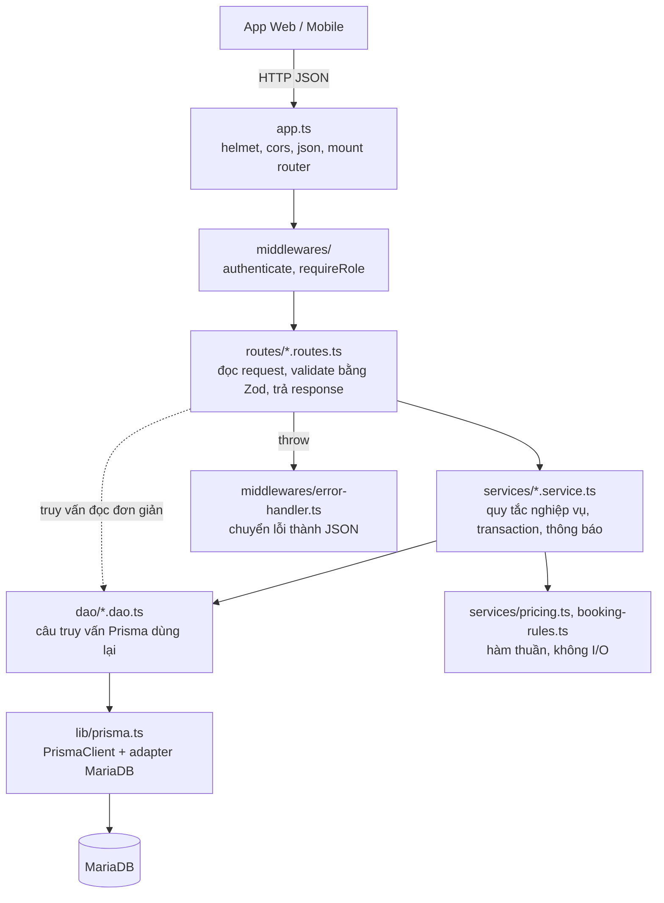

# Hướng dẫn phát triển backend

Backend nằm trong `be/`: Node.js 24, TypeScript, Express 5, Prisma 7 (adapter MariaDB), Zod, JWT, bcrypt. Tài liệu này mô tả kiến trúc theo lớp, file nào chứa gì, và cách thêm một chức năng mới.

## 1. Kiến trúc theo lớp



| Lớp | Thư mục | Được làm | Không được làm |
|---|---|---|---|
| Route | `src/routes/` | Khai báo URL, gắn middleware quyền, `schema.parse(request.body)`, gọi service/DAO, chọn HTTP status | Chứa quy tắc nghiệp vụ phức tạp |
| Validator | `src/validators/` | Schema Zod dùng chung giữa nhiều route | Truy cập DB |
| Service | `src/services/` | Quy tắc nghiệp vụ (BR-xx), transaction, kiểm tra quyền sở hữu, tạo thông báo | Đọc `request`/`response` |
| Hàm thuần | `src/services/pricing.ts`, `booking-rules.ts` | Tính tiền, hoa hồng, trạng thái, ngày giờ | Gọi DB (để unit test được) |
| DAO | `src/dao/` | Câu truy vấn Prisma dùng ở nhiều nơi, `select`/`include` chuẩn | Ném lỗi HTTP |
| Hạ tầng | `src/lib/`, `src/config/`, `src/middlewares/` | Prisma client, env, lỗi HTTP, phân trang, xác thực | |

Route đơn giản (chỉ đọc một bảng) được gọi Prisma trực tiếp; khi có quy tắc nghiệp vụ hoặc ghi nhiều bảng thì đưa vào service.

## 2. Cấu trúc file

```text
be/
├── Dockerfile, .dockerignore         Build image production
├── .env.example                      Mẫu biến môi trường (xem deploy.md)
├── prisma.config.ts                  Prisma CLI: schema, migrations, seed
├── prisma/
│   ├── schema.prisma                 26 model, 15 enum
│   ├── migrations/                   SQL migration (đã sửa tên bảng PascalCase)
│   ├── seed.ts                       Dữ liệu demo, chạy lại an toàn
│   └── backfill-search.ts            Tính lại Destination.searchText (npm run db:backfill)
├── postman/                          Collection kiểm thử end-to-end + fixtures/ (ảnh mẫu cho test upload)
├── uploads/                          Ảnh tải lên khi STORAGE_DRIVER=local (không commit)
├── tests/
│   ├── unit/                         pricing, booking-rules, giá mùa, tìm không dấu, nhận dạng ảnh
│   └── integration/                  Supertest: quyền, validation (không cần DB)
└── src/
    ├── server.ts                     Listen, job hủy booking quá hạn, job gửi push, tắt an toàn
    ├── app.ts                        Middleware chung + mount router
    ├── config/env.ts                 Đọc và kiểm tra biến môi trường bằng Zod
    ├── lib/                          prisma, http-error, pagination, slug, crypto (token + SHA-256), monitoring (Sentry),
    │                                 search-text (bỏ dấu), storage (local / S3), destination-search
    ├── middlewares/
    │   ├── auth.ts                   authenticate, optionalAuth, requireRole, signAccessToken
    │   ├── request-log.ts            X-Request-Id + log JSON mỗi request (route, status, ms)
    │   └── error-handler.ts          HttpError / ZodError / Prisma / upload error → JSON; lỗi 500 → log + Sentry
    ├── validators/                   auth, booking, destination
    ├── dao/                          user, destination, booking
    ├── services/
    │   ├── access.service.ts         assertCanManageDestination, commissionRateFor
    │   ├── auth.service.ts           Đăng ký, đăng nhập, hồ sơ
    │   ├── booking.service.ts        Báo giá, đặt, thanh toán, hủy, xác nhận, hết hạn
    │   ├── booking-rules.ts          Máy trạng thái, chính sách hủy, ngày giờ VN, mã booking
    │   ├── pricing.ts                Công thức giá, giảm giá, hoa hồng
    │   ├── destination.service.ts    Tạo/sửa tin, gửi duyệt, duyệt, giá từ, rating
    │   ├── review.service.ts         Đánh giá, kiểm duyệt
    │   ├── notification.service.ts   createNotification, notifyRoles
    │   ├── session.service.ts        Phiên đăng nhập: cấp, xoay vòng, thu hồi refresh token
    │   ├── verification.service.ts   Link xác thực email / đặt lại mật khẩu
    │   ├── mail.service.ts           Gửi email (console hoặc SMTP)
    │   ├── push.service.ts           Gửi push qua Expo (outbox)
    │   ├── payout.service.ts         Đối soát: xem trước, lập kỳ, chuyển, hủy
    │   ├── audit.service.ts          Ghi nhật ký quản trị
    │   └── stats.service.ts          Dashboard
    ├── routes/
    │   ├── auth.routes.ts            /api/auth
    │   ├── user.routes.ts            /api/users
    │   ├── catalog.routes.ts         /api/categories, facilities, packages, room-types, addon-services, vouchers
    │   ├── destination.routes.ts     /api/destinations
    │   ├── manage.routes.ts          /api/manage (trang quản lý của chủ / admin)
    │   ├── partner.routes.ts         /api/partners
    │   ├── booking.routes.ts         /api/bookings
    │   ├── favorite.routes.ts        /api/favorites
    │   ├── review.routes.ts          /api/reviews
    │   ├── notification.routes.ts    /api/notifications
    │   ├── conversation.routes.ts    /api/conversations
    │   ├── stats.routes.ts           /api/stats
    │   ├── payout.routes.ts          /api/payouts
    │   ├── audit.routes.ts           /api/audit-logs
    │   ├── device.routes.ts          /api/devices
    │   └── upload.routes.ts          /api/uploads (+ ảnh phục vụ ở /uploads)
    └── generated/prisma/             Prisma Client sinh tự động – không sửa tay
```

## 3. Phân quyền

Có hai lớp kiểm tra, cả hai đều cần:

1. **Theo vai trò** – middleware trên route:

   ```ts
   bookingRouter.patch("/:id/status", requireRole("OWNER", "STAFF", "ADMIN"), handler);
   ```

2. **Theo quyền sở hữu** – trong service, vì vai trò đúng chưa đủ (chủ A không được sửa địa điểm của chủ B):

   ```ts
   await assertCanManageDestination(currentUser(request), input.destinationId); // 403 nếu không phải của mình
   ```

| Hàm | File | Dùng khi |
|---|---|---|
| `authenticate` | `middlewares/auth.ts` | Bắt buộc đăng nhập; đọc lại user từ DB mỗi request (BR-11) |
| `optionalAuth` | `middlewares/auth.ts` | API công khai nhưng trả thêm dữ liệu cá nhân (`isFavorite`) |
| `requireRole(...roles)` | `middlewares/auth.ts` | Giới hạn vai trò |
| `isStaff(user)` | `middlewares/auth.ts` | STAFF hoặc ADMIN |
| `isOwner(user)`, `assertCanManageDestination` | `services/access.service.ts` | Chủ địa điểm |
| `canManageBooking` | `services/booking.service.ts` | Staff/Admin, hoặc chủ của địa điểm trong booking |

Dữ liệu không thuộc quyền truy cập trả **404** thay vì 403 (BR-10), trừ thao tác quản lý địa điểm trả 403 để chủ biết họ không có quyền.

## 4. Quy ước code

- **Express 5 tự bắt lỗi async:** handler chỉ cần `throw`, không cần `try/catch` hay `next(error)`.
- **Validate mọi input bằng Zod** ngay đầu handler: `const input = schema.parse(request.body)`. Không truyền thẳng `request.body` vào Prisma.
- **Lỗi nghiệp vụ** dùng helper trong `lib/http-error.ts` với `code` ổn định để giao diện xử lý:

  ```ts
  throw conflict("Booking chưa được thanh toán", "PAYMENT_REQUIRED");
  ```

  Thông báo viết tiếng Việt (hiển thị thẳng cho người dùng); `code` viết HOA_GẠCH_DƯỚI.
- **Response:** một đối tượng `{ data }`; danh sách `paginated(data, total, query)` → `{ data, meta }`; xóa trả 204.
- **Không trả `password`:** luôn dùng `publicUserSelect` hoặc `select` tường minh khi lấy `User`.
- **Ghi nhiều bảng** dùng `prisma.$transaction(async (tx) => ...)` và truyền `tx` vào hàm con (`createNotification(input, tx)`).
- **Thông báo** tạo trong cùng transaction với thay đổi nghiệp vụ.
- **Tiền** là số nguyên VNĐ; **ngày ở** là chuỗi `YYYY-MM-DD` → `parseDateOnly`; "hôm nay" dùng `todayInVietnam()`.
- **Raw SQL** (`$queryRaw`) viết tên bảng PascalCase (`Booking`, `RoomType`) để chạy được trên Linux.

## 5. Thêm một chức năng mới – ví dụ "Chủ địa điểm trả lời đánh giá"

| Bước | File | Việc |
|---|---|---|
| 1 | `prisma/schema.prisma` | Thêm `ownerReply String? @db.Text` và `ownerRepliedAt DateTime?` vào `Review` |
| 2 | `prisma/migrations/` | Tạo migration (mục 6); **sửa tên bảng PascalCase** trong SQL |
| 3 | `src/services/review.service.ts` | `replyToReview(user, reviewId, content)`: lấy review → `assertCanManageDestination(user, review.destinationId)` → cập nhật → `createNotification` cho khách |
| 4 | `src/routes/review.routes.ts` | `reviewRouter.patch("/:id/reply", requireRole("OWNER", "ADMIN"), ...)` với schema `{ content: z.string().trim().min(1).max(1000) }` |
| 5 | `src/dao/destination.dao.ts` | Thêm `ownerReply`, `ownerRepliedAt` vào `reviewPublicSelect` để khách thấy |
| 6 | `tests/` + `postman/` | Test chặn quyền (401/403) và luồng đúng |
| 7 | `docs/` | Cập nhật [api.md](../02-thiet-ke/api.md), [co-so-du-lieu.md](../02-thiet-ke/co-so-du-lieu.md), [nhat-ky-thay-doi.md](../04-quan-ly-du-an/nhat-ky-thay-doi.md) |

Route cụ thể (`/moderation`, `/mine`) phải khai báo **trước** route tham số (`/:id`).

## 6. Prisma và migration

```bash
cd be
npm run db:generate                          # sinh lại client sau khi sửa schema
npm run db:migrate -- --name ten_migration   # dev: tạo + áp dụng migration (terminal tương tác)
npm run db:deploy                            # server: áp dụng migration chưa chạy
npm run db:seed                              # nạp dữ liệu demo
npm run db:studio                            # giao diện xem dữ liệu
```

**Khi `migrate dev` không chạy được** (terminal không tương tác, như khi chạy qua công cụ tự động), sinh SQL bằng `migrate diff` rồi áp dụng:

```bash
mkdir prisma/migrations/20261101090000_ten_migration
npx prisma migrate diff --from-config-datasource --to-schema prisma/schema.prisma --script > prisma/migrations/20261101090000_ten_migration/migration.sql
# Mở file SQL, sửa `booking` → `Booking`, `user` → `User`... (MariaDB trên Windows viết thường)
npx prisma migrate deploy
npx prisma generate
```

Không sửa migration đã được chia sẻ cho nhóm hoặc đã chạy ở server; tạo migration mới để thay đổi tiếp. Thêm cột bắt buộc vào bảng đã có dữ liệu phải có `@default(...)`.

## 7. Job nền

| Job | Chu kỳ | Việc |
|---|---|---|
| `expireOverdueBookings()` | 60 giây | Hủy booking thanh toán online quá hạn (BR-19) |
| `dispatchPendingPush()` | 15 giây, chỉ khi `PUSH_ENABLED=true` | Đọc `Notification` có `pushedAt = NULL`, gửi tới Expo Push API, xóa token thiết bị đã gỡ app |

Job không chạy trong test (test chỉ import `app.ts`). Khi chạy nhiều instance API, chuyển job sang một tiến trình cron riêng để không chạy trùng.

## 7b. Ghi nhật ký quản trị

Mọi thao tác quản trị mới phải gọi `audit()` trong cùng transaction:

```ts
await audit({ actorId: user.id, action: "voucher.update", entity: "Voucher", entityId: id, before, after: data, ip: requestIp(request) }, tx);
```

`action` theo dạng `<đối tượng>.<hành động>`; danh sách đang dùng ở BR-25 ([quy-tac-nghiep-vu.md](../01-dac-ta/quy-tac-nghiep-vu.md)).

## 7b2. Log và Sentry

`app.use(requestLog)` đứng đầu `app.ts`: mọi response có `X-Request-Id`, mỗi request ghi một dòng JSON khi kết thúc. Lỗi không lường trước đi tới `errorHandler`: ghi log `level: error` + stack, gọi `captureError()` (no-op khi không có `SENTRY_DSN`), trả `requestId` cho client. Job nền tự bắt lỗi và cũng gọi `captureError()`. Không `console.log` dữ liệu request (body, query, token) ở chỗ khác.

## 7c. Lưu file

`lib/storage.ts` có hai driver chọn bằng `STORAGE_DRIVER`: `local` (ghi vào `UPLOAD_DIR`, Express phục vụ ở `/uploads`) và `s3` (S3, Cloudflare R2, MinIO qua `@aws-sdk/client-s3`). Route chỉ gọi `saveImage` / `deleteImage`, không biết file nằm ở đâu. Kiểm tra loại file bằng chữ ký byte (`detectImageType`), không tin `Content-Type` hay đuôi file.

## 8. Lệnh npm

| Lệnh | Công dụng |
|---|---|
| `npm run dev` | Chạy API, tự reload khi sửa code |
| `npm run typecheck` | Kiểm tra kiểu TypeScript |
| `npm test` | Unit + integration test (Vitest) |
| `npm run build` | `prisma generate` + biên dịch vào `dist/` |
| `npm start` | Chạy bản đã build |
| `npm run db:*` | Xem mục 6 |
| `npm run db:backfill` | Tính lại `searchText` cho mọi địa điểm (sau migration `platform_extensions`) |

Kiểm thử chi tiết: [kiem-thu.md](kiem-thu.md). Triển khai: [deploy.md](deploy.md).
