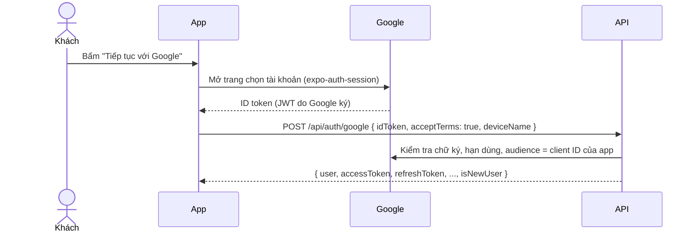

# Đăng nhập / đăng ký bằng Google

Khách bấm **"Tiếp tục với Google"** ở trang Đăng nhập (A1) hoặc **"Đăng ký bằng Google"** ở trang Đăng ký (A2). App lấy **ID token** của Google, gửi lên `POST /api/auth/google`; backend xác minh token rồi trả phiên đăng nhập giống đăng nhập bằng mật khẩu.

Nút Google **chỉ hiện khi đã cấu hình client ID** cho nền tảng đang chạy. Chưa cấu hình thì app chạy như cũ (chỉ có email + mật khẩu).

## 1. Cách hoạt động



Backend quyết định theo thứ tự (`planGoogleSignIn` trong `be/src/services/auth.service.ts`):

| Trường hợp | Kết quả |
|---|---|
| Tài khoản Google này đã liên kết (cột `User.googleId`) | Đăng nhập tài khoản đó |
| Email Google trùng một tài khoản đăng ký bằng mật khẩu | Liên kết Google vào tài khoản đó (xác thực email luôn nếu chưa) |
| Chưa có tài khoản | Tạo tài khoản mới: tên, email, ảnh đại diện lấy từ Google; email coi như đã xác thực; vai trò USER |
| Google báo email **chưa xác minh** | Từ chối (409 `GOOGLE_EMAIL_UNVERIFIED`) – tránh chiếm tài khoản người khác |
| Email đã liên kết với **tài khoản Google khác** | Từ chối (409 `GOOGLE_ACCOUNT_MISMATCH`) |
| Tài khoản bị khóa | 403 như đăng nhập thường |

Tài khoản tạo bằng Google có một mật khẩu ngẫu nhiên không ai biết. Muốn đăng nhập bằng email + mật khẩu thì dùng **Quên mật khẩu** (A3) để đặt mật khẩu; trang Đổi mật khẩu (P2) không dùng được vì không biết mật khẩu hiện tại.

## 2. Tạo client ID trên Google Cloud

1. Vào <https://console.cloud.google.com>, tạo project (ví dụ "Travelling App").
2. **APIs & Services → OAuth consent screen** (Google Auth Platform → Branding / Audience):
   - Loại người dùng **External**, điền tên app, email hỗ trợ, logo (tùy chọn).
   - Phạm vi (scopes): `openid`, `email`, `profile` (mặc định).
   - Khi đang ở chế độ **Testing**: thêm email của các thành viên nhóm vào **Test users** – chỉ những email này đăng nhập được. Muốn ai cũng dùng được thì **Publish app** (với 3 scope trên không cần Google duyệt).
3. **APIs & Services → Credentials → Create credentials → OAuth client ID**, tạo lần lượt:

| Loại | Điền | Dùng cho |
|---|---|---|
| **Web application** | *Authorized JavaScript origins*: `http://localhost:8081` (dev), `https://app.<domain>` (thật). *Authorized redirect URIs*: cùng các địa chỉ trên | Bản web |
| **Android** | *Package name*: `com.travellingapp.app` (trong `fe/app.json`). *SHA-1*: lấy từ keystore ký APK (xem mục 4) | App Android (development build / APK) |
| **iOS** (nếu có Mac) | *Bundle ID*: `com.travellingapp.app` | App iOS |

Client ID có dạng `123456789012-abc...xyz.apps.googleusercontent.com`. Client ID **không phải bí mật** (nằm trong app); **không cần** client secret.

## 3. Cấu hình

**Backend** (`be/.env` hoặc `.env` cạnh `docker-compose.yml`) – liệt kê **mọi** client ID, phân tách bằng dấu phẩy:

```env
GOOGLE_CLIENT_IDS=<web-client-id>,<android-client-id>,<ios-client-id>
```

**Frontend** (`fe/.env`, hoặc biến môi trường trên EAS khi build):

```env
EXPO_PUBLIC_GOOGLE_WEB_CLIENT_ID=<web-client-id>
EXPO_PUBLIC_GOOGLE_ANDROID_CLIENT_ID=<android-client-id>
EXPO_PUBLIC_GOOGLE_IOS_CLIENT_ID=<ios-client-id>
```

Đổi biến `EXPO_PUBLIC_*` xong phải chạy lại `npx expo start --clear` (hoặc build lại) mới có tác dụng.

## 4. Lấy SHA-1 cho client Android

- **Build bằng EAS:** `npx eas-cli@latest credentials` → Android → chọn profile → xem *SHA1 Fingerprint* của keystore.
- **Build trên máy** (`npx expo run:android`, keystore debug): chạy lệnh dưới, mật khẩu `android`, copy dòng `SHA1`.

```bash
keytool -list -v -keystore "%USERPROFILE%\.android\debug.keystore" -alias androiddebugkey -storepass android -keypass android
```

Debug và bản phát hành dùng keystore khác nhau → tạo 2 client Android (cùng package, khác SHA-1) và đưa cả hai vào `GOOGLE_CLIENT_IDS`.

## 5. Giới hạn cần biết

| Môi trường | Đăng nhập Google |
|---|---|
| Web (`npm run web`, bản deploy) | ✅ cần client Web |
| Development build / APK Android | ✅ cần client Android (đúng package + SHA-1) |
| **Expo Go** | ❌ Google không chấp nhận package của Expo Go – nút tự ẩn |
| Backend chưa có `GOOGLE_CLIENT_IDS` | API trả 503 `GOOGLE_DISABLED` |

## 6. Kiểm thử

- `npm test` trong `be/`: `planGoogleSignIn` (đăng nhập / liên kết / tạo mới / từ chối email chưa xác minh / từ chối liên kết trùng) và route `/api/auth/google` (thiếu đồng ý điều khoản → 400, chưa cấu hình → 503).
- Thử tay (sau khi có client ID): đăng nhập bằng Gmail chưa đăng ký → tạo tài khoản mới, T5 không hiện dải "Xác thực email"; đăng nhập bằng Gmail trùng email tài khoản demo → vào đúng tài khoản cũ.
