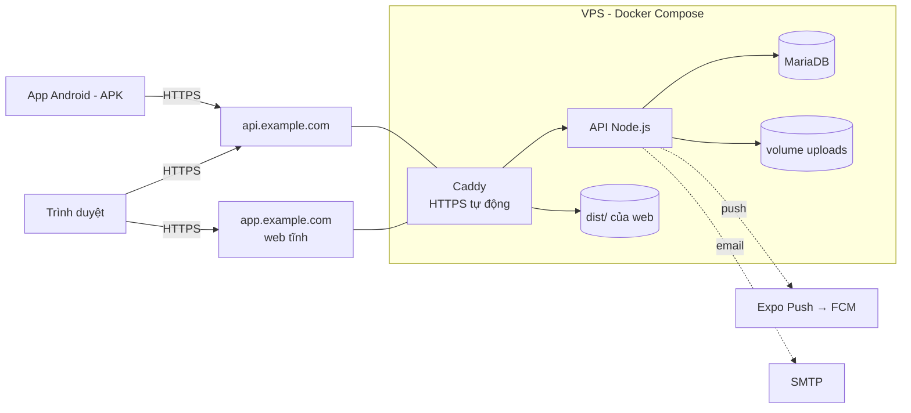

# Triển khai thực tế: web, API và file APK

Hướng dẫn đưa Travelling App lên môi trường thật: API + MariaDB trên một VPS có HTTPS, giao diện web trên domain riêng, và file APK Android cài được trên điện thoại. Cài đặt máy dev và bảng biến môi trường: [deploy.md](deploy.md). Đo và theo dõi app khi đang chạy: [giam-sat-van-hanh.md](giam-sat-van-hanh.md).

> **Bộ file đã điền sẵn tên miền `chantroixaxoi.xyz`:** thư mục [`deploy/`](../../deploy/README.md) (Caddyfile, `docker-compose.prod.yml`, mẫu `.env`, script cài VPS / triển khai / sao lưu) và `fe/.env.production`, `fe/eas.json`. Làm theo [deploy/README.md](../../deploy/README.md); tài liệu này giải thích chi tiết từng bước.

> **Trạng thái kiểm chứng (25/10/2026):** bản build production của backend (`npm run build` → `node dist/server.js`) đã chạy thử trên máy dev. Image Docker, Caddy, build web và build APK **chưa chạy thử** trong dự án (Docker Desktop tắt, chưa có tài khoản Expo của nhóm). Chạy lần lượt các bước dưới đây một lần trên môi trường thử trước khi demo.

## 1. Kiến trúc triển khai



| Thành phần | Chạy ở đâu | Ghi chú |
|---|---|---|
| API + MariaDB | VPS, `docker compose` | 1 vCPU / 2 GB RAM / 25 GB SSD đủ cho đồ án |
| HTTPS | Caddy (cùng compose) | Tự xin và gia hạn chứng chỉ Let's Encrypt |
| Web | Cùng VPS (Caddy phục vụ thư mục tĩnh), hoặc Cloudflare Pages / Netlify / Vercel | |
| APK | EAS Build (cloud của Expo) | Tải về file `.apk`, cài trực tiếp |
| Email | Gmail App Password / Brevo / Mailgun | Bắt buộc ở production để có xác thực email, quên mật khẩu |
| Ảnh | Volume `uploads` trên VPS, hoặc Cloudflare R2 | R2 khi muốn chạy nhiều máy chủ |

## 2. Chuẩn bị

| Việc | Chi tiết |
|---|---|
| Domain | Ví dụ `example.com`. Tạo 2 bản ghi DNS **A** trỏ về IP VPS: `api.example.com`, `app.example.com` |
| VPS | Ubuntu 24.04, mở cổng 22, 80, 443 (ví dụ `ufw allow 22,80,443/tcp`). Cài Docker Engine + Compose plugin theo docs.docker.com |
| Tài khoản Expo | expo.dev (miễn phí) để dùng EAS Build |
| Firebase | Chỉ cần nếu bật push trên Android (mục 6.5) |
| SMTP | Gmail: bật xác minh 2 bước → tạo App Password; hoặc Brevo (300 email/ngày miễn phí) |
| Git | Gắn tag cho mỗi lần phát hành (`git tag v1.0.0`) để quay lại được |

## 3. Triển khai API trên VPS

### 3.1. Lấy code và cấu hình

```bash
git clone <REPOSITORY_URL> travelling && cd travelling
git checkout v1.0.0
cp .env.example .env
```

Sửa `.env` ở thư mục gốc (file này **không commit**):

```env
DB_PASSWORD=<chuỗi ngẫu nhiên>
DB_ROOT_PASSWORD=<chuỗi ngẫu nhiên khác>
JWT_SECRET=<node -e "console.log(require('crypto').randomBytes(48).toString('hex'))">
CORS_ORIGINS=https://app.example.com
# Chỉ mở cổng API cho Caddy trên cùng máy, không mở ra Internet
API_PORT=127.0.0.1:3000
TRUST_PROXY=1
APP_URL=https://app.example.com
PUBLIC_BASE_URL=https://api.example.com
EMAIL_TRANSPORT=smtp
SMTP_HOST=smtp.gmail.com
SMTP_PORT=587
SMTP_USER=<gmail>
SMTP_PASS=<app password>
MAIL_FROM=Travelling App <gmail của bạn>
PUSH_ENABLED=true
SENTRY_DSN=<DSN của project Node.js trên sentry.io>
SENTRY_RELEASE=v1.0.0
```

`docker-compose.yml` đã đặt `NODE_ENV=production` và gắn volume `uploads`. Danh sách đủ biến: [deploy.md](deploy.md) mục 2.

### 3.2. Thêm Caddy (HTTPS)

Tạo `deploy/Caddyfile`:

```caddy
api.example.com {
	encode zstd gzip
	reverse_proxy api:3000
}

app.example.com {
	encode zstd gzip
	root * /srv/web
	# Web build dạng SPA: route không có file thì trả index.html
	try_files {path} /index.html
	file_server
	@assets path /_expo/* /assets/*
	header @assets Cache-Control "public, max-age=31536000, immutable"
	header /index.html Cache-Control "no-cache"
}
```

Tạo `docker-compose.prod.yml` (dùng chồng lên file gốc):

```yaml
services:
  caddy:
    image: caddy:2
    restart: unless-stopped
    depends_on:
      - api
    ports:
      - "80:80"
      - "443:443"
    volumes:
      - ./deploy/Caddyfile:/etc/caddy/Caddyfile:ro
      - ./fe/dist:/srv/web:ro
      - caddy_data:/data
      - caddy_config:/config

  api:
    logging:
      driver: json-file
      options: { max-size: "10m", max-file: "5" }

  db:
    logging:
      driver: json-file
      options: { max-size: "10m", max-file: "3" }

volumes:
  caddy_data:
  caddy_config:
```

### 3.3. Chạy

```bash
docker compose -f docker-compose.yml -f docker-compose.prod.yml up -d --build
docker compose ps                                  # api và db phải "healthy"
docker compose logs -f api                         # thấy "API server listening on port 3000 (production)"
curl https://api.example.com/health                # {"status":"ok","database":"connected"}
```

Container API tự chạy `prisma migrate deploy` trước khi khởi động, nên DB luôn đúng phiên bản code.

**Dữ liệu ban đầu:**

```bash
# Chỉ cho môi trường demo – tạo tài khoản mẫu mật khẩu SEED_DEFAULT_PASSWORD
docker compose exec api npm run db:seed
# Nâng cấp từ DB có dữ liệu trước migration platform_extensions
docker compose exec api npm run db:backfill
```

Môi trường thật không chạy seed; tạo tài khoản admin đầu tiên bằng cách đăng ký rồi đổi `role` trong DB:

```bash
docker compose exec db sh -c 'mariadb -uroot -p"$MARIADB_ROOT_PASSWORD" travelling_app -e "UPDATE User SET role=\"ADMIN\", emailVerifiedAt=NOW() WHERE email=\"admin@example.com\";"'
```

### 3.4. Cập nhật phiên bản mới

```bash
./backup.sh                                       # mục 7, luôn sao lưu trước
git fetch --tags && git checkout v1.1.0
sed -i 's/^SENTRY_RELEASE=.*/SENTRY_RELEASE=v1.1.0/' .env
docker compose -f docker-compose.yml -f docker-compose.prod.yml up -d --build api
docker compose logs -f api                        # xem migration chạy xong
```

API ngừng vài giây trong lúc container mới khởi động; đủ cho đồ án. Không chạy nhiều bản API cùng lúc (job hủy booking và job push chạy trong tiến trình).

### 3.5. Phương án không dùng VPS

| Nền tảng | API | DB | Lưu ý |
|---|---|---|---|
| Render / Railway | Deploy từ `be/Dockerfile` | MySQL/MariaDB do nền tảng cấp hoặc dịch vụ ngoài (Aiven) | `TRUST_PROXY=1`; ổ đĩa không bền → `STORAGE_DRIVER=s3` (Cloudflare R2) |
| Máy cá nhân khi demo | `npm run dev` | MariaDB local | Điện thoại cùng Wi-Fi; APK phải được build cho phép HTTP (mục 6.6) |

## 4. Triển khai web

### 4.1. Cấu hình một lần

Trong `fe/app.json`, đổi kiểu xuất web sang **SPA** (một `index.html` cho mọi route). App có đăng nhập và dữ liệu động nên không cần dựng sẵn từng trang, và SPA không cần cấu hình rewrite phức tạp cho route động như `/destinations/[slug]`:

```json
"web": {
  "output": "single",
  "favicon": "./assets/images/favicon.png",
  "bundler": "metro"
}
```

Kiểm tra lại tên tùy chọn trong tài liệu Expo SDK 57 (`https://docs.expo.dev/versions/v57.0.0/`) trước khi đổi.

### 4.2. Build

`EXPO_PUBLIC_*` được **nhúng vào code lúc build**: đổi địa chỉ API phải build lại.

```bash
cd fe
npm ci
EXPO_PUBLIC_API_URL=https://api.example.com/api npx expo export --platform web
# Kết quả: fe/dist/  (index.html + _expo/static/...)
npx serve dist -s                                  # xem thử ở http://localhost:3000 trước khi đưa lên
```

Trên Windows PowerShell: `$env:EXPO_PUBLIC_API_URL="https://api.example.com/api"; npx expo export --platform web`.

### 4.3. Đưa lên

| Cách | Lệnh / cấu hình | Chuyển mọi route về `index.html` |
|---|---|---|
| Cùng VPS (Caddy) | Build ngay trên VPS (`fe/dist` được gắn vào Caddy) hoặc `rsync -avz fe/dist/ vps:~/travelling/fe/dist/` | Đã có `try_files` trong Caddyfile |
| Cloudflare Pages | Build command: `npx expo export --platform web`, output `dist`, biến `EXPO_PUBLIC_API_URL` | Mặc định khi không có `404.html` |
| Netlify | Như trên | Thêm `fe/public/_redirects`: `/* /index.html 200` |
| Vercel | Như trên | `fe/vercel.json`: `{ "rewrites": [{ "source": "/(.*)", "destination": "/index.html" }] }` |

Sau khi có domain web, đặt `CORS_ORIGINS` và `APP_URL` của API đúng domain đó rồi khởi động lại API.

**Kiểm tra:** mở `https://app.example.com/destinations/da-lat-pine-hill-resort` trực tiếp (không đi từ trang chủ) và bấm F5 – phải hiện trang, không 404. DevTools → Network: mọi request tới `https://api.example.com`, không có lỗi CORS.

## 5. Chuẩn bị app Android

### 5.1. `app.json`

```json
{
  "expo": {
    "name": "Travelling App",
    "slug": "travelling-app",
    "version": "1.0.0",
    "scheme": "travellingapp",
    "android": {
      "package": "com.travellingapp.app",
      "versionCode": 1,
      "adaptiveIcon": { "...": "giữ như hiện tại" }
    },
    "ios": { "bundleIdentifier": "com.travellingapp.app" }
  }
}
```

| Trường | Quy tắc |
|---|---|
| `android.package` | Định danh duy nhất, **không đổi sau khi phát hành** (đổi = app khác, người dùng phải cài lại) |
| `version` | Phiên bản người dùng thấy (`1.0.0` → `1.1.0`) |
| `android.versionCode` | Số nguyên, **tăng mỗi lần build phát hành**; Android từ chối cài đè bản có versionCode nhỏ hơn |

Tên app, icon, splash đã có trong `app.json`; thay ảnh trong `fe/assets/images/` bằng ảnh thương hiệu trước khi phát hành.

### 5.2. `eas.json`

Tạo bằng `npx eas-cli@latest build:configure`, rồi sửa thành:

```json
{
  "cli": { "appVersionSource": "local" },
  "build": {
    "development": {
      "developmentClient": true,
      "distribution": "internal",
      "env": { "EXPO_PUBLIC_API_URL": "http://192.168.1.10:3000/api" }
    },
    "preview": {
      "distribution": "internal",
      "android": { "buildType": "apk" },
      "env": { "EXPO_PUBLIC_API_URL": "https://api.example.com/api" }
    },
    "production": {
      "android": { "buildType": "apk" },
      "env": { "EXPO_PUBLIC_API_URL": "https://api.example.com/api" }
    }
  }
}
```

| Profile | Dùng để | Ra file |
|---|---|---|
| `development` | Development build (cần cho push, debug native) | APK có dev menu |
| `preview` | Cho nhóm, giảng viên cài thử | APK |
| `production` | Bản phát hành | APK (đồ án). Muốn đưa lên Google Play: bỏ `buildType` để ra **AAB** |

## 6. Build file APK

### 6.1. Build trên cloud bằng EAS (khuyến nghị)

```bash
cd fe
npx eas-cli@latest login
npx eas-cli@latest build --platform android --profile preview
```

- Lần đầu EAS hỏi tạo **keystore** (khóa ký app) → chọn để EAS tạo và giữ. Mất keystore = không phát hành bản cập nhật cho cùng app được nữa; tải bản sao về cất giữ: `npx eas-cli@latest credentials` → Android → Download keystore.
- Build chạy trên máy chủ Expo (gói miễn phí có hàng đợi, thường 10–30 phút). Xong sẽ có link tải `.apk` và mã QR.

### 6.2. Build trên máy (không cần tài khoản Expo trả phí)

Cần Android Studio (Android SDK, JDK 17).

```bash
cd fe
npx expo prebuild --platform android --clean     # sinh thư mục android/ (đã gitignore, không sửa tay)
cd android
./gradlew assembleRelease                          # Windows: gradlew.bat assembleRelease
# APK: android/app/build/outputs/apk/release/app-release.apk
```

Bản này được ký bằng **khóa debug** của template: cài thử được nhưng **không dùng để phát hành**. Phát hành thì dùng EAS (6.1), hoặc tạo keystore riêng bằng `keytool` và cấu hình ký qua config plugin – không sửa tay `android/`.

### 6.3. Cài lên điện thoại

| Cách | Bước |
|---|---|
| Link / QR của EAS | Mở trên điện thoại → tải `.apk` → cho phép "Cài ứng dụng không rõ nguồn gốc" → cài |
| USB | Bật "Gỡ lỗi USB" → `adb install -r app-release.apk` (`-r` = cài đè giữ dữ liệu) |
| Gửi file | Google Drive / Zalo → mở file trên điện thoại |

### 6.4. Cập nhật không cần build lại (tùy chọn)

Thay đổi chỉ ở JavaScript/giao diện có thể đẩy qua **EAS Update** thay vì phát APK mới: `npx expo install expo-updates`, `npx eas-cli@latest update:configure`, rồi `npx eas-cli@latest update --channel preview --message "Sửa lỗi B5"`. Thay đổi native (thêm thư viện native, đổi `app.json` phần native) vẫn phải build APK mới.

### 6.5. Push notification trên APK

Expo Push trên Android đi qua Firebase Cloud Messaging:

1. Tạo project Firebase → thêm app Android với đúng `com.travellingapp.app` → tải `google-services.json` vào `fe/`, khai báo `"android": { "googleServicesFile": "./google-services.json" }`.
2. Firebase → Project settings → Service accounts → tạo khóa riêng (JSON) → tải lên EAS: `npx eas-cli@latest credentials` → Android → Google Service Account → FCM V1.
3. Cài `expo-notifications`, build lại APK.
4. API đặt `PUSH_ENABLED=true`.

Kiểm tra: đăng nhập trên APK → `GET /api/devices` thấy thiết bị → đặt một booking → điện thoại nhận push trong ~15 giây.

### 6.6. Gọi API bằng HTTP (chỉ khi demo trong mạng LAN)

Android chặn HTTP không mã hóa trong bản release. Production luôn dùng HTTPS. Nếu buộc phải demo với API `http://192.168.x.x:3000` trên máy cá nhân: `npx expo install expo-build-properties` và thêm plugin `["expo-build-properties", { "android": { "usesCleartextTraffic": true } }]` **chỉ cho bản demo**, rồi build lại.

### 6.7. Kiểm tra APK trước khi phát

| Kiểm tra | Cách |
|---|---|
| Chạy trên ≥ 2 máy thật (Android 10 và 14/15) | Cài APK, đi hết kịch bản demo ([kiem-thu.md](kiem-thu.md) mục 4) |
| Gọi đúng API production | Đăng nhập được; ảnh tải lên hiện được |
| Mất mạng | Bật chế độ máy bay → app báo "Không kết nối được máy chủ", không crash |
| Tắt mở lại | Vẫn đăng nhập (refresh token) |
| Link email | Bấm link xác thực trong Gmail trên điện thoại → mở app / web đúng trang |
| Dung lượng APK | Ghi lại để so sánh các bản sau ([giam-sat-van-hanh.md](giam-sat-van-hanh.md) mục 6) |

## 7. Sao lưu và khôi phục

Tạo `backup.sh` trên VPS:

```bash
#!/bin/sh
set -e
cd ~/travelling
STAMP=$(date +%Y%m%d-%H%M)
mkdir -p backups
docker compose exec -T db sh -c 'mariadb-dump -uroot -p"$MARIADB_ROOT_PASSWORD" --single-transaction --routines travelling_app' | gzip > backups/db-$STAMP.sql.gz
docker run --rm -v travelling_uploads:/data -v "$PWD/backups":/backup alpine tar czf /backup/uploads-$STAMP.tgz -C /data .
find backups -type f -mtime +14 -delete          # giữ 14 ngày
```

Tên volume (`travelling_uploads`) = `<tên thư mục>_uploads`; kiểm tra bằng `docker volume ls`. Chạy hằng ngày: `crontab -e` → `0 3 * * * ~/travelling/backup.sh >> ~/travelling/backups/backup.log 2>&1`. Định kỳ chép thư mục `backups/` ra ngoài VPS (Google Drive, máy cá nhân).

**Khôi phục:**

```bash
gunzip -c backups/db-20261101-0300.sql.gz | docker compose exec -T db sh -c 'mariadb -uroot -p"$MARIADB_ROOT_PASSWORD" travelling_app'
docker run --rm -v travelling_uploads:/data -v "$PWD/backups":/backup alpine sh -c 'cd /data && tar xzf /backup/uploads-20261101-0300.tgz'
```

Thử khôi phục vào một máy khác ít nhất một lần: bản sao lưu chưa từng khôi phục thử thì chưa chắc dùng được.

## 8. Quay lại bản trước (rollback)

| Tình huống | Cách làm |
|---|---|
| Bản API mới lỗi, **không có migration mới** | `git checkout v1.0.0` → `docker compose ... up -d --build api` |
| Bản API mới lỗi, **có migration mới** | Migration chỉ chạy tiến: khôi phục bản sao lưu DB chụp trước khi cập nhật (mục 7), rồi checkout tag cũ và build lại |
| Web lỗi | Build lại từ tag cũ; trên Cloudflare Pages / Netlify / Vercel chọn "Rollback" bản deploy trước |
| APK lỗi | Phát lại APK cũ (giữ file các bản đã phát); nếu đã dùng EAS Update: `eas update:rollback` |

## 9. Danh sách trước khi công bố

| Hạng mục | ☐ |
|---|---|
| `JWT_SECRET`, `DB_PASSWORD`, `DB_ROOT_PASSWORD` ngẫu nhiên, không dùng giá trị mẫu | ☐ |
| `CORS_ORIGINS`, `APP_URL`, `PUBLIC_BASE_URL` đúng domain HTTPS | ☐ |
| `API_PORT=127.0.0.1:3000` (API không mở thẳng ra Internet), firewall chỉ mở 22/80/443 | ☐ |
| `EMAIL_TRANSPORT=smtp`, gửi thử quên mật khẩu tới hộp thư thật | ☐ |
| Không chạy seed trên DB thật; nếu là bản demo thì đổi mật khẩu tài khoản demo | ☐ |
| `curl https://api.example.com/health` → `connected` | ☐ |
| Web: mở trực tiếp route sâu + F5 không 404; không lỗi CORS | ☐ |
| APK: `versionCode` đã tăng, keystore đã sao lưu, cài được trên 2 máy thật | ☐ |
| Sao lưu tự động chạy, đã thử khôi phục một lần | ☐ |
| Giám sát uptime đã bật ([giam-sat-van-hanh.md](giam-sat-van-hanh.md) mục 2); `SENTRY_DSN` đã đặt và nhận được sự kiện thử | ☐ |
| Đã gắn tag git cho bản phát hành | ☐ |
